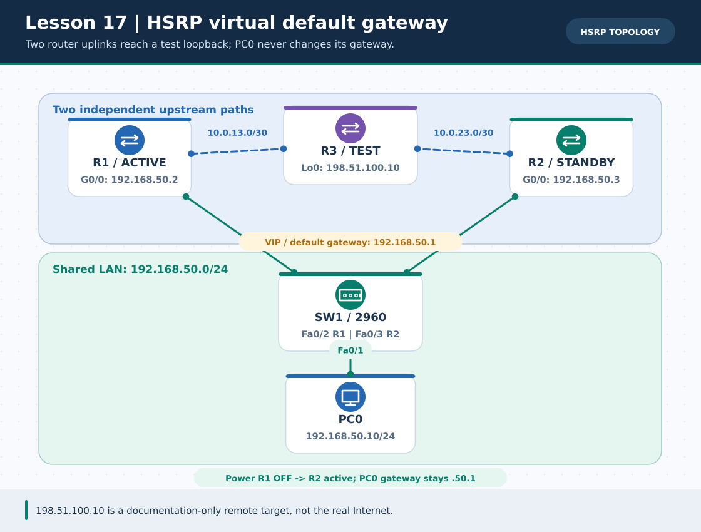
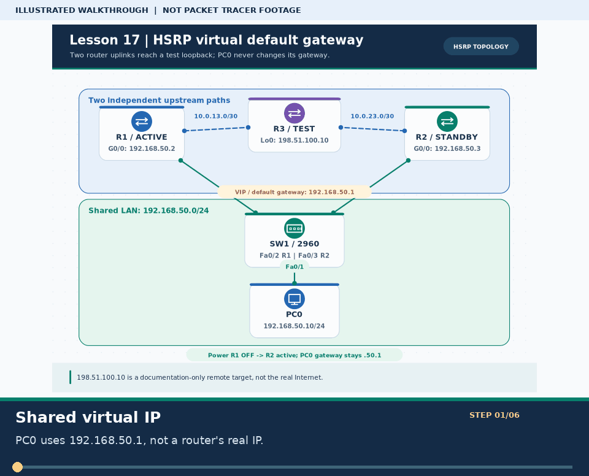
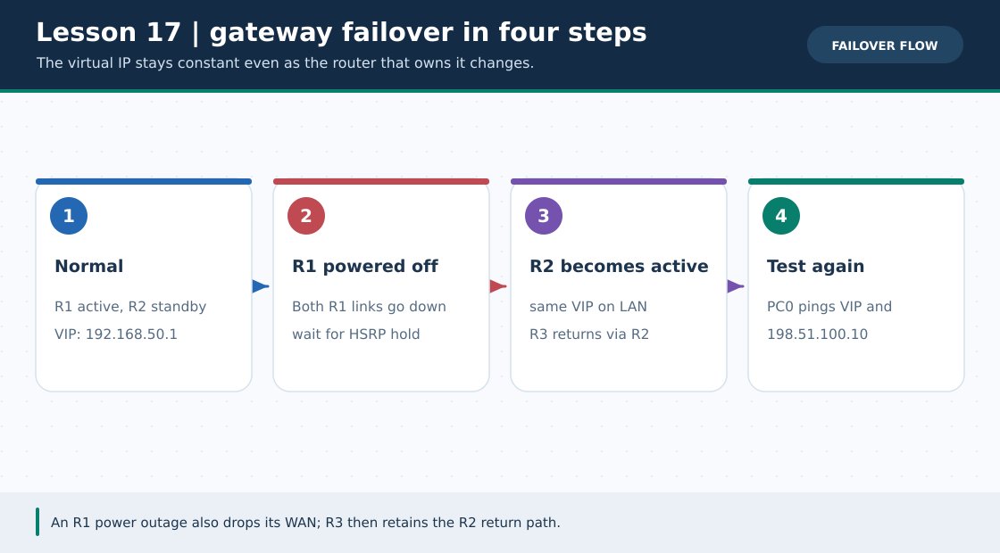

# Practical Lesson 17: HSRP virtual gateway and resilient return path

> **Navigation:** [English home](../README.md) · [Practical Lesson index](README.md) · [Full Bengali guide](../../lessons/17-hsrp-gateway-redundancy.md)

**Learning goal.** Keep a PC's gateway at 192.168.50.1 while two routers exchange the Active role.



> **About this visual:** Illustrated topology or concept map from the corresponding Bengali guide; a diagram, not a Packet Tracer capture.



> **30-second GIF:** six illustrated stages of the topology and checks. This is **not a Packet Tracer recording or proof of successful device behavior**. See the [GIF search names and study priorities](../../GIF-CATALOG.md) if you want to source your own alternative.



> This second diagram separates the concept/flow from the physical topology. Compare its labels with the numbered build steps below.

## Understand the design

PC0 is 192.168.50.10/24 with HSRP VIP .1; R1 LAN .2 priority 120; R2 LAN .3 priority 100. Separate /30 links lead to R3 test loopback 198.51.100.10/32. R3 must know both return paths to 192.168.50.0/24.

### Key ideas

- The virtual address stays fixed even as the Active router changes.
- R1 and R2 each need a valid upstream next hop, and R3 needs routes back to the shared LAN.
- Powering R1 fully off is the principal failover test: shutting only its LAN interface can blackhole replies via its surviving WAN.

## Build or work through it

1. Build the shared LAN and two independent R3 links exactly as in the topology/IP table.
2. Configure HSRP group 1 on both LAN-facing routers with VIP .1; set R1 priority 120 and R2 priority 100, both with preempt.
3. Configure each router's default route toward its own R3 link; add R3's two return routes and loopback.
4. Record show standby and baseline PC0-to-198.51.100.10 ping, then power R1 entirely off and repeat after the hold timer.

### Copyable study example

Read the comment or role label first: IOS commands, PC commands and shell commands run in **different places**. This example is not a verified Packet Tracer run.

```bash
# In a shell, print one role at a time and paste ONLY on that role
python3 scripts/ios_config_generator.py hsrp --role R1
python3 scripts/ios_config_generator.py hsrp --role R2
python3 scripts/ios_config_generator.py hsrp --role R3
```

## Verify; do not guess

- [ ] Initially show standby reports R1 Active and R2 Standby; PC0's gateway remains 192.168.50.1.
- [ ] After R1 is powered off, R2 becomes Active and the loopback ping resumes after convergence.
- [ ] After R1 returns, observe priority/preemption and verify the path again.

## If it fails

- If R2 becomes Active but remote ping fails, inspect R2's R3 link and the R3 return path.
- Do not use only R1 LAN shutdown as proof of this topology's upstream failover; R3 may still choose R1's live WAN.

## Check your understanding

**Question.** Why can remote ping fail when R2 is Active after only shutting R1's LAN interface?

<details><summary>Reveal the explanation</summary>

**Answer.** R3 may still send replies toward R1's live WAN; R1 can no longer forward them to the shared LAN.

</details>

---

**Continue:** [English track](README.md) · [Full Bengali lesson, complete tables and additional exercises](../../lessons/17-hsrp-gateway-redundancy.md)
