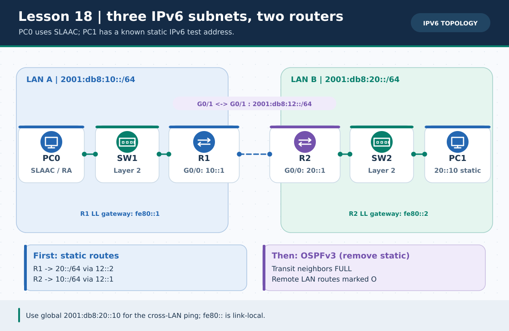
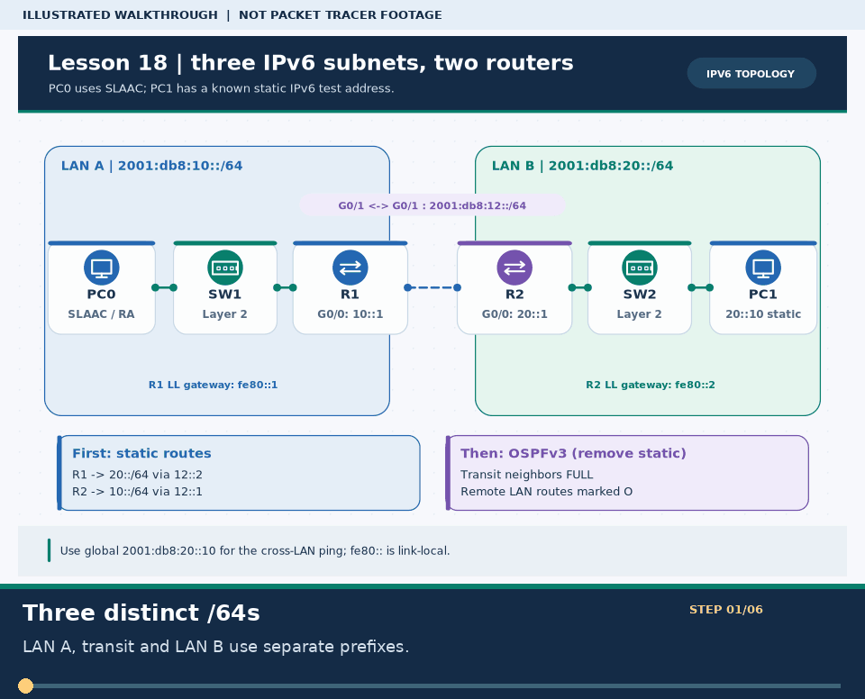
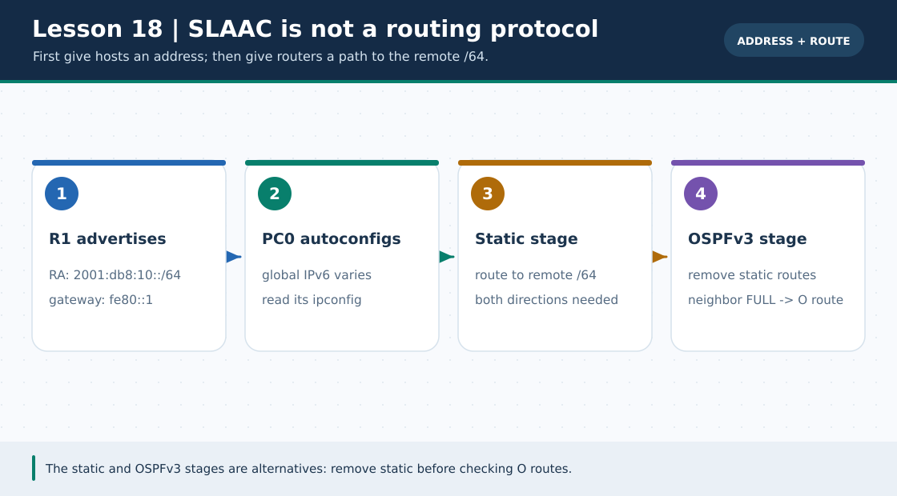

# Practical Lesson 18: IPv6 SLAAC, static routing and OSPFv3

> **Navigation:** [English home](../README.md) · [Practical Lesson index](README.md) · [Full Bengali guide](../../lessons/18-ipv6-slaac-routing.md)

**Learning goal.** Let one PC learn its IPv6 address by RA, then test static routing and OSPFv3 in separate stages.



> **About this visual:** Illustrated topology or concept map from the corresponding Bengali guide; a diagram, not a Packet Tracer capture.



> **30-second GIF:** six illustrated stages of the topology and checks. This is **not a Packet Tracer recording or proof of successful device behavior**. See the [GIF search names and study priorities](../../GIF-CATALOG.md) if you want to source your own alternative.



> This second diagram separates the concept/flow from the physical topology. Compare its labels with the numbered build steps below.

## Understand the design

LAN A is 2001:db8:10::/64 with R1 ::1 and PC0 SLAAC; R1-R2 transit is 2001:db8:12::/64; LAN B is 2001:db8:20::/64 with R2 ::1 and static PC1 2001:db8:20::10/64, gateway fe80::2.

### Key ideas

- ipv6 unicast-routing enables router advertisements so PC0 learns its LAN prefix and link-local gateway.
- SLAAC assigns a local address; it does not by itself teach R1 a route to LAN B.
- A lower-distance static route can hide a working OSPFv3 route; remove the statics before checking for O entries.

## Build or work through it

1. Connect PC0-SW1-R1, transit R1-R2, and R2-SW2-PC1 with separate /64s.
2. Configure both routers for IPv6 forwarding and unique interface addresses; set PC0 Auto Config and PC1 static ::10.
3. Add an IPv6 static route to the remote /64 on BOTH routers; test PC0-to-PC1 ping.
4. Remove those two static routes and configure OSPFv3 on the transit and LAN interfaces with distinct router IDs.
5. Inspect OSPFv3 adjacency and confirm remote O routes before running the final ping.

### Copyable study example

Read the comment or role label first: IOS commands, PC commands and shell commands run in **different places**. This example is not a verified Packet Tracer run.

```bash
# In a shell, print per-router commands for each distinct phase
python3 scripts/ios_config_generator.py ipv6-static --role R1
python3 scripts/ios_config_generator.py ipv6-static --role R2
python3 scripts/ios_config_generator.py ospfv3 --role R1
python3 scripts/ios_config_generator.py ospfv3 --role R2
```

## Verify; do not guess

- [ ] PC0 shows a 2001:db8:10::/64 address and link-local default gateway fe80::1.
- [ ] The static phase works only after both forward and return routes are configured.
- [ ] After removing statics, show ipv6 route shows O for the remote LAN and show ipv6 ospf neighbor is FULL.

## If it fails

- If PC0 lacks a global address, check RA, IPv6 unicast routing, interface state and Auto Config.
- If OSPFv3 is FULL but the remote route still displays S, remove the leftover static route.

## Check your understanding

**Question.** Does a successful SLAAC lease prove R1 knows the route to 2001:db8:20::/64?

<details><summary>Reveal the explanation</summary>

**Answer.** No. R1 needs a separate static or dynamically learned IPv6 route to the remote /64.

</details>

---

**Continue:** [English track](README.md) · [Full Bengali lesson, complete tables and additional exercises](../../lessons/18-ipv6-slaac-routing.md)
