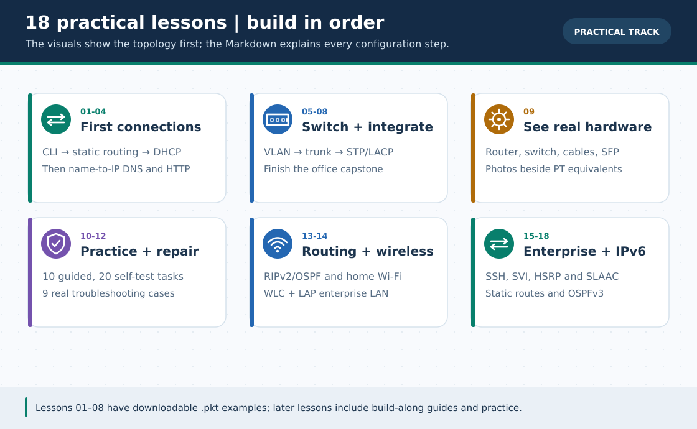

# 18 Practical Lessons · English Track

> **Navigation:** [English home](../README.md) · [বাংলা সূচি](../../lessons/README.md) · [26 GIFs and search priorities](../../GIF-CATALOG.md)

Build in order. Each guide includes a topology, one 30-second illustrated GIF, device-scoped steps, verification and an English self-check.

**Interpretation:** These pages are independently readable English adaptations; the full-length Bengali originals and their extended tests remain available via a link at the top/bottom of every page. GIFs are conceptual illustrations, **not Packet Tracer recordings**.

| # | English guide | Bengali original | 30-second GIF |
| :---: | :--- | :--- | :--- |
| 01 | [Router CLI basics and the first LAN](01-router-cli-basics.md) | [বাংলা গাইড](../../lessons/01-router-cli-basics.md) | [▶ Watch GIF](../../assets/gifs/01-router-cli-basics.gif) |
| 02 | [Two routers and bidirectional static routing](02-static-routing.md) | [বাংলা গাইড](../../lessons/02-static-routing.md) | [▶ Watch GIF](../../assets/gifs/02-static-routing.gif) |
| 03 | [Router DHCP server and the DORA exchange](03-dhcp.md) | [বাংলা গাইড](../../lessons/03-dhcp.md) | [▶ Watch GIF](../../assets/gifs/03-dhcp.gif) |
| 04 | [DNS lookup and an HTTP server](04-dns-http-server.md) | [বাংলা গাইড](../../lessons/04-dns-http-server.md) | [▶ Watch GIF](../../assets/gifs/04-dns-http-server.gif) |
| 05 | [VLAN segmentation and access ports](05-vlan.md) | [বাংলা গাইড](../../lessons/05-vlan.md) | [▶ Watch GIF](../../assets/gifs/05-vlan.gif) |
| 06 | [802.1Q trunks and router-on-a-stick](06-trunk-inter-vlan.md) | [বাংলা গাইড](../../lessons/06-trunk-inter-vlan.md) | [▶ Watch GIF](../../assets/gifs/06-trunk-inter-vlan.gif) |
| 07 | [STP, port security and EtherChannel](07-switching.md) | [বাংলা গাইড](../../lessons/07-switching.md) | [▶ Watch GIF](../../assets/gifs/07-switching.gif) |
| 08 | [Office network integration project](08-final-project.md) | [বাংলা গাইড](../../lessons/08-final-project.md) | [▶ Watch GIF](../../assets/gifs/08-final-project.gif) |
| 09 | [Real network hardware and rack infrastructure](09-real-hardware.md) | [বাংলা গাইড](../../lessons/09-real-hardware.md) | [▶ Watch GIF](../../assets/gifs/09-real-hardware.gif) |
| 10 | [Ten practice labs: attempt, check, then reveal](10-practice-lab.md) | [বাংলা গাইড](../../lessons/10-practice-lab.md) | [▶ Watch GIF](../../assets/gifs/10-practice-lab.gif) |
| 11 | [Skill ladder and independent practice list](11-practice-list.md) | [বাংলা গাইড](../../lessons/11-practice-list.md) | [▶ Watch GIF](../../assets/gifs/11-practice-list.gif) |
| 12 | [Troubleshooting problem bank: nine cases](12-problem-solve.md) | [বাংলা গাইড](../../lessons/12-problem-solve.md) | [▶ Watch GIF](../../assets/gifs/12-problem-solve.gif) |
| 13 | [RIPv2, OSPFv2 and link failover](13-dynamic-routing-ospf.md) | [বাংলা গাইড](../../lessons/13-dynamic-routing-ospf.md) | [▶ Watch GIF](../../assets/gifs/13-dynamic-routing-ospf.gif) |
| 14 | [Home Wi-Fi and enterprise WLC](14-wireless-lan.md) | [বাংলা গাইড](../../lessons/14-wireless-lan.md) | [▶ Watch GIF](../../assets/gifs/14-wireless-lan.gif) |
| 15 | [Secure remote access, NTP and Syslog](15-ssh-syslog-ntp.md) | [বাংলা গাইড](../../lessons/15-ssh-syslog-ntp.md) | [▶ Watch GIF](../../assets/gifs/15-ssh-syslog-ntp.gif) |
| 16 | [3560 multilayer-switch SVI inter-VLAN routing](16-multilayer-switch-svi.md) | [বাংলা গাইড](../../lessons/16-multilayer-switch-svi.md) | [▶ Watch GIF](../../assets/gifs/16-multilayer-switch-svi.gif) |
| 17 | [HSRP virtual gateway and resilient return path](17-hsrp-gateway-redundancy.md) | [বাংলা গাইড](../../lessons/17-hsrp-gateway-redundancy.md) | [▶ Watch GIF](../../assets/gifs/17-hsrp-gateway-redundancy.gif) |
| 18 | [IPv6 SLAAC, static routing and OSPFv3](18-ipv6-slaac-routing.md) | [বাংলা গাইড](../../lessons/18-ipv6-slaac-routing.md) | [▶ Watch GIF](../../assets/gifs/18-ipv6-slaac-routing.gif) |

> **Files:** Existing downloadable Packet Tracer examples belong to the earlier labs. Lessons 16–18 have **no native .pkt**; create those projects yourself.

[English home](../README.md) · [Full GIF catalog and replacement search names](../../GIF-CATALOG.md) · [Bengali home](../../README.md)
