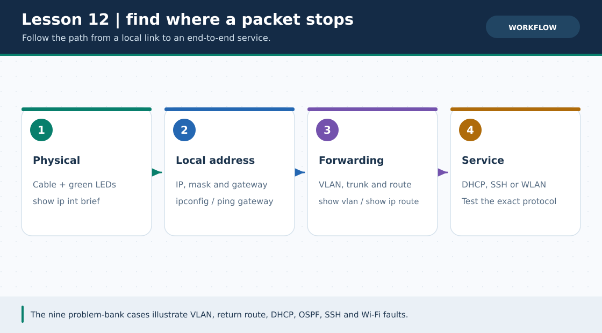
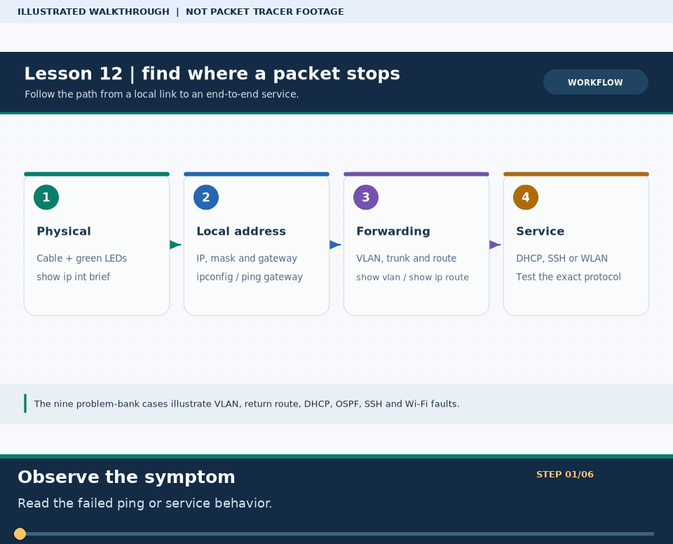

# লেসন ১২ · Problem Solve — সমস্যা ও সমাধান ব্যাংক (Troubleshooting Bank)

> 🌐 **English:** [Read this guide in English](../en/lessons/12-problem-solve.md) · [English track index](../en/README.md)

> **নেভিগেশন:** [⬅ লেসন ১১](11-practice-list.md) · [📚 লেসন সূচি](README.md) · [🏠 হোম](../README.md) · [📖 Cheat-Sheet](../reference/cli-command-cheatsheet.md) · [পরের লেসন ১৩ ➡](13-dynamic-routing-ospf.md)

| 🎯 লক্ষ্য | ⏱️ সময় | 📊 লেভেল | 🧰 pkt ফাইল |
| :--- | :--- | :--- | :--- |
| ল্যাব করতে গিয়ে সবচেয়ে বেশি যে বাস্তব ভুলগুলো হয় — তার ধাপে ধাপে সমাধান | ~১০–১৫ মিনিট (প্রতি সমস্যা) | 🟢→🔴 (সমস্যা ধরে) | [🕵️ Broken Labs Challenge](../Extras/broken-labs-challenge.md) দিয়ে হাতে-কলমে টেস্ট করো |

**Tags:** `#problem-solve` `#troubleshooting` `#vlan` `#static-route` `#roas` `#dhcp-apipa` `#err-disabled` `#trunk`

---

### 🖼️ চিত্রে বোঝো: Ping ফেল করলে কোথায় দেখবে



> **ছবির সারকথা:** Physical link → IP/Gateway → VLAN/Route → Service—যে ধাপে প্রথম ব্যর্থ, সেখানেই বাগ।



> 🎞️ **৩০ সেকেন্ডে মনে রাখো:** এটি উপরের ডায়াগ্রামের ওপর ভিত্তি করে বানানো ছয় ধাপের ভিজ্যুয়াল সারাংশ; বাস্তব Packet Tracer run, packet capture বা ফলের প্রমাণ নয়। [সব GIF-এর topic search name ও গুরুত্ব](../GIF-CATALOG.md) দেখো।


---

## 📌 এই লেসনটা কী?

এখানে তত্ত্ব নয় — ল্যাব ও পরীক্ষায় সবচেয়ে বেশি যে **বাস্তব সমস্যাগুলো (Real Lab Bugs)** সামনে আসে, তার **Problem Bank**। নতুন কোনো কেস এলে [`scripts/lab_writer.py`](../scripts/lab_writer.py) দিয়ে সহজেই এখানে নতুন Problem যোগ করা যায়!

প্রতিটি সমস্যা একই ৫-ধাপের গঠনে সাজানো:

| ধাপ | কী থাকবে |
| :--- | :--- |
| ❌ **সমস্যা** | কী হচ্ছে / কী ভুল আউটপুট দেখাচ্ছে (বর্তমান অবস্থা) |
| 🎯 **চাইছি** | ঠিক কী আউটপুট বা আচরণ চাই (Expected State) |
| ✅ **সমাধান** | Switch/Router CLI কমান্ড — প্রতিটি লাইনের কাজসহ |
| 🔍 **যাচাই** | `show` / `ping` কমান্ডের Expected Output — প্রমাণসহ |
| 🧠 **লজিক** | কেন এটা কাজ করল — যাতে পরের বার নিজেই ধরতে পারো |

### 🗂️ সমস্যা সূচি (ক্লিক করলেই সরাসরি সেই সমস্যায় যাবে)

| # | সমস্যার শিরোনাম | ক্যাটাগরি | লেভেল |
| :---: | :--- | :---: | :---: |
| **[Problem ০১](#problem-01)** | VLAN 20 থেকে ভুলবশত ঢুকে যাওয়া অতিরিক্ত পোর্ট সরানো | VLAN / Switchport | 🟢 |
| **[Problem ০২](#problem-02)** | Static Routing-এ একদিকে প্যাকেট যায়, কিন্তু Ping Reply আসে না (`Request timed out`) | Static Routing | 🟢 |
| **[Problem ০৩](#problem-03)** | Router-on-a-Stick করার পরও ভিন্ন VLAN-এর মধ্যে Ping ব্যর্থ | Inter-VLAN / Trunk | 🟡 |
| **[Problem ০৪](#problem-04)** | PC-তে DHCP দিলে `169.254.x.x` (APIPA) আসছে — আসল IP পাচ্ছে না | DHCP | 🟡 |
| **[Problem ০৫](#problem-05)** | Port Security Violation-এ সুইচ পোর্ট `err-disabled` (লাল বাতি) — পুনরায় চালু করা | Switch Security | 🟠 |
| **[Problem ০৬](#problem-06)** | দুই সুইচের মাঝে Trunk থাকা সত্ত্বেও নতুন VLAN 30-এর ট্রাফিক পার হচ্ছে না | Trunk / VLAN DB | 🟠 |
| **[Problem ০৭](#problem-07)** | OSPF চালু করার পরও `show ip ospf neighbor` খালি — Neighbor হচ্ছে না | OSPF Routing | 🟠 |
| **[Problem ০৮](#problem-08)** | `crypto key generate rsa` এরর অথবা PC থেকে `ssh -l admin` ঢোকা যাচ্ছে না | SSH / Security | 🟡 |
| **[Problem ০৯](#problem-09)** | Packet Tracer ল্যাপটপে Wi-Fi মডিউল বসানো যাচ্ছে না (`power is on` এরর) | Wireless LAN | 🟢 |

> ⚠️ **নিয়ম:** সমাধান অংশে যাওয়ার আগে সমস্যাটি পড়ে ৩০ সেকেন্ড নিজে ভাবো — *"আমি হলে কোন `show` কমান্ডটা আগে চালাতাম?"*

---

<a id="problem-01"></a>

# 🛠️ Problem ০১ — VLAN 20 থেকে অতিরিক্ত পোর্ট সরানো

## ❌ সমস্যা

একটি সুইচে দুটি VLAN আছে — **VLAN 10 (CSE)** ও **VLAN 20 (EEE)**। প্রতি VLAN-এ একটা করে পোর্ট লাগবে: `Fa0/1` → VLAN 10, `Fa0/2` → VLAN 20।

কিন্তু কনফিগ করার সময় `interface range fastEthernet 0/2 - 4` দিয়ে ফেলায় তিনটে পোর্টই VLAN 20-এ চলে গেছে! `show vlan brief`:

```text
VLAN Name                             Status    Ports
---- -------------------------------- --------- -----------------------
1    default                          active    ...
10   CSE                              active    Fa0/1
20   EEE                              active    Fa0/2, Fa0/3, Fa0/4   ← ভুল!
```

## 🎯 চাইছি (Expected Output)

`Fa0/3` ও `Fa0/4` কে VLAN 20 থেকে সরিয়ে **Default VLAN 1**-এ ফেরাতে চাই:
* **VLAN 10 — CSE:** `Fa0/1` · **VLAN 20 — EEE:** `Fa0/2` · **VLAN 1 — default:** `Fa0/3, Fa0/4`

## ✅ সমাধান (Switch CLI)

```cisco
enable
configure terminal

interface range fastEthernet 0/3 - 4
 switchport mode access
 switchport access vlan 1
 exit

end
copy running-config startup-config
```

| কমান্ড | কাজ |
| :--- | :--- |
| `interface range fastEthernet 0/3 - 4` | সরাতে চাওয়া পোর্ট দুটো (`Fa0/3`, `Fa0/4`) একসাথে সিলেক্ট |
| `switchport access vlan 1` | দুই পোর্টকে VLAN 1 (default)-এ পাঠাল — **এই এক লাইনেই পোর্টগুলো VLAN 20 থেকে বেরিয়ে গেল** |

## 🔍 যাচাই

```cisco
show vlan brief
```
```text
VLAN Name                             Status    Ports
---- -------------------------------- --------- -----------------------
1    default                          active    Fa0/3, Fa0/4, ...
10   CSE                              active    Fa0/1
20   EEE                              active    Fa0/2
```

## 🧠 লজিক — কেন এটা কাজ করল?

একটি Access Port একই সময়ে **একটাই VLAN**-এ থাকতে পারে। তাই `switchport access vlan 1` (অথবা `no switchport access vlan`) দিলেই পোর্টটি আগের VLAN 20 ছেড়ে Default VLAN 1-এ চলে আসে — এতে VLAN 20 মুছে যায় না, শুধু পোর্ট সরে যায়।

---

<a id="problem-02"></a>

# 🛠️ Problem ০২ — Static Routing-এ Ping `Request timed out` (Return Route মিসিং)

## ❌ সমস্যা

দুটি রাউটার (`R1` ও `R2`) দিয়ে দুটি LAN যুক্ত করা হয়েছে ([লেসন ০২](02-static-routing.md)-এর মতো):
* `PC0 (192.168.1.10)` → `R1 (10.0.0.1)` ↔ `R2 (10.0.0.2)` → `PC1 (192.168.2.10)`
* `R1`-এ `ip route 192.168.2.0 255.255.255.0 10.0.0.2` দেওয়া হয়েছে।
* কিন্তু `PC0` থেকে `ping 192.168.2.10` দিলে সব প্যাকেট **`Request timed out`** দেখাচ্ছে! Simulation Mode-এ দেখা যাচ্ছে প্যাকেট `PC1` পর্যন্ত পৌঁছাচ্ছে, কিন্তু `R2`-তে এসে ড্রপ হচ্ছে!

## 🎯 চাইছি (Expected Output)

`PC0` (`192.168.1.10`) থেকে `PC1` (`192.168.2.10`)-এ ১০০% সফল দ্বিমুখী Ping (`TTL=126`)।

## ✅ সমাধান (`R2` Router CLI)

সমস্যা `R1`-এ নয়, **`R2`-তে ফিরতি পথ (Return Route) দেওয়া হয়নি!** `R2`-তে ঢুকে আগে যাচাই করো এবং ফিরতি রুট যোগ করো:

```cisco
! R2-তে
enable
show ip route
! দেখবে 192.168.1.0/24 নেটওয়ার্কের কোনো 'S' রুট নেই!

configure terminal
ip route 192.168.1.0 255.255.255.0 10.0.0.1
end
copy running-config startup-config
```

## 🔍 যাচাই

```cisco
R2# show ip route
```
```text
S    192.168.1.0/24 [1/0] via 10.0.0.1
C    192.168.2.0/24 is directly connected, GigabitEthernet0/0
C    10.0.0.0/30 is directly connected, GigabitEthernet0/1
```
এবার `PC0` থেকে `ping 192.168.2.10` দিলে সাথে সাথে `Reply from 192.168.2.10: bytes=32 time<1ms TTL=126` আসবে ✅।

## 🧠 লজিক — কেন এটা কাজ করল?

**Ping মানে দুটো বার্তা:** (১) `Echo Request` যাওয়া এবং (২) `Echo Reply` ফিরে আসা। `R1` জানত `192.168.2.0`-এ কীভাবে যেতে হয়, কিন্তু `PC1` যখন উত্তর পাঠাল, তখন `R2` জানত না `192.168.1.0` কোথায়! তাই **রাউটিং সবসময় দ্বিমুখী (Two-Way)** হতে হয়।

---

<a id="problem-03"></a>

# 🛠️ Problem ০৩ — Router-on-a-Stick করার পরও Inter-VLAN Ping হচ্ছে না

## ❌ সমস্যা

[লেসন ০৬](06-trunk-inter-vlan.md) অনুযায়ী `R1`-এ `G0/0.10` (`192.168.10.1`) এবং `G0/0.20` (`192.168.20.1`) Subinterface বানিয়ে `encapsulation dot1Q` ও IP বসানো হয়েছে। তবুও:
1. রাউটার ও সুইচের মাঝের লিংক লাইট **লাল** হয়ে আছে, অথবা
2. সবুজ থাকলেও VLAN 10 থেকে VLAN 20-এ Ping যাচ্ছে না!

## 🎯 চাইছি (Expected Output)

`G0/0.10` ও `G0/0.20` দুটোই `up/up` থাকবে এবং VLAN 10-এর PC থেকে VLAN 20-এর PC-তে Ping সফল হবে (`TTL=127`)।

## ✅ সমাধান (দুই প্রান্তই চেক করো)

### ধাপ ১ — Router `R1`: মূল Physical Interface `G0/0`-এ `no shutdown` দাও!
Subinterface-এ IP দিলেও মূল ফিজিক্যাল পোর্ট `G0/0` ডিফল্টভাবে `administratively down` থাকে:

```cisco
! R1 CLI
enable
configure terminal
interface gigabitEthernet 0/0
 no shutdown
 exit
end
copy running-config startup-config
```
*(মনে রাখবে: মূল `G0/0`-এ কোনো IP বসবে না, শুধু `no shutdown` বসবে!)*

### ধাপ ২ — Switch `SW1`: রাউটারমুখী পোর্টটিকে `Trunk` করো!
সুইচের যে পোর্টটি রাউটারে গেছে (যেমন `G0/1`), সেটি Access মোডে থাকলে 802.1Q ট্যাগ রাউটারে যাবেই না:

```cisco
! SW1 CLI
enable
configure terminal
interface gigabitEthernet 0/1
 switchport mode trunk
 exit
end
copy running-config startup-config
```

## 🔍 যাচাই

```cisco
R1# show ip interface brief
! GigabitEthernet0/0       unassigned      YES unset  up     up
! GigabitEthernet0/0.10    192.168.10.1    YES manual up     up
! GigabitEthernet0/0.20    192.168.20.1    YES manual up     up

SW1# show interfaces trunk
! Port: Gig0/1 | Mode: on | Encapsulation: 802.1q | Status: trunking
```

## 🧠 লজিক — কেন এটা কাজ করল?

Subinterface হলো মূল পোর্টের ভেতরের ভার্চুয়াল দরজা — মূল ফটক (`G0/0`) তালাবদ্ধ (`shutdown`) থাকলে ভেতরের কোনো দরজাই কাজ করবে না। আর সুইচ-রাউটার লিংক **Trunk** না হলে সুইচ ফ্রেমের গায়ে VLAN Tag লাগাবে না, ফলে রাউটার বুঝতেই পারবে না প্যাকেট কোন Subinterface-এর!

---

<a id="problem-04"></a>

# 🛠️ Problem ০৪ — PC-তে DHCP দিলে `169.254.x.x` (APIPA) দেখাচ্ছে

## ❌ সমস্যা

রাউটারে DHCP Pool তৈরি করার পরও PC-তে `Desktop → IP Configuration → DHCP` দিলে কিছুক্ষণ পর **`DHCP failed. APIPA is being used`** লিখে `169.254.x.x` IP বসিয়ে দিচ্ছে!

## 🎯 চাইছি (Expected Output)

PC যেন `169.254.x.x` না পেয়ে রাউটারের DHCP Pool (যেমন `192.168.1.11`) থেকে সঠিক IP, Mask ও Gateway পায়।

## ✅ সমাধান (৩টি প্রধান কারণ চেক করো)

### কারণ ১: রাউটার ইন্টারফেসের IP আর DHCP Pool-এর `network` মিলছে না!
রাউটার কোন পুল থেকে IP দেবে তা চেনে **যে ইন্টারফেস দিয়ে অনুরোধ এল, সেই ইন্টারফেসের IP দেখে**।

```cisco
! R1 CLI
enable
show ip interface brief
show running-config | section dhcp
```
যদি ইন্টারফেসে থাকে `192.168.10.1/24`, কিন্তু পুলে ভুল করে লেখা থাকে `network 192.168.1.0 255.255.255.0` — তবে কাজ করবে না! ঠিক করো:

```cisco
configure terminal
ip dhcp pool OFFICE
 network 192.168.10.0 255.255.255.0
 default-router 192.168.10.1
 exit
end
```

### কারণ ২: সুইচ পোর্টের কমলা বাতি (STP Delay) বা ভুল VLAN!
* সুইচে কেবল লাগানোর সাথে সাথেই DHCP চাপলে STP `Listening/Learning` অবস্থায় (কমলা বাতি — ৩০ সেকেন্ড) DHCP Discover প্যাকেট ব্লক হয়ে যায়। **সমাধান:** বাতি সবুজ হওয়ার পর PC-তে একবার `Static` → আবার `DHCP` ক্লিক করো! *(অথবা সুইচ পোর্টে `spanning-tree portfast` দাও।)*
* সুইচ পোর্ট যদি `VLAN 20`-এ থাকে, তবে রাউটারে `G0/0.20` সাবইন্টারফেস ও তার সাবনেটের পুল থাকতে হবে।

### কারণ ৩: DHCP Server অন্য সাবনেটে/রাউটারের ওপাশে (`ip helper-address` মিসিং)
DHCP Discover হলো **Broadcast** — রাউটার ডিফল্টভাবে Broadcast পার করে না। সার্ভার অন্য সাবনেটে থাকলে ক্লায়েন্টের গেটওয়ে ইন্টারফেসে দিতে হবে:
```cisco
interface gigabitEthernet 0/0
 ip helper-address [DHCP_SERVER_IP]
```

## 🔍 যাচাই

PC-তে `Static` → `DHCP` টগল করার পর:
```cisco
R1# show ip dhcp binding
```
এখন ক্লায়েন্টের MAC ও `192.168.10.x` IP দেখা যাবে ✅।

## 🧠 লজিক — APIPA (`169.254.x.x`) আসলে কী?

পিসি যখন ৪ বার `DHCP Discover` ব্রডকাস্ট পাঠিয়েও কোনো DHCP সার্ভারের সাড়া পায় না, তখন অপারেটিং সিস্টেম নিজে থেকেই **`169.254.0.0/16` (APIPA)** রেঞ্জের একটি অস্থায়ী লোকাল IP বসিয়ে নেয়। তাই `169.254` দেখা মানেই **এক কথায়: পিসি থেকে DHCP সার্ভার পর্যন্ত রাস্তা বন্ধ বা পুলের নেটওয়ার্ক মেলেনি!**

---

<a id="problem-05"></a>

# 🛠️ Problem ০৫ — Port Security Violation-এ সুইচ পোর্ট `err-disabled` (লাল বাতি)

## ❌ সমস্যা

সুইচের `Fa0/1` পোর্টে Port Security (`maximum 1`, `violation shutdown`) চালু ছিল। ভুলবশত অন্য একটি ল্যাপটপ লাগাতেই পোর্টের বাতি **লাল** হয়ে গেছে! এখন আসল অনুমোদিত `PC0` ফিরিয়ে লাগালেও পোর্ট আর সবুজ হচ্ছে না!

```cisco
SW1# show interfaces fastEthernet 0/1 status
! Port    Name   Status         Vlan   Duplex  Speed Type
! Fa0/1          err-disabled   10     auto    auto  10/100BaseTX
```

## 🎯 চাইছি (Expected Output)

আসল অনুমোদিত `PC0` লাগানোর পর `Fa0/1` পোর্টকে `err-disabled` অবস্থা থেকে মুক্ত করে আবার `connected (up/up)` করা।

## ✅ সমাধান (Switch CLI)

১. আগে নিশ্চিত হও অচেনা ডিভাইস খুলে **আসল অনুমোদিত PC0** লাগানো হয়েছে *(নইলে চালু করার সাথে সাথে আবার বন্ধ হয়ে যাবে!)*।
২. সুইচে শুধু `no shutdown` দিলে কাজ হবে না — **আগে ম্যানুয়ালি `shutdown`, তারপর `no shutdown`** দিতে হবে:

```cisco
enable
configure terminal

interface fastEthernet 0/1
 shutdown
 no shutdown
 exit

end
copy running-config startup-config
```

> 💡 যদি আগের Sticky MAC বদলে নতুন PC-কে স্থায়ীভাবে অনুমতি দিতে চাও, তবে `shutdown` অবস্থায় আগে পুরনো স্টিকি ম্যাক মুছে নাও: `no switchport port-security mac-address sticky [OLD_MAC]`, তারপর `no shutdown` দাও।

## 🔍 যাচাই

```cisco
SW1# show port-security interface fastEthernet 0/1
! Port Security              : Enabled
! Port Status                : Secure-up   ✅
```

## 🧠 লজিক — কেন শুধু `no shutdown`-এ কাজ হয় না?

IOS-এর কাছে পোর্টটি প্রশাসনিকভাবে চালু ছিল, কিন্তু নিরাপত্তা লঙ্ঘনের শাস্তিস্বরূপ সিস্টেম তাকে `err-disabled` লকে আটকে রেখেছে। `shutdown` কমান্ড দিলে ওই এরর-স্টেট রিসেট হয় এবং পরের `no shutdown` পোর্টটিকে নতুনের মতো সচল করে।

---

<a id="problem-06"></a>

# 🛠️ Problem ০৬ — দুই সুইচের মাঝে Trunk থাকা সত্ত্বেও নতুন VLAN-এর Ping ব্যর্থ

## ❌ সমস্যা

তিনটি সুইচ সিরিয়ালে যুক্ত: `SW1 ══(Trunk)══ SW2 ══(Trunk)══ SW3`।
`SW1` এবং `SW3`-এ নতুন **VLAN 30 (HR)** বানিয়ে দুটি PC বসানো হয়েছে, কিন্তু তারা একে অপরকে Ping পাচ্ছে না! অথচ পুরনো VLAN 10-এর Ping ঠিকই যাচ্ছে!

## 🎯 চাইছি (Expected Output)

`SW1`-এর VLAN 30 পিসি থেকে `SW2` হয়ে `SW3`-এর VLAN 30 পিসিতে সফল Ping।

## ✅ সমাধান (`SW2` ও Trunk Allowed List চেক করো)

মাঝখানের সুইচ `SW2`-তে কোনো HR পিসি না থাকলেও **`SW2`-এর VLAN Database-এ `VLAN 30` তৈরি থাকতে হবে**, এবং ট্রাঙ্কে VLAN 30 অনুমোদিত থাকতে হবে!

```cisco
! SW2 CLI-তে
enable
show vlan brief
show interfaces trunk
```
যদি `SW2`-তে VLAN 30 না থাকে বা ট্রাঙ্কে ব্লক থাকে:

```cisco
! SW2 CLI
configure terminal
vlan 30
 name HR
 exit

! যদি ট্রাঙ্কে নির্দিষ্ট allowed list দেওয়া থাকে, তবে ৩০ যোগ করো:
interface range gigabitEthernet 0/1 - 2
 switchport trunk allowed vlan add 30
 exit
end
copy running-config startup-config
```
*(⚠️ সাবধান: `switchport trunk allowed vlan 30` লেখার সময় **`add`** শব্দটা বাদ দিলে আগের সব VLAN মুছে শুধু ৩০ থেকে যাবে! তাই সবসময় `allowed vlan add 30` লিখবে!)*

## 🔍 যাচাই

```cisco
SW2# show interfaces trunk
! Vlans allowed and active in management domain: 1,10,20,30  ✅
```

## 🧠 লজিক — কেন এটা কাজ করল?

সুইচ যে VLAN নিজের `vlan.dat` ডেটাবেসে চেনেই না (`active` নেই), সেই VLAN-এর ফ্রেম সে ট্রাঙ্ক দিয়ে ফরওয়ার্ড করে না — মাঝপথেই ফেলে দেয়! তাই ট্রাঙ্ক পথের **প্রতিটি সুইচে** সংশ্লিষ্ট VLAN তৈরি থাকতে হয়।

---

<a id="problem-07"></a>

# 🛠️ Problem ০৭ — OSPF চালু করার পরও `show ip ospf neighbor` খালি!

## ❌ সমস্যা

[লেসন ১৩](13-dynamic-routing-ospf.md) অনুযায়ী `R1` এবং `R2`-এর মাঝে `10.0.12.0/30` লিংকে পিং কাজ করছে, কিন্তু দুই রাউটারে OSPF কনফিগার করার পরও `show ip ospf neighbor` সম্পূর্ণ ফাঁকা এবং কোনো `O` রুট টেবিলে আসছে না!

## 🎯 চাইছি (Expected Output)

`show ip ospf neighbor` কমান্ডে প্রতিবেশী রাউটার `FULL` স্ট্যাটাসে দেখাবে এবং দূরবর্তী LAN-এর `O` রুট যুক্ত হবে।

## ✅ সমাধান (৩টি প্রধান জায়গা মেলাও)

দুই রাউটারেই `show ip protocols` চালিয়ে নিচের ৩টি ভুল চেক ও সংশোধন করো:

```cisco
enable
show ip protocols

configure terminal
router ospf 1
 ! ভুল ১: WAN পোর্টে passive-interface পড়ে থাকলে তা সরিয়ে দাও!
 no passive-interface gigabitEthernet 0/1

 ! ভুল ২: দুই রাউটারের Area নম্বর ভিন্ন থাকলে একই Area (area 0) করে দাও!
 no network 10.0.12.0 0.0.0.3 area 1
 network 10.0.12.0 0.0.0.3 area 0
 exit
end
```
*(ভুল ৩: দুই প্রান্তের ইন্টারফেসে Subnet Mask সমান `/30` কি না এবং দুই রাউটারের `router-id` যেন হুবহু এক না হয় তা নিশ্চিত করো!)*

## 🔍 যাচাই

```cisco
R1# show ip ospf neighbor
! Neighbor ID   Pri   State      Dead Time   Address      Interface
! 2.2.2.2         1   FULL/BDR   00:00:37    10.0.12.2    GigabitEthernet0/1 ✅
```

## 🧠 লজিক — কেন এটা কাজ করল?

দুটি OSPF রাউটার প্রতি ১০ সেকেন্ড পরপর `224.0.0.5` মাল্টিকাস্ট ঠিকানায় **Hello Packet** পাঠিয়ে বন্ধুত্ব (Adjacency) গড়ে। যদি WAN পোর্ট `passive` থাকে তবে হ্যালো যায়ই না; আর হ্যালো প্যাকেটের ভেতরের **Area ID, Subnet Mask ও Hello/Dead Timer** ১০০% না মিললে তারা একে অপরকে প্রত্যাখ্যান করে!

---

<a id="problem-08"></a>

# 🛠️ Problem ০৮ — `crypto key generate rsa` এরর অথবা SSH লগইন ব্যর্থ

## ❌ সমস্যা

[লেসন ১৫](15-ssh-syslog-ntp.md) করার সময় রাউটারে RSA চাবি বানাতে গেলে দেখাচ্ছে:
`% Please define a domain-name first.`
অথবা চাবি বানানোর পরও PC থেকে `ssh -l admin 192.168.1.1` দিলে `Connection refused` দেখাচ্ছে!

## 🎯 চাইছি (Expected Output)

সফলভাবে `2048`-বিট RSA কী তৈরি হবে এবং PC-র Command Prompt থেকে `ssh -l admin 192.168.1.1` দিয়ে পাসওয়ার্ড দিয়ে রাউটারে প্রবেশ করা যাবে।

## ✅ সমাধান (Router CLI)

```cisco
enable
configure terminal

! ১. ডিফল্ট 'Router' নাম বদলে কাস্টম hostname এবং domain-name দাও
hostname R1
ip domain-name office.local

! ২. ইউজারনেম ও গোপন পাসওয়ার্ড তৈরি করো
username admin secret AdminPass123!

! ৩. এবার 2048-bit RSA চাবি জেনারেট করো
crypto key generate rsa
! প্রম্পটে 2048 লিখে Enter চাপো
ip ssh version 2

! ৪. VTY রিমোট লাইনে SSH ও লোকাল ইউজার যাচাই চালু করো
line vty 0 4
 transport input ssh
 login local
 exit

end
copy running-config startup-config
```

## 🔍 যাচাই

```cisco
R1# show ip ssh
! SSH Enabled - version 2.0 ✅
```
এবং PC0 থেকে `ssh -l admin 192.168.1.1` দিলে সাথে সাথে `Password:` প্রম্পট আসবে!

## 🧠 লজিক — কেন এটা কাজ করল?

SSH সার্ভারের এনক্রিপশন চাবির নাম তৈরি হয় `<hostname>.<domain-name>` ফর্মুলায় — তাই কাস্টম হোস্টনেম ও ডোমেইন ছাড়া RSA কী তৈরি অসম্ভব। আর `line vty 0 4`-এ `login local` না দিলে রাউটার জানে না কোন ইউজার ডেটাবেস দিয়ে পাসওয়ার্ড মেলাতে হবে।

---

<a id="problem-09"></a>

# 🛠️ Problem ০৯ — ল্যাপটপে Wi-Fi কার্ড বসছে না (`Cannot add a module when the power is on`)

## ❌ সমস্যা

[লেসন ১৪](14-wireless-lan.md)-এ `Laptop0`-কে Wi-Fi-তে যুক্ত করার জন্য Physical ট্যাবে গিয়ে `WPC300N` ওয়্যারলেস মডিউল বসাতে গেলেই পপ-আপ এরর আসছে:
`Cannot add a module when the power is on.` বা `Cannot remove a module when the power is on.`

## 🎯 চাইছি (Expected Output)

ল্যাপটপের তারের ইথারনেট কার্ড সরিয়ে `WPC300N` ওয়্যারলেস কার্ড বসানো এবং `PC Wireless` অ্যাপ দিয়ে Wi-Fi-তে কানেক্ট হওয়া।

## ✅ সমাধান (Packet Tracer GUI ধাপ)

1. `Laptop0` খুলে **`Physical`** ট্যাবে যাও এবং `Zoom In` করো।
2. ল্যাপটপের বাম/ডান কোণায় থাকা **গোল পাওয়ার বাটনে মাউস ক্লিক করো** — দেখবে পাশের ছোট **সবুজ/হলুদ LED বাতিটি নিভে গেছে** (মানে ল্যাপটপ এখন বন্ধ)।
3. নিচের স্লটে থাকা পুরনো ইথারনেট মডিউলটি ড্র্যাগ করে বাম পাশের `MODULES` তালিকায় ছেড়ে দাও।
4. বাম তালিকা থেকে **`WPC300N`** ড্র্যাগ করে খালি স্লটে বসাও।
5. **সবচেয়ে জরুরি:** আবার **পাওয়ার বাটনে ক্লিক করে ল্যাপটপ চালু করো** (সবুজ বাতি জ্বলে উঠবে)!

## 🔍 যাচাই

`Laptop0 → Desktop → PC Wireless` খুললে এখন আর এরর না দেখিয়ে সিগন্যাল ও `Connect` ট্যাব কাজ করবে ✅।

## 🧠 লজিক — কেন এটা কাজ করল?

বাস্তব হার্ডওয়্যারেও মাদারবোর্ডে বিদ্যুৎ চালু থাকা অবস্থায় নেটওয়ার্ক কার্ড খুললে শর্ট-সার্কিট হয়। Packet Tracer সেই বাস্তব অভ্যাসটি শেখানোর জন্যই ডিভাইস বন্ধ (`Power OFF`) না করা পর্যন্ত কোনো কার্ড বদলাতে দেয় না!

---

# 🔮 নতুন সমস্যা যোগ করতে চাও?

এই রেপোতে থাকা অটোমেশন স্ক্রিপ্ট চালিয়ে মাত্র ১ লাইনে নতুন সমস্যার টেমপ্লেট যোগ করতে পারো:

```bash
python3 scripts/lab_writer.py problem --num 10 --title "তোমার সমস্যার নাম" --append
```

হাত গরম রাখতে অনুশীলন করো → [🕵️ Broken Network Detective Challenge](../Extras/broken-labs-challenge.md) · [Practice Lab](10-practice-lab.md) · [পরের লেসন ১৩ · OSPF ➡](13-dynamic-routing-ospf.md)

---

> **নেভিগেশন:** [⬅ লেসন ১১](11-practice-list.md) · [📚 লেসন সূচি](README.md) · [🏠 হোম](../README.md) · [📖 Cheat-Sheet](../reference/cli-command-cheatsheet.md) · [পরের লেসন ১৩ ➡](13-dynamic-routing-ospf.md)

**এই লেসনের Tags:** `#problem-solve` `#troubleshooting` `#switchport` `#vlan` `#static-route` `#roas` `#apipa` `#err-disabled` `#trunk`
