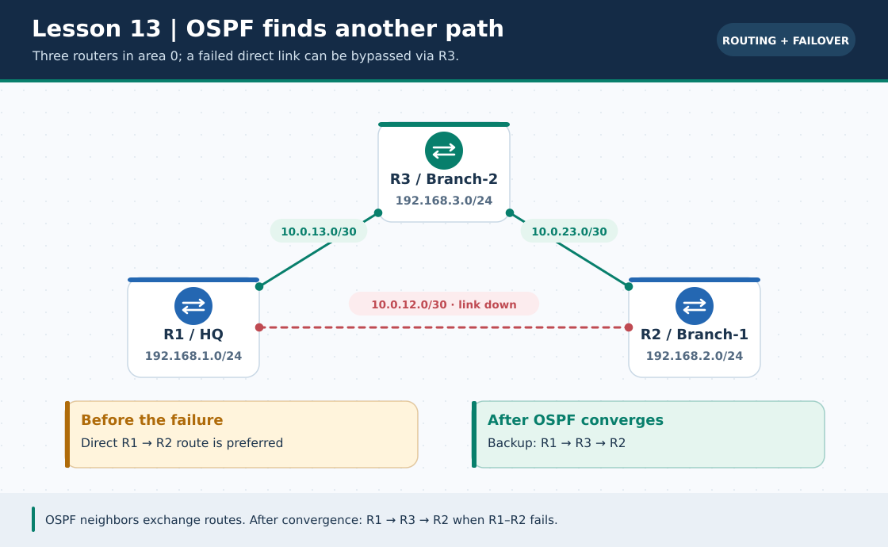
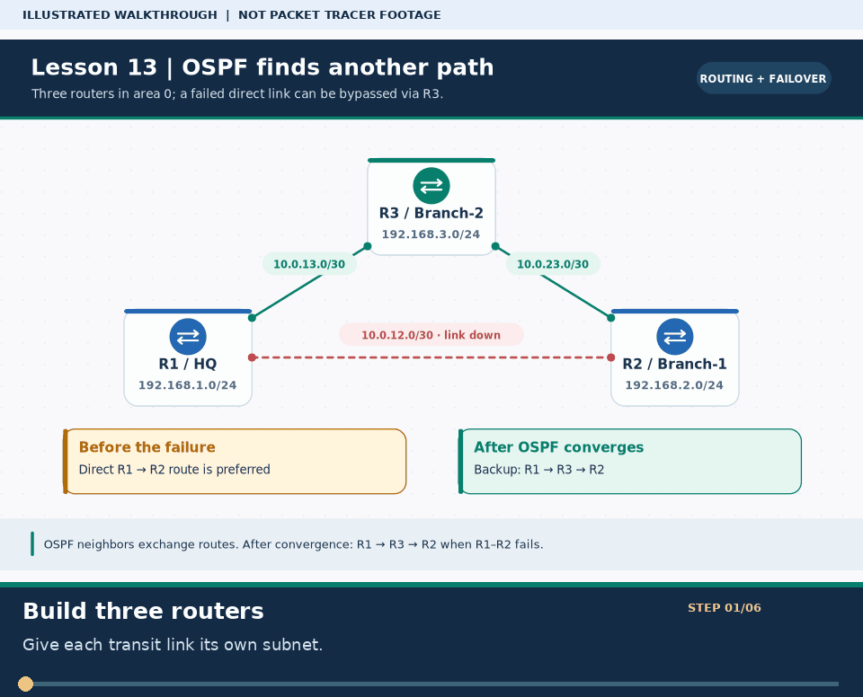

# লেসন ১৩ · Dynamic Routing — RIPv2 ও Single-Area OSPF

> 🌐 **English:** [Read this guide in English](../en/lessons/13-dynamic-routing-ospf.md) · [English track index](../en/README.md)

> **নেভিগেশন:** [⬅ লেসন ১২](12-problem-solve.md) · [📚 লেসন সূচি](README.md) · [🏠 হোম](../README.md) · [পরের লেসন ১৪ ➡](14-wireless-lan.md)

| 🎯 লক্ষ্য | ⏱️ সময় | 📊 লেভেল | 🧰 ল্যাব ফাইল |
| :--- | :--- | :--- | :--- |
| ৩টি রাউটারের ত্রিভুজ নেটওয়ার্কে RIPv2 ও OSPF কনফিগার করা এবং কেবল কেটে স্বয়ংক্রিয় বিকল্প পথ (Failover) পরীক্ষা করা | ~৬৫ মিনিট | 🟠 Intermediate | `lesson-13-dynamic-routing-ospf.pkt` *(নিচের টপোলজি দেখে বানাও)* |

**Tags:** `#dynamic-routing` `#ospf` `#ripv2` `#wildcard-mask` `#area-0` `#router-id` `#failover` `#ccna`

---

### 🖼️ চিত্রে বোঝো: লিংক নষ্ট হলে OSPF-এর বিকল্প পথ



> **ছবির সারকথা:** R1–R2 সরাসরি লিংক ডাউন হলেও R1 → R3 → R2 পথে প্যাকেট যেতে পারে।



> 🎞️ **৩০ সেকেন্ডে মনে রাখো:** এটি উপরের ডায়াগ্রামের ওপর ভিত্তি করে বানানো ছয় ধাপের ভিজ্যুয়াল সারাংশ; বাস্তব Packet Tracer run, packet capture বা ফলের প্রমাণ নয়। [সব GIF-এর topic search name ও গুরুত্ব](../GIF-CATALOG.md) দেখো।


---

## 🎯 এই লেসনে যা শিখবে

1. **Static Routing বনাম Dynamic Routing** — বড় নেটওয়ার্কে কেন Static Route অচল হয়ে পড়ে
2. **Administrative Distance (AD)** ও **Metric** — রাউটার কীভাবে সেরা পথ বেছে নেয়
3. **Lab A:** `RIPv2` (`router rip`, `version 2`, `no auto-summary`) দিয়ে দ্রুত ডায়নামিক রাউটিং
4. **Wildcard Mask** বের করার ১-সেকেন্ডের বাংলা সূত্র (`255.255.255.255 − Subnet Mask`)
5. **Lab B (CCNA-র সবচেয়ে গুরুত্বপূর্ণ ল্যাব):** ৩টি রাউটারে **Single-Area OSPFv2 (`Area 0`)** কনফিগার, `router-id`, `passive-interface` ও **স্বয়ংক্রিয় Failover পরীক্ষা**!

### 🏷️ মূল শব্দকোষ (Quick Glossary)

| শব্দ | সহজ অর্থ | মান / উদাহরণ |
| :--- | :--- | :--- |
| **Dynamic Routing** | রাউটারগুলো নিজেরা নিজেদের মধ্যে কথা বলে স্বয়ংক্রিয়ভাবে পথ শেখে ও লিংক ছিঁড়লে নতুন পথ খুঁজে নেয় | `OSPF`, `RIPv2`, `EIGRP` |
| **Administrative Distance (AD)** | কোন রাউটিং তথ্যের ওপর রাউটার কতটা ভরসা করবে (যত **কম**, তত বেশি বিশ্বাসযোগ্য!) | Connected=`0`, Static=`1`, OSPF=`110`, RIP=`120` |
| **Wildcard Mask** | Subnet Mask-এর ঠিক উল্টো মাস্ক — OSPF ও ACL-এ কোন বিট মেলাতে হবে তা বলে দেয় | `/24` → `0.0.0.255`, `/30` → `0.0.0.3` |
| **OSPF Area 0** | OSPF-এর মূল মেরুদণ্ড (Backbone Area) — সিঙ্গেল-এরিয়া OSPF-এ সব রাউটার `area 0`-তে থাকে | `network ... area 0` |
| **Passive Interface** | যে পোর্টে কোনো রাউটার নেই (শুধু PC/Switch আছে), সেখানে অযথা OSPF/RIP হ্যালো মেসেজ পাঠানো বন্ধ রাখা | `passive-interface g0/0` |

> 🔗 **পূর্বপাঠ:** [লেসন ০২ · Static Routing](02-static-routing.md) · [CCNA ০৫ · Subnetting](../ccna-fundamentals/05-subnetting-basics.md)

---

# 📖 Part 1 — ধারণা: কেন Dynamic Routing দরকার?

[লেসন ০২](02-static-routing.md)-এ মাত্র ২টি রাউটারে আমরা ২টি `ip route` লিখেছিলাম। কিন্তু ধরো তোমার কোম্পানিতে **২০টি শাখা অফিসের ২০টি রাউটার** আছে!
* প্রতি রাউটারে হাতে হাতে ১৯টি করে রুট লিখতে হবে ($20 \times 19 = 380$ টি কমান্ড!)।
* মাঝখানের কোনো ফাইবার কেবল কেটে গেলে অ্যাডমিন ঘুম থেকে উঠে রুট না বদলানো পর্যন্ত নেটওয়ার্ক বন্ধ থাকবে!

**সমাধান হলো Dynamic Routing:** প্রতিটি রাউটার শুধু **নিজের সাথে সরাসরি যুক্ত (`Connected`) নেটওয়ার্কগুলোর নাম ঘোষণা (Advertise)** করে। বাকি সব রাউটারের পথ সে প্রতিবেশীদের কাছ থেকে আপনা-আপনি শিখে নেয়!

### 📊 তিনটি প্রধান রাউটিং পদ্ধতির তুলনা

| বিষয় | Static Route | RIPv2 (Distance Vector) | OSPFv2 (Link-State) ⭐ |
| :--- | :--- | :--- | :--- |
| **Routing Table কোড** | `S` | `R` | **`O`** |
| **Administrative Distance** | `1` | `120` | **`110`** |
| **সেরা পথ মাপার মাপকাঠি (Metric)** | ম্যানুয়াল | **Hop Count** (কয়টি রাউটার পার হলো; সর্বোচ্চ ১৫) | **Cost** (লিংকের গতির ওপর ভিত্তি করে: $10^8 / \text{BW}$) |
| **বাস্তবে ব্যবহার** | ছোট শাখা / Default Route | পুরনো ছোট ল্যাব (বড় নেটওয়ার্কে নিষিদ্ধ) | **বিশ্বজুড়ে এন্টারপ্রাইজ ও ISP স্ট্যান্ডার্ড (CCNA মূল ফোকাস)** |

> 🧠 **মজার প্রশ্ন:** যদি `R1` থেকে `R2`-তে যাওয়ার সরাসরি লিংকটি ধীরগতির পুরনো কেবল হয় (10 Mbps), আর `R1 → R3 → R2` পথটি দ্রুতগতির ফাইবার (1 Gbps) হয়:
> * **RIP** বোকার মতো ধীরগতির সরাসরি লিংকটাই নেবে (কারণ Hop মাত্র ১টি!)।
> * **OSPF** বুদ্ধিমানের মতো দ্রুতগতির ফাইবার পথটি বেছে নেবে (কারণ তার ব্যান্ডউইথ বেশি, তাই Cost কম)!

---

# 🧩 Part 2 — কমন ল্যাব টপোলজি (ত্রিভুজ রিডান্ডেন্ট নেটওয়ার্ক)

আমরা ৩টি রাউটারকে ত্রিভুজাকারে যুক্ত করব যাতে **যেকোনো ১টি WAN কেবল কেটে দিলেও** বিকল্প পথে যোগাযোগ সচল থাকে!

### 📌 প্রয়োজনীয় ডিভাইস
* **3 × Router:** Cisco `1941` (`R1`, `R2`, `R3`) — *প্রতিটি রাউটারে ৩টি পোর্ট লাগবে, তাই `HWIC-2T` সিরিয়াল কার্ড অথবা `Cisco 2911` (যাতে ৩টি Gigabit পোর্ট `G0/0, G0/1, G0/2` বিল্ট-ইন থাকে!) নাও। সবচেয়ে সহজ: **৩টি `Cisco 2911` Router** নাও!*
* **3 × Switch:** Cisco `2960` (`SW1`, `SW2`, `SW3`)
* **3 × PC:** `PC1`, `PC2`, `PC3`

### 📌 Topology Diagram (`Cisco 2911` রাউটার ব্যবহার করে)

```text
                        [ R3 (Branch-2) ] ─── G0/0 ─── [ SW3 ] ─── [ PC3 ]
                       /  192.168.3.1/24                          192.168.3.10
                      /         \
       WAN 2: 10.0.23.0/30       WAN 3: 10.0.13.0/30
     (G0/1: .2)     /             \     (G0/2: .2)
                   /               \
          (G0/2: .1)               (G0/2: .1)
     [ R2 (Branch-1) ]═════════════[ R1 (HQ) ]
      G0/1: 10.0.12.2   WAN 1:      G0/1: 10.0.12.1
           │          10.0.12.0/30       │
      G0/0 (.2.1)                   G0/0 (.1.1)
           │                             │
        [ SW2 ]                       [ SW1 ]
           │                             │
        [ PC2 ]                       [ PC1 ]
     192.168.2.10                  192.168.1.10
```

### 📋 সম্পূর্ণ IP Addressing Table

| Device | Interface | IP Address | Subnet Mask | Connected Network |
| :--- | :--- | :--- | :--- | :--- |
| **R1 (HQ)** | `G0/0` (LAN 1) | `192.168.1.1` | `255.255.255.0` | `192.168.1.0/24` |
| **R1 (HQ)** | `G0/1` (to R2) | `10.0.12.1` | `255.255.255.252` | `10.0.12.0/30` |
| **R1 (HQ)** | `G0/2` (to R3) | `10.0.13.1` | `255.255.255.252` | `10.0.13.0/30` |
| **R2 (Br-1)** | `G0/0` (LAN 2) | `192.168.2.1` | `255.255.255.0` | `192.168.2.0/24` |
| **R2 (Br-1)** | `G0/1` (to R1) | `10.0.12.2` | `255.255.255.252` | `10.0.12.0/30` |
| **R2 (Br-1)** | `G0/2` (to R3) | `10.0.23.1` | `255.255.255.252` | `10.0.23.0/30` |
| **R3 (Br-2)** | `G0/0` (LAN 3) | `192.168.3.1` | `255.255.255.0` | `192.168.3.0/24` |
| **R3 (Br-2)** | `G0/1` (to R2) | `10.0.23.2` | `255.255.255.252` | `10.0.23.0/30` |
| **R3 (Br-2)** | `G0/2` (to R1) | `10.0.13.2` | `255.255.255.252` | `10.0.13.0/30` |
| **PC1 / PC2 / PC3** | `Fa0` | `.1.10` / `.2.10` / `.3.10` | `255.255.255.0` | GW: `.1.1` / `.2.1` / `.3.1` |

---

# ⚙️ Part 3 — প্রথমে বেস ইন্টারফেস IP বসাও

রাউটিং প্রোটোকল চালুর আগে ৩টি রাউটারের পোর্টগুলোতে IP ও `no shutdown` দিয়ে নাও:

<details>
<summary>🔽 <b>R1, R2 ও R3-এর বেস Interface কমান্ড দেখো (ক্লিক করো)</b></summary>

```cisco
! === R1 ===
enable
configure terminal
hostname R1
interface g0/0
 ip address 192.168.1.1 255.255.255.0
 no shutdown
interface g0/1
 ip address 10.0.12.1 255.255.255.252
 no shutdown
interface g0/2
 ip address 10.0.13.1 255.255.255.252
 no shutdown
end

! === R2 ===
enable
configure terminal
hostname R2
interface g0/0
 ip address 192.168.2.1 255.255.255.0
 no shutdown
interface g0/1
 ip address 10.0.12.2 255.255.255.252
 no shutdown
interface g0/2
 ip address 10.0.23.1 255.255.255.252
 no shutdown
end

! === R3 ===
enable
configure terminal
hostname R3
interface g0/0
 ip address 192.168.3.1 255.255.255.0
 no shutdown
interface g0/1
 ip address 10.0.23.2 255.255.255.252
 no shutdown
interface g0/2
 ip address 10.0.13.2 255.255.255.252
 no shutdown
end
```
</details>

---

# 🧪 Part 4 — Lab A: RIPv2 (দ্রুত পরিচিতি)

RIPv2-তে শুধু নিজের সরাসরি যুক্ত প্রধান নেটওয়ার্কগুলোর নাম লিখতে হয়:

```cisco
! R1-এ উদাহরণ (বাকিগুলোতে শুধু নিজের LAN 192.168.2.0 / 3.0 বদলাবে)
configure terminal
router rip
 version 2
 no auto-summary
 passive-interface gigabitEthernet 0/0
 network 192.168.1.0
 network 10.0.0.0
 exit
```
* **`version 2`:** সাবনেট মাস্ক (VLSM / `/30`) সাপোর্ট চালু করে (Version 1-এ `/30` কাজ করে না!)।
* **`no auto-summary`:** `10.0.12.0/30` ও `10.0.23.0/30`-কে ভুল করে `10.0.0.0/8` বানিয়ে ফেলা রোধ করে।
* পরের OSPF ল্যাব করার আগে তিন রাউটার থেকেই RIP মুছে ফেলতে: `no router rip`।

---

# 🌟 Part 5 — Lab B: Single-Area OSPFv2 (মূল CCNA ল্যাব)

## ১. Wildcard Mask বের করার সহজ বাংলা সূত্র 🧮

OSPF-এ Subnet Mask-এর বদলে **Wildcard Mask** দিতে হয়। সূত্র মাত্র একটাই — **`255.255.255.255` থেকে Subnet Mask বিয়োগ করো!**

```text
  /24 এর ক্ষেত্রে:                        /30 এর ক্ষেত্রে:
    255 . 255 . 255 . 255                 255 . 255 . 255 . 255
  - 255 . 255 . 255 .   0               - 255 . 255 . 255 . 252
  ───────────────────────               ───────────────────────
    0   .   0 .   0 . 255                 0   .   0 .   0 .   3   ← Wildcard Mask!
```
* যেখানে **`0`** = ওই অক্টেট হুবহু মিলতে হবে। যেখানে **`255`** (বা `3`) = ওই রেঞ্জের যেকোনো সংখ্যা হতে পারে।

## ২. তিনটি রাউটারে OSPF কনফিগারেশন

### Router `R1` CLI:
```cisco
configure terminal
router ospf 1
 router-id 1.1.1.1
 passive-interface gigabitEthernet 0/0
 network 192.168.1.0 0.0.0.255 area 0
 network 10.0.12.0 0.0.0.3 area 0
 network 10.0.13.0 0.0.0.3 area 0
 exit
end
copy running-config startup-config
```

### Router `R2` CLI:
```cisco
configure terminal
router ospf 1
 router-id 2.2.2.2
 passive-interface gigabitEthernet 0/0
 network 192.168.2.0 0.0.0.255 area 0
 network 10.0.12.0 0.0.0.3 area 0
 network 10.0.23.0 0.0.0.3 area 0
 exit
end
copy running-config startup-config
```

### Router `R3` CLI:
```cisco
configure terminal
router ospf 1
 router-id 3.3.3.3
 passive-interface gigabitEthernet 0/0
 network 192.168.3.0 0.0.0.255 area 0
 network 10.0.23.0 0.0.0.3 area 0
 network 10.0.13.0 0.0.0.3 area 0
 exit
end
copy running-config startup-config
```

### 💡 প্রতিটি কমান্ডের কাজ
| কমান্ড | কাজ |
| :--- | :--- |
| `router ospf 1` | Process ID `1` দিয়ে OSPF চালু করা *(দুই রাউটারে Process ID ভিন্ন হলেও চলে, তবে এক রাখা ভালো)* |
| `router-id 1.1.1.1` | OSPF মানচিত্রে রাউটারের নিজস্ব পরিচয়পত্র (নাম্বার প্লেট) |
| `passive-interface g0/0` | সুইচ/পিসির দিকে OSPF Hello মেসেজ পাঠানো বন্ধ রাখে (নিরাপত্তা ও ব্যান্ডউইথ বাঁচায়) |
| `network ... area 0` | কোন কোন ইন্টারফেসে OSPF চলবে এবং কোন নেটওয়ার্ক প্রতিবেশীদের শেখাবে *(Area ID অবশ্যই মিলতে হবে!)* |

> 🛠️ **বোনাস টিপ:** যেকোনো সাবনেটের OSPF কমান্ড অটোমেটিক জেনারেট করতে চালাও:
> `python3 scripts/ios_config_generator.py ospf`

---

# 🔍 Part 6 — Verification ও স্বয়ংক্রিয় Failover পরীক্ষা!

### ১. Neighbor সম্পর্ক যাচাই (`FULL` দেখা মানে সফল!)
কনফিগ দেওয়ার কয়েক সেকেন্ডের মধ্যেই CLI-তে মেসেজ আসবে:
`%OSPF-5-ADJCHG: Process 1, Nbr 2.2.2.2 on GigabitEthernet0/1 from LOADING to FULL, Loading Done`

```cisco
R1# show ip ospf neighbor
```
```text
Neighbor ID     Pri   State           Dead Time   Address         Interface
2.2.2.2           1   FULL/BDR        00:00:38    10.0.12.2       GigabitEthernet0/1
3.3.3.3           1   FULL/BDR        00:00:35    10.0.13.2       GigabitEthernet0/2
```

### ২. Routing Table-এ **`O`** রুট দেখা
```cisco
R1# show ip route ospf
```
```text
O    192.168.2.0/24 [110/2] via 10.0.12.2, 00:02:14, GigabitEthernet0/1
O    192.168.3.0/24 [110/2] via 10.0.13.2, 00:02:10, GigabitEthernet0/2
O    10.0.23.0/30 [110/2] via 10.0.12.2, 00:02:14, GigabitEthernet0/1
```
> দেখো `[110/2]` মানে কী: **`110`** = OSPF-এর Administrative Distance, আর **`2`** = গন্তব্যে পৌঁছানোর মোট Cost!

### ৩. 🔥 ম্যাজিক পরীক্ষা: কেবল কেটে স্বয়ংক্রিয় Failover!
1. `PC1` থেকে `tracert 192.168.2.10` দাও → দেখবে প্যাকেট সরাসরি **`R1 (192.168.1.1) → R2 (10.0.12.2) → PC2`** পথে যাচ্ছে (২ হপ)।
2. এবার Packet Tracer-এর **`Delete (X)`** টুল দিয়ে **`R1` ও `R2`-এর মাঝখানের কেবলটি কেটে দাও!** (Static Route হলে এখন নেটওয়ার্ক সম্পূর্ণ বন্ধ হয়ে যেত!)
3. কয়েক সেকেন্ড পর আবার `PC1` থেকে `tracert 192.168.2.10` দাও!
4. **জাদু দেখো:** কোনো হাত না লাগিয়েই OSPF নতুন পথ বের করে নিয়েছে:
   **`R1 (192.168.1.1) → R3 (10.0.13.2) → R2 (10.0.23.1) → PC2`**! 🎉

---

# ❌ Troubleshooting

| সমস্যা | সম্ভাব্য কারণ | সমাধান |
| :--- | :--- | :--- |
| `show ip ospf neighbor` সম্পূর্ণ খালি | ভুল পোর্টে `passive-interface` দেওয়া বা `area` নম্বর অমিল | WAN পোর্টে কখনো `passive-interface` দেবে না (`no passive-interface g0/1`); দুই প্রান্তে একই `area 0` নিশ্চিত করো ([Problem ০৭](12-problem-solve.md#problem-07)) |
| রাউট আসছে না, অথচ পিং চলে | Wildcard Mask ভুল বা `network` স্টেটমেন্টে ভুল IP | `show ip protocols` দিয়ে দেখো কোন নেটওয়ার্ক বিজ্ঞাপিত হচ্ছে |
| `router-id` বদলানোর পরও পুরনো ID দেখাচ্ছে | পুরনো OSPF প্রসেস রিসেট হয়নি | প্রিভিলেজড মোডে `clear ip ospf process` দিয়ে `yes` লেখো |

---

# ❓ অনুশীলন কুইজ (নিজে যাচাই করো)

**প্রশ্ন ১.** Cisco রাউটারে OSPF এবং RIP-এর ডিফল্ট Administrative Distance (AD) যথাক্রমে কত?

- **A.** OSPF = 90, RIP = 110
- **B.** OSPF = 110, RIP = 120
- **C.** OSPF = 120, RIP = 110
- **D.** OSPF = 1, RIP = 120

<details>
<summary>✅ <b>উত্তর ও ব্যাখ্যা দেখো</b></summary>

**✅ উত্তর: B. OSPF = 110, RIP = 120**

**🧠 কেন:**

Connected = `0`, Static = `1`, EIGRP = `90`, **OSPF = `110`**, এবং **RIP = `120`**। যেহেতু ১১০ < ১২০, তাই একই গন্তব্যে OSPF ও RIP দুটোই চালু থাকলে রাউটার সবসময় OSPF-এর পথটি বেছে নেবে।
</details>

---

**প্রশ্ন ২.** `/30` (`255.255.255.252`) সাবনেটের জন্য সঠিক Wildcard Mask কোনটি?

- **A.** 0.0.0.255
- **B.** 0.0.0.252
- **C.** 0.0.0.3
- **D.** 0.0.0.4

<details>
<summary>✅ <b>উত্তর ও ব্যাখ্যা দেখো</b></summary>

**✅ উত্তর: C. 0.0.0.3**

**🧠 কেন:**

`255.255.255.255` থেকে `255.255.255.252` বিয়োগ করলে পাওয়া যায় `0.0.0.3`।
</details>

---

**প্রশ্ন ৩.** OSPF-এ `passive-interface gigabitEthernet 0/0` কমান্ডটি কেন ব্যবহার করা হয়?

- **A.** ইন্টারফেসটি সম্পূর্ণ বন্ধ (`shutdown`) করার জন্য
- **B.** ওই সাবনেটকে রাউটিং টেবিল থেকে মুছে ফেলার জন্য
- **C.** নেটওয়ার্কটি বিজ্ঞাপন (advertise) চালু রেখেই ক্লায়েন্ট LAN-এর দিকে অপ্রয়োজনীয় OSPF Hello পাঠানো বন্ধ রাখতে
- **D.** ইন্টারফেসের ব্যান্ডউইথ বাড়ানোর জন্য

<details>
<summary>✅ <b>উত্তর ও ব্যাখ্যা দেখো</b></summary>

**✅ উত্তর: C. নেটওয়ার্কটি বিজ্ঞাপন (advertise) চালু রেখেই ক্লায়েন্ট LAN-এর দিকে অপ্রয়োজনীয় OSPF Hello পাঠানো বন্ধ রাখতে**

**🧠 কেন:**

LAN সুইচের দিকে শুধু পিসি থাকে, কোনো রাউটার থাকে না। `passive-interface` দিলে হ্যাকার পিসি নকল OSPF রাউটার সেজে রুট চুরি করতে পারে না, অথচ LAN সাবনেটটি ঠিকই অন্য রাউটারদের জানানো হয়।
</details>

---

# ✅ Final Checklist

| কাজ | যাচাই কমান্ড | অবস্থা |
| :--- | :--- | :---: |
| তিন রাউটারে `router ospf 1` ও `router-id` সেট | `show ip protocols` | ☐ |
| প্রতি রাউটারে ২জন করে Neighbor `FULL` | `show ip ospf neighbor` | ☐ |
| Routing Table-এ `O` কোডযুক্ত রুট দৃশ্যমান | `show ip route ospf` | ☐ |
| `PC1 ↔ PC2 ↔ PC3` সব পিং সফল | `ping` | ☐ |
| `R1–R2` কেবল কেটে স্বয়ংক্রিয় Failover প্রমাণিত | `tracert 192.168.2.10` (`R3` হয়ে যাচ্ছে) | ☐ |

---

> **নেভিগেশন:** [⬅ লেসন ১২](12-problem-solve.md) · [📚 লেসন সূচি](README.md) · [🏠 হোম](../README.md) · [পরের লেসন ১৪ ➡](14-wireless-lan.md)

**এই লেসনের Tags:** `#ospf` `#ripv2` `#dynamic-routing` `#wildcard-mask` `#failover` `#area-0`
