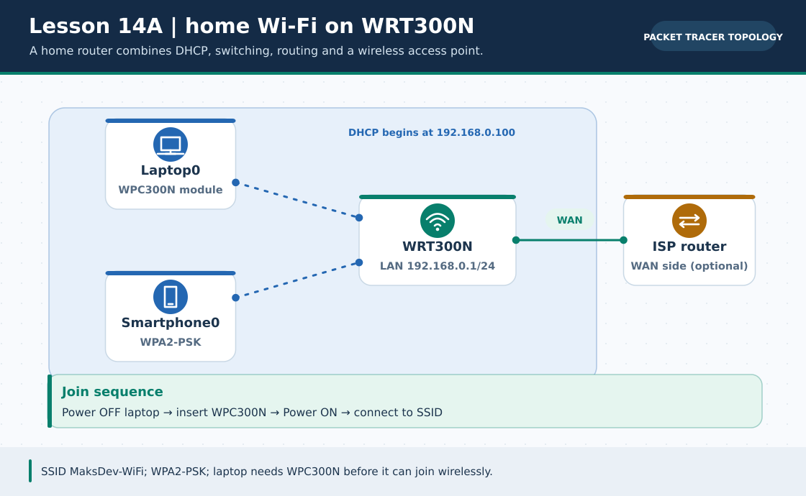
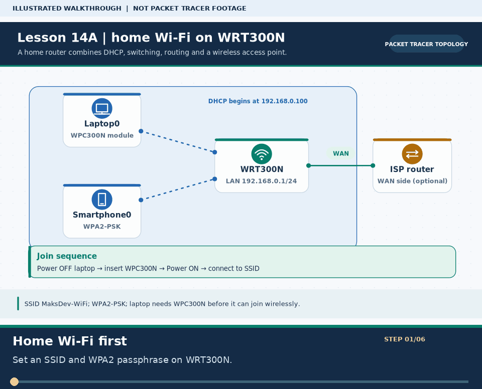
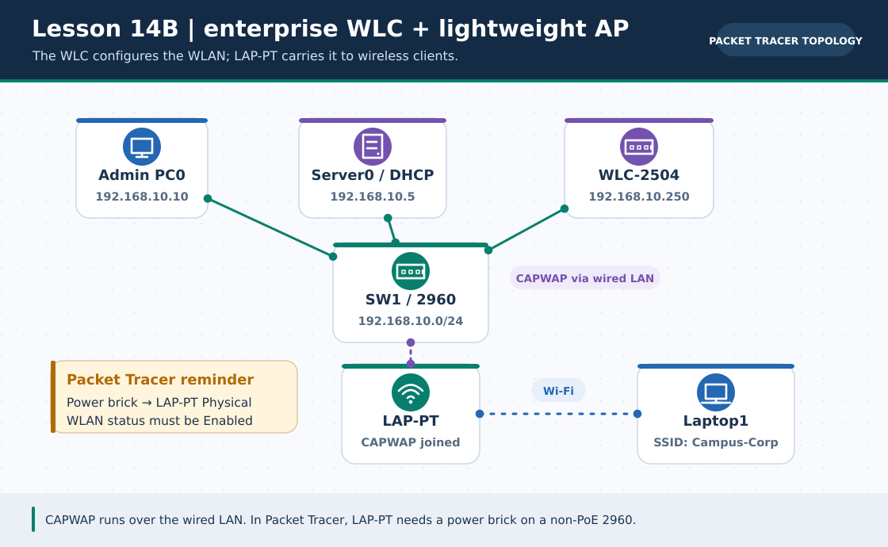

# লেসন ১৪ · Wireless LAN — Home Wi-Fi ও Enterprise WLC কনফিগারেশন

> 🌐 **English:** [Read this guide in English](../en/lessons/14-wireless-lan.md) · [English track index](../en/README.md)

> **নেভিগেশন:** [⬅ লেসন ১৩](13-dynamic-routing-ospf.md) · [📚 লেসন সূচি](README.md) · [🏠 হোম](../README.md) · [পরের লেসন ১৫ ➡](15-ssh-syslog-ntp.md)

| 🎯 লক্ষ্য | ⏱️ সময় | 📊 লেভেল | 🧰 ল্যাব ফাইল |
| :--- | :--- | :--- | :--- |
| বাসা/ছোট অফিসের Wi-Fi Router (`WRT300N`) এবং বড় কোম্পানির Wireless LAN Controller (`WLC-2504` + `LAP`) হাতে-কলমে সেটআপ করা | ~৫৫ মিনিট | 🟡→🟠 Intermediate | `lesson-14-wireless-lan.pkt` *(নিচের ধাপ অনুসরণ করে বানাও)* |

**Tags:** `#wireless` `#wifi` `#wlan` `#wlc` `#lightweight-ap` `#wpa2-psk` `#ssid` `#capwap` `#ccna`

---

## 🎯 এই লেসনে যা শিখবে

1. তারবিহীন নেটওয়ার্কের মূল ধারণা: **SSID, 2.4 GHz vs 5 GHz, CSMA/CA** এবং **WPA2/WPA3** নিরাপত্তা
2. Packet Tracer-এ ল্যাপটপে Wi-Fi কার্ড (`WPC300N`) লাগানোর গোপন নিয়ম *(Power Switch ট্রিক!)*
3. **Lab 1 (Home / Small Office Wi-Fi):** `WRT300N` ওয়্যারলেস রাউটারে SSID, WPA2 পাসওয়ার্ড ও ইন্টারনেট রাউটিং
4. **Autonomous AP বনাম Lightweight AP + WLC** — কেন বড় ক্যাম্পাসে কেন্দ্রীয় কন্ট্রোলার লাগে
5. **Lab 2 (CCNA Enterprise WLAN):** `Cisco WLC-2504` + `LAP-PT` দিয়ে পেশাদার কর্পোরেট Wi-Fi নেটওয়ার্ক তৈরি!

### 🏷️ মূল শব্দকোষ (Quick Glossary)

| শব্দ | সহজ অর্থ | নোট / স্ট্যান্ডার্ড |
| :--- | :--- | :--- |
| **SSID** (*Service Set Identifier*) | মোবাইলে বা ল্যাপটপে ভেসে ওঠা Wi-Fi নেটওয়ার্কের নাম | যেমন: `CSE-Campus-WiFi` |
| **CSMA/CA** (*Collision Avoidance*) | বাতাসে সিগন্যাল সংঘর্ষ ঠেকানোর নিয়ম *(তারের Ethernet ব্যবহার করে CSMA/CD)* | IEEE `802.11` |
| **WPA2-PSK (AES)** | শক্তিশালী পাসওয়ার্ড ও AES এনক্রিপশনযুক্ত ঘরের/ছোট অফিসের Wi-Fi নিরাপত্তা | `WEP` পুরনো ও অনিরাপদ ❌ |
| **WLC** (*Wireless LAN Controller*) | একটি কেন্দ্রীয় সার্ভার/ডিভাইস যেখান থেকে এক ক্লিকে ১০০টি Access Point নিয়ন্ত্রণ করা যায় | যেমন: `Cisco WLC-2504` |
| **CAPWAP** | Lightweight AP ও WLC-এর মধ্যে যোগাযোগের সুরক্ষিত টানেল প্রোটোকল | `UDP 5246` ও `5247` |

---

# 📖 Part 1 — ধারণা: ২ ধরনের Wi-Fi আর্কিটেকচার

### ১. বাসাবাড়ি বা ছোট অফিস (Home Router / Autonomous AP)
একটি বক্সের ভেতরেই Router + Switch + DHCP + Wi-Fi Access Point সব থাকে (যেমন বাসার TP-Link বা Packet Tracer-এর `WRT300N`)। ১–২টি রুমের জন্য দারুণ, কিন্তু বিশ্ববিদ্যালয়ের ৫০টি ক্লাসরুমে ৫০টি আলাদা রাউটার বসালে পাসওয়ার্ড বদলাতে ৫০ বার লগইন করতে হবে!

### ২. বড় অফিস বা বিশ্ববিদ্যালয় (WLC + Lightweight AP — CCNA স্ট্যান্ডার্ড)
প্রতিটি ফ্লোরে শুধু হালকা অ্যান্টেনা ডিভাইস (**Lightweight AP / `LAP`**) লাগানো থাকে, আর সার্ভার রুমে থাকে একটি **Wireless LAN Controller (`WLC`)**। WLC-তে একবার SSID ও পাসওয়ার্ড দিলে সব ফ্লোরের AP স্বয়ংক্রিয়ভাবে তা শিখে নেয়!

### 📡 2.4 GHz বনাম 5 GHz ব্যান্ড তুলনা

| বৈশিষ্ট্য | 2.4 GHz (`802.11b/g/n`) | 5 GHz (`802.11a/n/ac/ax`) |
| :--- | :--- | :--- |
| **দূরত্ব ও দেয়াল ভেদ করার ক্ষমতা** | 🟢 বেশি দূর যায়, দেয়াল সহজে পার হয় | 🟡 দূরত্ব কম |
| **গতি (Speed)** | 🟡 তুলনামূলক কম | 🟢 অনেক বেশি (Gigabit গতি) |
| **নন-ওভারল্যাপিং চ্যানেল** | মাত্র ৩টি (**`1, 6, 11`** — পরীক্ষায় আসে!) | অনেকগুলো চ্যানেল (হস্তক্ষেপ কম) |

---

# 🧪 Part 2 — Lab 1: Home / Small Office Wi-Fi (`WRT300N`)

### 🖼️ চিত্রে বোঝো: Home Wi-Fi: WRT300N ও ক্লায়েন্ট



> **ছবির সারকথা:** Laptop-এ WPC300N বসিয়ে Wi-Fi-তে যুক্ত করো; WRT300N DHCP ও গেটওয়ে দুটোই দেয়।



> 🎞️ **৩০ সেকেন্ডে মনে রাখো:** এটি উপরের ডায়াগ্রামের ওপর ভিত্তি করে বানানো ছয় ধাপের ভিজ্যুয়াল সারাংশ; বাস্তব Packet Tracer run, packet capture বা ফলের প্রমাণ নয়। [সব GIF-এর topic search name ও গুরুত্ব](../GIF-CATALOG.md) দেখো।


---

### 🧩 Step 1: ডিভাইস নির্বাচন ও টপোলজি
* **Network Devices → Wireless Devices → `WRT300N`** (১টি)
* **End Devices → `Laptop-PT`** (১টি) এবং **`SmartPhone-PT`** (১টি)
* *(ঐচ্ছিক)* বাইরের অফিস/ISP দেখানোর জন্য ১টি `Cisco 1941` রাউটার + ১টি `Server-PT`

```text
   (Wireless ~ ~ ~)                              (Wired Cable)
  [ Laptop0 ]   [ Smartphone0 ]             [ ISP Router (203.0.113.1) ]
        \             /                                   │
         ~           ~                           Internet Port (WAN)
        [ WRT300N Wi-Fi Router ] ═════════════════════════╝
          LAN IP: 192.168.0.1/24
          SSID  : MaksDev-WiFi
```

### 🔧 Step 2: Laptop0-তে Wi-Fi কার্ড (`WPC300N`) লাগানো *(সবচেয়ে জরুরি ট্রিক!)*
Packet Tracer-এ নতুন `Laptop-PT`-তে ডিফল্টভাবে শুধু তারের Ethernet পোর্ট থাকে, Wi-Fi কার্ড থাকে না!
1. **`Laptop0`**-তে ক্লিক করো → **`Physical`** ট্যাবে যাও।
2. ছবিটি জুম করে ল্যাপটপের পাশের **ছোট গোল পাওয়ার সুইচে ক্লিক করে ল্যাপটপ বন্ধ (Power OFF) করো** *(সবুজ বাতি নিভে যাবে — চালু অবস্থায় মডিউল টানলে এরর দেবে!)*।
3. নিচের স্লটে থাকা তারের মডিউলটি (`PT-LAPTOP-NM-1CFE`) মাউস দিয়ে টেনে বাম পাশের MODULES তালিকায় ফেলে দাও।
4. বাম তালিকা থেকে **`WPC300N`** (Wireless কার্ড) টেনে খালি স্লটে বসিয়ে দাও।
5. আবার **পাওয়ার সুইচ চেপে ল্যাপটপ চালু (Power ON) করো**! ✅

### ⚙️ Step 3: `WRT300N` GUI কনফিগারেশন
1. **`WRT300N`**-এ ক্লিক করো → **`GUI`** ট্যাবে যাও:
   * **Setup → Basic Setup:** Router IP = `192.168.0.1`, Subnet Mask = `255.255.255.0`, DHCP = `Enabled` (Start IP: `192.168.0.100`) → নিচে **`Save Settings`** চাপো!
2. উপরের **`Wireless`** ট্যাবে ক্লিক করো:
   * **Basic Wireless Settings:** Network Name (SSID) = **`MaksDev-WiFi`** → **`Save Settings`** চাপো।
   * **Wireless Security** সাব-ট্যাবে ক্লিক করো:
     * Security Mode: **`WPA2 Personal`**
     * Encryption: **`AES`**
     * Passphrase: **`bangladesh123`** *(কমপক্ষে ৮ অক্ষর হতে হবে!)*
     * নিচে স্ক্রল করে **`Save Settings`** ক্লিক করো!

### 📱 Step 4: Laptop ও Smartphone কানেক্ট করা
* **Laptop0 → Desktop → PC Wireless → Connect ট্যাব:**
  * রিফ্রেশ দিলে তালিকায় `MaksDev-WiFi` আসবে → সিলেক্ট করে **Connect** চাপো → Pre-shared Key বক্সে `bangladesh123` লিখে **Connect** দাও! ড্যাশবোর্ডে ডটেড সিগন্যাল রেখা ভেসে উঠবে! 🎉
* **Smartphone0 → Config → Wireless0:**
  * SSID = `MaksDev-WiFi` · Authentication = **`WPA2-PSK`** · Pass Phrase = `bangladesh123`।
* যাচাই: `Laptop0 → Command Prompt` → `ipconfig` (`192.168.0.100` পাবে) → `ping 192.168.0.1` ✅!

---

# 🏢 Part 3 — Lab 2: Enterprise WLC + Lightweight AP (`CCNA 200-301` স্পেশাল)

### 🖼️ চিত্রে বোঝো: Enterprise Wi-Fi: WLC, Switch ও LAP



> **ছবির সারকথা:** WLC থেকে CAPWAP সুইচের তার দিয়ে LAP-এ যায়; LAP থেকে Laptop-এ Wi-Fi সিগন্যাল যায়।

---

এবার বানাব আসল কর্পোরেট ক্যাম্পাস Wi-Fi নেটওয়ার্ক!

### 🧩 Step 1: টপোলজি ও ডিভাইসসমূহ
* **Wireless Devices → `2504` (বা `WLC-PT`)** Wireless LAN Controller (১টি)
* **Wireless Devices → `LAP-PT`** Lightweight Access Point (১টি — ⚠️ *খেয়াল রেখো: `AP-PT` নয়, **`LAP-PT`** নেবে!*)
* **Switches → `2960`** (`SW1`), **End Devices → `PC0`** (Admin PC), **`Server0`** (DHCP Server), **`Laptop1`** (`WPC300N` যুক্ত)

```text
          [ Admin PC0 ]                  [ DHCP Server0 ]
         192.168.10.10/24                192.168.10.5/24
                │                               │
              Fa0/1                           Fa0/2
          ┌───────────────────────────────────────────┐
          │             Switch 2960 (SW1)             │
          └─────┬───────────────────────────────┬─────┘
              Fa0/3                           Fa0/4
                │                               │
       (Management Port 1)              (GigabitEthernet0)
      [ Cisco WLC-2504 ]                   [ LAP-PT ]  ⚡ (Power Brick লাগাতে ভুলবে না!)
       192.168.10.250/24                  (DHCP + CAPWAP)
                                                ~
                                                ~  SSID: Campus-Corp
                                          [ Laptop1 ]
```

> ⚠️ **LAP-PT চালু করার জরুরি নিয়ম:** বাস্তবে সুইচ PoE দিয়ে AP চালায়, কিন্তু Packet Tracer-এ `2960` সুইচে PoE নেই! তাই **`LAP-PT` → Physical ট্যাবে** গিয়ে নিচের পাওয়ার অ্যাডাপ্টার (`Power Brick`) মাউস দিয়ে টেনে সকেটে লাগিয়ে দাও — নইলে `LAP-PT` বন্ধই থাকবে!

### ⚙️ Step 2: IP ও DHCP Server (`Server0`) সেটআপ
1. **Admin PC0:** Static IP `192.168.10.10`, Mask `255.255.255.0`, Gateway `192.168.10.1`।
2. **WLC-2504 → Config → Management:** IPv4 Address = **`192.168.10.250`**, Subnet Mask = `255.255.255.0`, Default Gateway = `192.168.10.1`।
3. **Server0:**
   * **Desktop → IP Configuration:** Static IP `192.168.10.5`, Mask `255.255.255.0`।
   * **Services → DHCP:** Service **`On`** করো → Start IP `192.168.10.50`, Mask `255.255.255.0`, **WLC Address: `192.168.10.250`** দিয়ে **`Save`** চাপো! *(এতেই `LAP-PT` স্বয়ংক্রিয়ভাবে আইপি ও WLC-র ঠিকানা পেয়ে CAPWAP টানেল গড়বে!)*

### 🌐 Step 3: ব্রাউজারে WLC ড্যাশবোর্ড খুলে WLAN তৈরি!
1. **`Admin PC0` → Desktop → Web Browser** খোলো।
2. অ্যাড্রেস বারে লেখো: **`https://192.168.10.250`** *(HTTP নয়, অবশ্যই **`https://`**! পেজ লোড হতে ৫–১০ সেকেন্ড সময় দিতে পারো)*।
3. প্রথমবার **Initial Setup Wizard** আসলে:
   * Admin User: `admin` · Password: `Cisco123!` *(বড় হাতের অক্ষর, সংখ্যা ও চিহ্নসহ কমপক্ষে ৬ অক্ষর!)*
   * System Name: `Campus-WLC`, Management IP: `192.168.10.250`, Mask: `255.255.255.0`, Default Router: `192.168.10.1` → বাকি ধাপ Next দিয়ে **Apply** করো।
4. পুনরায় `https://192.168.10.250` খুলে **`Login`** চাপো (`admin` / `Cisco123!`)।
5. উপরের মেনু থেকে **`WLANs`** ট্যাবে ক্লিক করো → ডান কোণায় `Create New` ড্রপডাউনের পাশে **`Go`** চাপো:
   * **Profile Name:** `Campus_WLAN`
   * **SSID:** `Campus-Corp`
   * **ID:** `1` → **`Apply`** চাপো।
6. এবার WLAN সেটিংস পেজে:
   * **General ট্যাব:** Status = ✅ **`Enabled`** টিক দাও! *(এটি ভুলে গেলে SSID বাতাসে ছড়াবেই না!)*
   * **Security → Layer 2 ট্যাব:** Layer 2 Security = **`WPA+WPA2`** → নিচে **`WPA2 Policy`** টিক দাও → Authentication Key Mgmt = ✅ **`PSK`** টিক দাও → PSK Format `ASCII` বক্সে পাসওয়ার্ড লেখো: **`campus2026`**।
   * ডান উপরে **`Apply`** ক্লিক করো!

### 🎉 Step 4: কানেক্ট ও যাচাই!
* মাউস `LAP-PT`-র ওপর ধরলে দেখবে `CAPWAP Status: Connected to 192.168.10.250` এবং `Provides WLANs: Campus-Corp` দেখাচ্ছে!
* `Laptop1 → Desktop → PC Wireless → Connect` থেকে `Campus-Corp` সিলেক্ট করে `campus2026` পাসওয়ার্ড দাও → সাথে সাথে কানেক্ট হয়ে `192.168.10.5x` আইপি পেয়ে যাবে!

---

# ❌ Troubleshooting

| সমস্যা | সম্ভাব্য কারণ | সমাধান |
| :--- | :--- | :--- |
| ল্যাপটপে `WPC300N` কার্ড বসছে না | ল্যাপটপের পাওয়ার চালু আছে | Physical ভিউতে ল্যাপটপের গোল পাওয়ার বাটনে ক্লিক করে আগে বন্ধ করো ([Problem ০৯](12-problem-solve.md#problem-09)) |
| `http://192.168.10.250` খুলছে না | `http` লেখা হয়েছে বা সুইচ পোর্ট এখনো কমলা | অবশ্যই **`https://`** লেখো এবং সুইচের বাতি সবুজ হওয়ার পর চেষ্টা করো |
| `LAP-PT` অন হচ্ছে না | পাওয়ার অ্যাডাপ্টার লাগানো হয়নি | `LAP-PT → Physical` ট্যাবে পাওয়ার ব্রিক টেনে লাগাও |
| WLC-তে WLAN বানিয়েছি কিন্তু ল্যাপটপে SSID আসছে না | WLAN `Enabled` টিক দেওয়া হয়নি বা `LAP` জয়েন করেনি | `WLANs` পেজে Status `Enabled` করে `Apply` চাপো; DHCP পুলে `WLC Address` চেক করো |

---

# ❓ অনুশীলন কুইজ (নিজে যাচাই করো)

**প্রশ্ন ১.** 2.4 GHz ব্যান্ডে পরস্পরের সাথে হস্তক্ষেপ না করা (Non-overlapping) স্ট্যান্ডার্ড চ্যানেল ৩টি কী কী?

- **A.** 1, 2, 3
- **B.** 1, 6, 11
- **C.** 2, 5, 10
- **D.** 36, 40, 44

<details>
<summary>✅ <b>উত্তর ও ব্যাখ্যা দেখো</b></summary>

**✅ উত্তর: B. 1, 6, 11**

**🧠 কেন:**

2.4 GHz ব্যান্ডে পাশাপাশি চ্যানেলগুলোর ফ্রিকোয়েন্সি ওভারল্যাপ করে। শুধুমাত্র **Channel 1, 6 এবং 11** পরস্পর থেকে সম্পূর্ণ আলাদা থাকে, তাই পাশাপাশি ৩টি AP বসালে এই তিনটি চ্যানেলে ভাগ করে দেওয়া হয়।
</details>

---

**প্রশ্ন ২.** একটি এন্টারপ্রাইজ নেটওয়ার্কে Lightweight AP (`LAP`) এবং Wireless LAN Controller (`WLC`) কোন প্রোটোকলের মাধ্যমে যুক্ত থাকে?

- **A.** STP
- **B.** CAPWAP
- **C.** OSPF
- **D.** POP3

<details>
<summary>✅ <b>উত্তর ও ব্যাখ্যা দেখো</b></summary>

**✅ উত্তর: B. CAPWAP**

**🧠 কেন:**

**CAPWAP** (*Control and Provisioning of Wireless Access Points*, UDP পোর্ট 5246/5247) প্রোটোকল দিয়ে সব Lightweight AP কেন্দ্রীয় WLC থেকে কনফিগারেশন গ্রহণ করে ও ট্রাফিক আদান-প্রদান করে।
</details>

---

**প্রশ্ন ৩.** ঘরের বা ছোট অফিসের Wi-Fi নেটওয়ার্কে নিচের কোন সিকিউরিটি মোডটি ব্যবহার করা বিপজ্জনক ও নিষিদ্ধ?

- **A.** WPA2-PSK (AES)
- **B.** WPA3-Personal
- **C.** WEP (Wired Equivalent Privacy)
- **D.** WPA2-Enterprise (802.1X)

<details>
<summary>✅ <b>উত্তর ও ব্যাখ্যা দেখো</b></summary>

**✅ উত্তর: C. WEP (Wired Equivalent Privacy)**

**🧠 কেন:**

**WEP** পুরনো RC4 অ্যালগরিদম ব্যবহার করে যা কয়েক মিনিটেই ক্র্যাক করা যায়। তাই সর্বনিম্ন **WPA2 (AES)** অথবা **WPA3** ব্যবহার করা আবশ্যক।
</details>

---

# ✅ Final Checklist

| কাজ | যাচাই | অবস্থা |
| :--- | :--- | :---: |
| `Laptop0`-এ পাওয়ার অফ করে `WPC300N` কার্ড স্থাপন | Physical ভিউতে সবুজ বাতি | ☐ |
| `WRT300N`-এ `WPA2-Personal (AES)` সহ Wi-Fi চালু | ল্যাপটপ ও স্মার্টফোন কানেক্টেড ✅ | ☐ |
| `LAP-PT`-এ পাওয়ার ব্রিক ও DHCP WLC Address সেট | CAPWAP স্ট্যাটাস `Connected` | ☐ |
| `https://192.168.10.250` খুলে `Campus-Corp` WLAN তৈরি | `Laptop1` কানেক্ট হয়ে পিং সফল ✅ | ☐ |

---

> **নেভিগেশন:** [⬅ লেসন ১৩](13-dynamic-routing-ospf.md) · [📚 লেসন সূচি](README.md) · [🏠 হোম](../README.md) · [পরের লেসন ১৫ ➡](15-ssh-syslog-ntp.md)

**এই লেসনের Tags:** `#wireless` `#wlc` `#lightweight-ap` `#capwap` `#wpa2` `#ssid` `#wrt300n`
