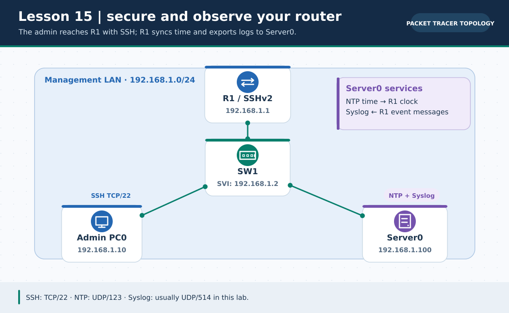
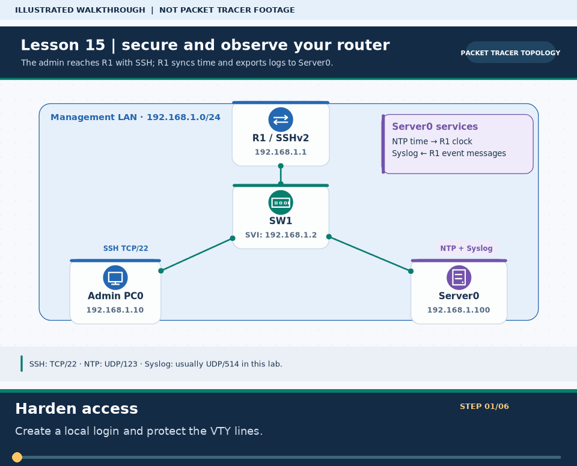

# লেসন ১৫ · SSH Remote Access, Device Hardening, NTP ও Syslog Server

> 🌐 **English:** [Read this guide in English](../en/lessons/15-ssh-syslog-ntp.md) · [English track index](../en/README.md)

> **নেভিগেশন:** [⬅ লেসন ১৪](14-wireless-lan.md) · [📚 লেসন সূচি](README.md) · [🏠 হোম](../README.md) · [📖 Cheat-Sheet](../reference/cli-command-cheatsheet.md)

| 🎯 লক্ষ্য | ⏱️ সময় | 📊 লেভেল | 🧰 ল্যাব ফাইল |
| :--- | :--- | :--- | :--- |
| রাউটারকে হ্যাকারদের হাত থেকে সুরক্ষিত করা (Hardening), এনক্রিপ্টেড SSH রিমোট লগইন, NTP ঘড়ি সিঙ্ক ও কেন্দ্রীয় Syslog লগিং সেটআপ | ~৫০ মিনিট | 🟠 Intermediate | `lesson-15-ssh-syslog-ntp.pkt` *(নিচের টপোলজি দেখে বানাও)* |

**Tags:** `#ssh` `#security` `#hardening` `#ntp` `#syslog` `#rsa-keys` `#port-22` `#ccna-security`

---

### 🖼️ চিত্রে বোঝো: SSH, NTP ও Syslog-এর যোগাযোগ পথ



> **ছবির সারকথা:** Admin PC রাউটারে SSH করে; Server0 সময় দেয় আর রাউটারের ইভেন্ট লগ গ্রহণ করে।



> 🎞️ **৩০ সেকেন্ডে মনে রাখো:** এটি উপরের ডায়াগ্রামের ওপর ভিত্তি করে বানানো ছয় ধাপের ভিজ্যুয়াল সারাংশ; বাস্তব Packet Tracer run, packet capture বা ফলের প্রমাণ নয়। [সব GIF-এর topic search name ও গুরুত্ব](../GIF-CATALOG.md) দেখো।


---

## 🎯 এই লেসনে যা শিখবে

1. **Telnet বনাম SSH** — কেন আসল নেটওয়ার্কে Telnet বন্ধ রাখা বাধ্যতামূলক
2. **Cisco Device Hardening:** `enable secret`, `service password-encryption`, `banner motd`, ও `logging synchronous`
3. রাউটারে RSA ক্রিপ্টো কী তৈরি করে **SSHv2 রিমোট লগইন** চালু করা এবং PC থেকে `ssh -l admin` দিয়ে ঢোকা
4. **NTP Server (`UDP 123`):** সব রাউটার ও সুইচের ঘড়ি এক সেকেন্ডের নিখুঁততায় মিলিয়ে রাখা
5. **Syslog Server (`UDP 514`):** পোর্ট ডাউন বা লগইন চেষ্টার সব রেকর্ড অটোমেটিক কেন্দ্রীয় সার্ভারে জমা রাখা!

### 🏷️ মূল শব্দকোষ (Quick Glossary)

| শব্দ | সহজ অর্থ | পোর্ট / নোট |
| :--- | :--- | :--- |
| **Telnet** | পুরনো রিমোট CLI প্রোটোকল — পাসওয়ার্ড খোলা টেক্সটে (Plain Text) পাঠায়, তাই ঝুঁকিপূর্ণ ❌ | `TCP Port 23` |
| **SSH** (*Secure Shell*) | সম্পূর্ণ এনক্রিপ্টেড রিমোট CLI প্রোটোকল — কেউ মাঝপথে আড়ি পাতলেও পাসওয়ার্ড দেখতে পায় না ✅ | **`TCP Port 22`** |
| **RSA Key** | SSH এনক্রিপশন চালানোর জন্য রাউটারে তৈরি করা গাণিতিক নিরাপত্তা চাবি (`1024` বা `2048` বিট) | `crypto key generate rsa` |
| **NTP** (*Network Time Protocol*) | নেটওয়ার্কের সব ডিভাইসের ঘড়ি কেন্দ্রীয় সময় সার্ভারের সাথে মেলানোর প্রোটোকল | **`UDP Port 123`** |
| **Syslog** | রাউটার/সুইচের সব ইভেন্ট ও সতর্কবার্তা কেন্দ্রীয় লগ সার্ভারে পাঠানোর স্ট্যান্ডার্ড | **`UDP Port 514`** |

---

# 🧩 Part 1 — ল্যাব টপোলজি ও IP Plan

### 📌 প্রয়োজনীয় ডিভাইস
* **1 × Router:** Cisco `1941` (`R1`)
* **1 × Switch:** Cisco `2960` (`SW1`)
* **1 × PC:** `PC0` (Network Admin Workstation)
* **1 × Server:** `Server0` (NTP + Syslog Server)

```text
                        [ Router R1 ]
                      G0/0: 192.168.1.1/24
                      (SSHv2 + NTP Client + Syslog Client)
                             │
                             │ G0/1
                     [ Switch 2960 (SW1) ]
                      SVI: 192.168.1.2/24
                      /                 \
                  Fa0/1                 Fa0/2
                   /                       \
          [ Admin PC0 ]               [ Server0 ]
         192.168.1.10/24             192.168.1.100/24
        (SSH Terminal)              (NTP + Syslog ON)
```

### 📋 IP Addressing Table (`192.168.1.0/24`)

| Device | Interface | IP Address | Subnet Mask | Default Gateway |
| :--- | :--- | :--- | :--- | :--- |
| **R1** | `GigabitEthernet 0/0` | `192.168.1.1` | `255.255.255.0` | — |
| **SW1** | `VLAN 1 (SVI)` | `192.168.1.2` | `255.255.255.0` | `192.168.1.1` |
| **Admin PC0** | `FastEthernet 0` | `192.168.1.10` | `255.255.255.0` | `192.168.1.1` |
| **Server0** | `FastEthernet 0` | `192.168.1.100` | `255.255.255.0` | `192.168.1.1` |

---

# 🔐 Part 2 — Step-by-Step: Device Hardening ও SSHv2 কনফিগারেশন

`R1`-এর CLI খুলে নিচের ৬টি ধাপ সিরিয়ালে সম্পন্ন করো:

```cisco
enable
configure terminal

! ধাপ ১: Hostname ও Domain Name (RSA Key তৈরির জন্য এ দুটি বাধ্যতামূলক!)
hostname R1
ip domain-name office.local
no ip domain-lookup

! ধাপ ২: ইন্টারফেস সচল করা
interface gigabitEthernet 0/0
 ip address 192.168.1.1 255.255.255.0
 no shutdown
 exit

! ধাপ ৩: শক্তিশালী পাসওয়ার্ড, ইউজার অ্যাকাউন্ট ও ব্যানার (Hardening)
enable secret EnablePass123!
username admin secret AdminPass123!
service password-encryption
banner motd # WARNING: Authorized Network Admins Only! All sessions are logged. #

! ধাপ ৪: RSA এনক্রিপশন চাবি তৈরি ও SSH Version 2 চালু করা
crypto key generate rsa
! প্রম্পটে জিজ্ঞেস করবে: How many bits in the modulus [512]: 2048  (লিখে Enter চাপো!)
ip ssh version 2
ip ssh time-out 60
ip ssh authentication-retries 3

! ধাপ ৫: Console লাইন সুরক্ষা ও বিরক্তিকর লগ ইন্টারাপ্ট বন্ধ (logging synchronous)
line console 0
 login local
 logging synchronous
 exec-timeout 5 0
 exit

! ধাপ ৬: VTY রিমোট লাইনে Telnet বন্ধ করে শুধুমাত্র SSH চালু করা!
line vty 0 4
 transport input ssh
 login local
 logging synchronous
 exec-timeout 5 0
 exit

end
copy running-config startup-config
```

### 💡 কেন এই কমান্ডগুলো এত গুরুত্বপূর্ণ?
* **`hostname` + `ip domain-name`:** RSA কী-এর নাম হয় `R1.office.local` — ডিফল্ট `Router` নাম থাকলে `crypto key generate rsa` এরর দেবে!
* **`transport input ssh`:** এটি দেওয়ার সাথে সাথে পোর্ট ২৩ (**Telnet**) পুরোপুরি তালাবদ্ধ হয়ে যায়, কেবল পোর্ট ২২ (**SSH**) খোলা থাকে!
* **`login local`:** রাউটারকে বলে `username admin secret ...` ডেটাবেস থেকে ইউজার ও পাসওয়ার্ড মিলিয়ে দেখতে।
* **`logging synchronous`:** তুমি কমান্ড টাইপ করার মাঝখানে হঠাৎ `%LINK-5-CHANGED` মেসেজ এসে লেখা ভেঙে দেওয়া চিরতরে বন্ধ করে!

### 🧪 Admin PC0 থেকে SSH পরীক্ষা করো!
1. আগে প্রমাণ করো Telnet বন্ধ: **PC0 → Command Prompt**-এ লেখো:
   ```cmd
   C:\> telnet 192.168.1.1
   Trying 192.168.1.1 ...Open
   [Connection to 192.168.1.1 closed by foreign host]   ← Telnet ব্লকড! ✅
   ```
2. এবার **SSH** দিয়ে নিরাপদে ঢোকো (`-l` হলো ছোট হাতের `L`, মানে Login user):
   ```cmd
   C:\> ssh -l admin 192.168.1.1
   Open
   Password: ************   (AdminPass123! টাইপ করে Enter দাও — স্ক্রিনে অক্ষর দেখা যাবে না!)

   WARNING: Authorized Network Admins Only! All sessions are logged.
   R1> enable
   Password: ************   (EnablePass123!)
   R1#
   ```
   🎉 **অভিনন্দন!** তুমি নিজের ডেস্কের পিসি বসেই এনক্রিপ্টেড টানেলে রাউটারের ভেতরে ঢুকে পড়েছ!

*(চাইলে একই কমান্ড `SW1` সুইচেও দিয়ে `interface vlan 1` → `ip address 192.168.1.2 255.255.255.0` → `no shutdown` করে সুইচেও SSH চালু করতে পারো!)*

---

# ⏱️ Part 3 — NTP (Network Time Protocol) কনফিগারেশন

রাউটার রিস্টার্ট নিলে তার ঘড়ি ১৯৯৩ সালে (`Mar 1 1993`) ফিরে যায়! সঠিক তারিখ ও সময় সেট করি:

### Step 1: `Server0`-এ NTP চালু করো
* **Server0 → Services → NTP:**
  * NTP: **`On`** করো (চাইলে আজকের তারিখ ও সময় মিলিয়ে দাও)।

### Step 2: `R1` রাউটারকে NTP Client বানাও
```cisco
R1# configure terminal
R1(config)# ntp server 192.168.1.100
R1(config)# service timestamps log datetime msec
R1(config)# end
```
*(একটু ফাস্ট-ফরওয়ার্ড টাইম চাপলে ঘড়ি সিঙ্ক হয়ে যাবে!)*

### 🔍 NTP যাচাই:
```cisco
R1# show clock
R1# show ntp status
! দেখবে: Clock is synchronized, stratum 2, reference is 192.168.1.100 ✅
```

---

# 📜 Part 4 — Syslog Server (কেন্দ্রীয় ইভেন্ট লগিং)

### Step 1: `Server0`-এ Syslog চালু করো
* **Server0 → Services → SYSLOG:** Service = **`On`** নিশ্চিত করো (নিচের টেবিলটি আপাতত ফাঁকা থাকবে)।

### Step 2: `R1` রাউটারে Syslog পাঠানো চালু করো
```cisco
R1# configure terminal
R1(config)# logging host 192.168.1.100
R1(config)# logging trap informational
R1(config)# end
R1# copy running-config startup-config
```

### 🧪 লাইভ Syslog টেস্ট!
১. `R1`-এ একটি টেস্ট লুপব্যাক পোর্ট তৈরি করে বন্ধ করো:
```cisco
R1# configure terminal
R1(config)# interface loopback 99
R1(config-if)# shutdown
R1(config-if)# no shutdown
R1(config-if)# end
```
২. এবার **`Server0 → Services → SYSLOG`** খুলে দেখো!
দেখবে নিখুঁত তারিখ, সময়, হোস্টনেম (`192.168.1.1`) ও `%LINK-5-CHANGED: Interface Loopback99, changed state to administratively down` মেসেজ সার্ভারে রেকর্ড হয়ে গেছে! 🔥

---

# 📊 Syslog-এর ৮টি Severity Level (CCNA পরীক্ষার প্রিয় প্রশ্ন!)

মনে রাখার বিখ্যাত ইংরেজি বাক্য: **_E_very _A_wesome _C_isco _E_ngineer _W_ill _N_eed _I_cecream _D_aily** (`0 → 7`):

| Level # | নাম | অর্থ (যত ছোট সংখ্যা, তত মারাত্মক বিপদ!) |
| :---: | :--- | :--- |
| **0** | **Emergencies** | সিস্টেম সম্পূর্ণ অকেজো |
| **1** | **Alerts** | তাৎক্ষণিক ব্যবস্থা জরুরি |
| **2** | **Critical** | গুরুতর অবস্থা |
| **3** | **Errors** | এরর ঘটেছে |
| **4** | **Warnings** | সতর্কবার্তা |
| **5** | **Notifications** | স্বাভাবিক কিন্তু গুরুত্বপূর্ণ ঘটনা (যেমন পোর্ট up/down) |
| **6** | **Informational** | সাধারণ তথ্যমূলক বার্তা (`logging trap informational` দিলে ০–৬ সব যায়!) |
| **7** | **Debugging** | বিস্তারিত ডিবাগ মেসেজ |

---

# ❌ Troubleshooting

| সমস্যা | সম্ভাব্য কারণ | সমাধান |
| :--- | :--- | :--- |
| `% Please define a domain-name first.` | `ip domain-name` বা কাস্টম `hostname` দেওয়া হয়নি | আগে `hostname R1` ও `ip domain-name office.local` দাও, তারপর `crypto key generate rsa` ([Problem ০৮](12-problem-solve.md#problem-08)) |
| PC থেকে `ssh -l admin 192.168.1.1` কাজ করছে না | VTY লাইনে `login local` বা `username` দেওয়া হয়নি | `line vty 0 4`-এ `transport input ssh` ও `login local` চেক করো |
| সার্ভারে কোনো Syslog জমা হচ্ছে না | Server-এ SYSLOG `Off` বা গেটওয়ে/পিং ভাঙা | `ping 192.168.1.100` এবং Server → Services → SYSLOG `On` চেক করো |

---

# ❓ অনুশীলন কুইজ (নিজে যাচাই করো)

**প্রশ্ন ১.** SSH, NTP এবং Syslog প্রোটোকল তিনটি যথাক্রমে কোন ট্রান্সপোর্ট প্রোটোকল ও পোর্ট নম্বর ব্যবহার করে?

- **A.** SSH=TCP 23, NTP=TCP 123, Syslog=TCP 514
- **B.** SSH=TCP 22, NTP=UDP 123, Syslog=UDP 514
- **C.** SSH=UDP 22, NTP=UDP 161, Syslog=TCP 80
- **D.** SSH=TCP 22, NTP=TCP 25, Syslog=UDP 69

<details>
<summary>✅ <b>উত্তর ও ব্যাখ্যা দেখো</b></summary>

**✅ উত্তর: B. SSH=TCP 22, NTP=UDP 123, Syslog=UDP 514**

**🧠 কেন:**

রিমোট লগইনে নির্ভরযোগ্যতা দরকার তাই **SSH = TCP 22** (Telnet = TCP 23)। আর হালকা ও দ্রুত টাইম সিঙ্ক এবং লগ পাঠানোর জন্য **NTP = UDP 123** ও **Syslog = UDP 514** ব্যবহৃত হয়।
</details>

---

**প্রশ্ন ২.** VTY লাইনে Telnet সম্পূর্ণ বন্ধ করে শুধুমাত্র SSH অনুমোদন করার সঠিক কমান্ড কোনটি?

- **A.** `transport input telnet ssh`
- **B.** `transport input all`
- **C.** `transport input ssh`
- **D.** `enable secret ssh`

<details>
<summary>✅ <b>উত্তর ও ব্যাখ্যা দেখো</b></summary>

**✅ উত্তর: C. `transport input ssh`**

**🧠 কেন:**

`line vty 0 4`-এর ভেতরে `transport input ssh` দিলে শুধুমাত্র এনক্রিপ্টেড SSH সেশন গ্রহণ করা হয় এবং অরক্ষিত Telnet পোর্ট স্বয়ংক্রিয়ভাবে প্রত্যাখ্যাত হয়।
</details>

---

**প্রশ্ন ৩.** Cisco রাউটারে `crypto key generate rsa` কমান্ড চালানোর আগে কোন দুটি কনফিগারেশন থাকা বাধ্যতামূলক?

- **A.** DHCP Pool এবং Static Route
- **B.** ডিফল্টের বদলে নিজস্ব `hostname` এবং `ip domain-name`
- **C.** NTP Server এবং Syslog Server
- **D.** VLAN 10 এবং Trunk Port

<details>
<summary>✅ <b>উত্তর ও ব্যাখ্যা দেখো</b></summary>

**✅ উত্তর: B. ডিফল্টের বদলে নিজস্ব `hostname` এবং `ip domain-name`**

**🧠 কেন:**

IOS রাউটারটি `<hostname>.<domain-name>` (যেমন `R1.office.local`) নাম দিয়ে RSA কী-জোড়া তৈরি করে। দুটির যেকোনো একটি না থাকলে কী জেনারেট করতে দেয় না।
</details>

---

# ✅ Final Checklist

| কাজ | যাচাই | অবস্থা |
| :--- | :--- | :---: |
| `enable secret` + `service password-encryption` সক্রিয় | `show running-config` (পাসওয়ার্ড হ্যাশ/গোপন) | ☐ |
| `PC0` থেকে `telnet 192.168.1.1` ব্লকড কিন্তু `ssh -l admin 192.168.1.1` সফল | PC Command Prompt | ☐ |
| `R1`-এর ঘড়ি `Server0`-এর সাথে সিঙ্ক (`synchronized`) | `show ntp status` | ☐ |
| পোর্ট ডাউন/আপ করলে `Server0`-এর SYSLOG ট্যাবে মেসেজ জমা হচ্ছে | `Server0 → SYSLOG` | ☐ |

---

> **নেভিগেশন:** [⬅ লেসন ১৪](14-wireless-lan.md) · [📚 লেসন সূচি](README.md) · [🏠 হোম](../README.md) · [📖 Cheat-Sheet](../reference/cli-command-cheatsheet.md)

**এই লেসনের Tags:** `#ssh` `#hardening` `#ntp` `#syslog` `#rsa` `#cybersecurity` `#ccna`
