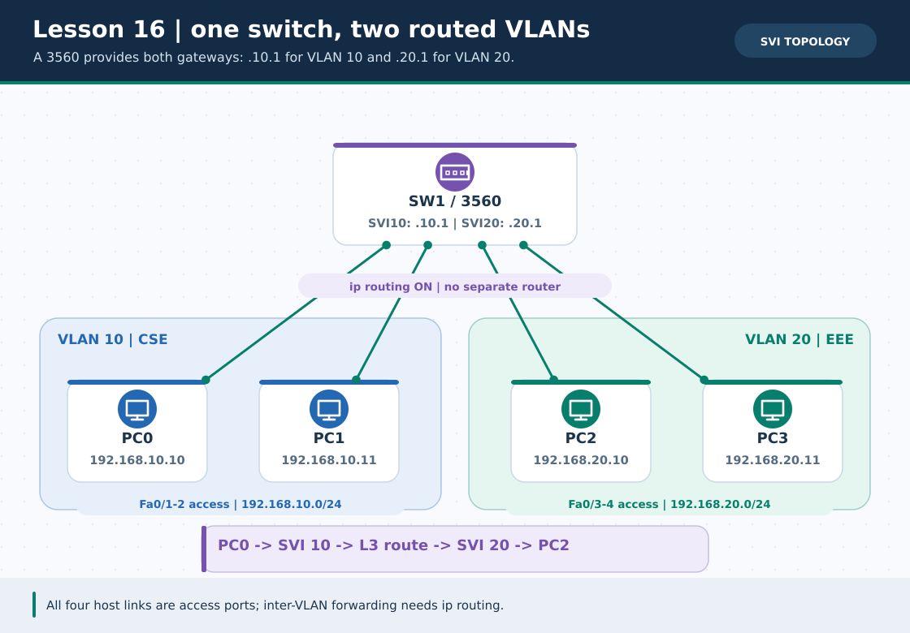
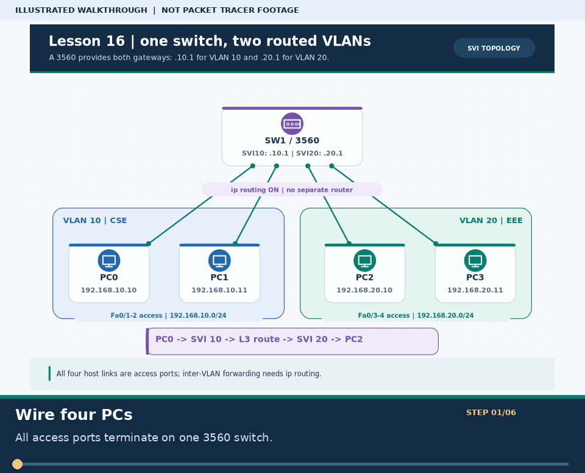
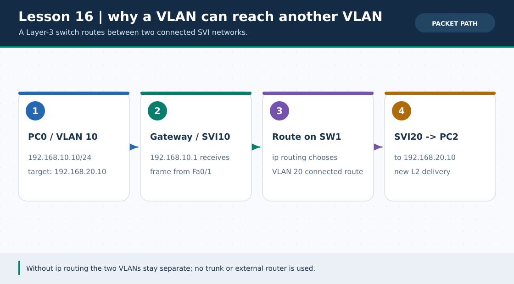

# লেসন ১৬ · Multilayer Switch ও SVI Inter-VLAN Routing

> 🌐 **English:** [Read this guide in English](../en/lessons/16-multilayer-switch-svi.md) · [English track index](../en/README.md)

> **নেভিগেশন:** [⬅ লেসন ১৫](15-ssh-syslog-ntp.md) · [➡ লেসন ১৭](17-hsrp-gateway-redundancy.md) · [📚 লেসন সূচি](README.md) · [🏠 হোম](../README.md) · [📖 CLI Cheat-Sheet](../reference/cli-command-cheatsheet.md)

| 🎯 লক্ষ্য | ⏱️ সময় | 📊 লেভেল | 🧰 প্রয়োজন |
| :--- | :--- | :--- | :--- |
| 3560-এর দুটি VLAN SVI-কে গেটওয়ে বানিয়ে **আলাদা রাউটার ছাড়াই** PC0 ↔ PC2 পিং | ৩০–৪০ মিনিট | 🟠 Intermediate | Packet Tracer-এ **নিজে বানাবে**; এই লেসনের `.pkt` এখনো নেই |

**Tags:** `#multilayer-switch` `#svi` `#inter-vlan-routing` `#vlan10` `#vlan20` `#ip-routing` `#ccna`

---

### 🖼️ ছবি ১: একটি 3560, দুটি VLAN, দুটি গেটওয়ে



> **ছবির সারকথা:** VLAN 10-এর PC0/PC1 এবং VLAN 20-এর PC2/PC3 একই সুইচে, কিন্তু আলাদা broadcast domain-এ। `interface vlan 10/20`-এর IP-ই তাদের নিজ নিজ **default gateway**; `ip routing` ছাড়া এক VLAN থেকে অন্য VLAN-এ যাবে না। ছবিটি শিক্ষামূলক নকশা, Packet Tracer screenshot নয়।



> 🎞️ **৩০ সেকেন্ডে মনে রাখো:** এটি উপরের ডায়াগ্রামের ওপর ভিত্তি করে বানানো ছয় ধাপের ভিজ্যুয়াল সারাংশ; বাস্তব Packet Tracer run, packet capture বা ফলের প্রমাণ নয়। [সব GIF-এর topic search name ও গুরুত্ব](../GIF-CATALOG.md) দেখো।


### 🖼️ ছবি ২: প্যাকেট কীভাবে অন্য VLAN-এ পৌঁছায়



> **ছবির সারকথা:** PC0 → VLAN 10-এর gateway `.10.1` → সুইচের **Layer-3 routing table** → VLAN 20-এর SVI `.20.1` → PC2। VLAN আলাদা থাকলেও রাউটিং সক্রিয় থাকলে যোগাযোগ সম্ভব; সাধারণ 2960-এর management SVI একই কাজ করে না।

---

## 🏷️ আগে যে চারটি শব্দ জানবে

| শব্দ | বাংলা ব্যাখ্যা |
| :--- | :--- |
| **Multilayer Switch** | Layer 2 switching-এর পাশাপাশি Layer 3 IP routing করতে পারে এমন সুইচ; এখানে `3560-24PS`। |
| **SVI (Switch Virtual Interface)** | `interface vlan 10`-এর মতো লজিক্যাল L3 ইন্টারফেস। VLAN-এর gateway IP এখানে বসে। |
| **Access Port** | এক VLAN-এর untagged host traffic বহন করে; এই ল্যাবে চারটি PC পোর্টই access। |
| **`ip routing`** | সুইচে VLAN-গুলোর *মধ্যে* IP packet forwarding চালু করে; SVI-তে IP বসানো একা যথেষ্ট নয়। |

**পূর্বশর্ত:** [লেসন ০৫-এ VLAN Isolation](05-vlan.md) এবং [লেসন ০৬-এ Router-on-a-Stick](06-trunk-inter-vlan.md) দেখে নাও। এখানে একটি L3 সুইচেই উভয় gateway থাকে; PC-পোর্টে trunk দরকার নেই।

## 🧩 ডিভাইস, কেবল ও IP Plan

Packet Tracer-এ **1 × 3560-24PS (SW1)** এবং **4 × PC** নাও। Copper Straight-Through দিয়ে PC0→SW1 `Fa0/1`, PC1→`Fa0/2`, PC2→`Fa0/3`, PC3→`Fa0/4` জোড়ো। অন্য কোনো router বা switch লাগবে না।

| ডিভাইস | পোর্ট / VLAN | IPv4 / Mask | Default Gateway |
| :--- | :--- | :--- | :--- |
| SW1 | `Vlan10` (CSE) | `192.168.10.1/24` | — |
| SW1 | `Vlan20` (EEE) | `192.168.20.1/24` | — |
| PC0 | `Fa0/1` · VLAN 10 | `192.168.10.10/24` | `192.168.10.1` |
| PC1 | `Fa0/2` · VLAN 10 | `192.168.10.11/24` | `192.168.10.1` |
| PC2 | `Fa0/3` · VLAN 20 | `192.168.20.10/24` | `192.168.20.1` |
| PC3 | `Fa0/4` · VLAN 20 | `192.168.20.11/24` | `192.168.20.1` |

> প্রতিটি PC-এর **Desktop → IP Configuration**-এ `Subnet Mask 255.255.255.0` এবং উপরের IP/gateway বসাও। SVI `up/up` হওয়ার জন্য VLAN থাকতে হবে এবং সাধারণত ওই VLAN-এর অন্তত একটি সচল access port থাকতে হবে; শুরুতে STP settle হওয়ার জন্য কিছুক্ষণ অপেক্ষা করো।

## 🔧 SW1 কনফিগারেশন (CLI-তে এক ডিভাইসেই)

```cisco
enable
configure terminal
hostname SW1
vlan 10
 name CSE
exit
vlan 20
 name EEE
exit
interface range fastEthernet 0/1 - 2
 switchport mode access
 switchport access vlan 10
 no shutdown
exit
interface range fastEthernet 0/3 - 4
 switchport mode access
 switchport access vlan 20
 no shutdown
exit
interface vlan 10
 ip address 192.168.10.1 255.255.255.0
 no shutdown
exit
interface vlan 20
 ip address 192.168.20.1 255.255.255.0
 no shutdown
exit
end
```

**এখন আগে পরীক্ষা:** PC0 থেকে PC1 (`192.168.10.11`) ping সফল হওয়ার কথা; PC0 থেকে PC2 (`192.168.20.10`) এখনো ব্যর্থ হতে পারে, কারণ routing চালু করিনি। Switch-এর CLI-তে:

```cisco
configure terminal
ip routing
end
copy running-config startup-config
```

> 🛠️ একই টপোলজির সুইচ অংশটি চাইলে তৈরি করো: `python3 scripts/ios_config_generator.py svi-switch`। জেনারেটরের আউটপুট **শুধু SW1-তে** পেস্ট করবে।

## ✅ যাচাই: শুধু green light নয়, route-ও দেখো

SW1-এর privileged prompt (`SW1#`)-এ:

```cisco
show vlan brief
show ip interface brief
show ip route
show running-config | include ip routing
```

| কী দেখবে | প্রত্যাশিত ফল (সিমুলেটরে নিজে যাচাই) |
| :--- | :--- |
| `show vlan brief` | `Fa0/1–2` VLAN 10; `Fa0/3–4` VLAN 20। |
| `show ip interface brief` | `Vlan10 192.168.10.1 up/up` এবং `Vlan20 192.168.20.1 up/up`। |
| `show ip route` | `C 192.168.10.0/24` ও `C 192.168.20.0/24` connected routes। |
| PC0 → PC1 | `ping 192.168.10.11` সফল; একই VLAN। |
| PC0 → PC2 / PC3 | `ping 192.168.20.10` ও `.11` সফল; **SVI routing**। |
| PC2 → PC0 | `ping 192.168.10.10` সফল; return direction-ও ঠিক। |

প্রথম ICMP packet ARP শেখার সময় timeout হলে ২–৩ বার ping দাও। `show interfaces trunk`-এ কিছু না দেখানো **এখানে স্বাভাবিক**: কোনো trunk ব্যবহার করিনি।

## 🧯 সমস্যা হলে কোথায় দেখবে

| উপসর্গ | সম্ভাব্য কারণ → করণীয় |
| :--- | :--- |
| `Vlan10`/`Vlan20` down/down | `show vlan brief`; সংশ্লিষ্ট PC cable/port ও VLAN membership, `no shutdown` পরীক্ষা। |
| একই VLAN ping হয়, অন্য VLAN নয় | `ip routing` আছে? PC0-এর gateway `.10.1` এবং PC2-এর `.20.1` ঠিক? |
| `% Invalid input` at `ip routing` | 2960 L2-এর বদলে **3560/3650 multilayer model** বেছে নাও; Packet Tracer model/command support দেখে নাও। |
| SVI up কিন্তু PC gateway ping হয় না | PC subnet mask `/24`, access VLAN, link up ও STP convergence পরীক্ষা। |
| শুধু 192.168.20.1 ping হয়, PC2 হয় না | PC2-এর IP, mask, host port `Fa0/3`, firewall/PC power যাচাই। |

> ⚠️ **মডেল-ভেদে CLI:** নিচের উদাহরণটি Packet Tracer-এর 3560-ধাঁচের classic IOS syntax; বাস্তব 3650-তে physical port নাম `Gi1/0/x` হতে পারে। ডিভাইসের CLI-তে `show ip interface brief` ও `interface ?` দিয়ে port নাম জেনে বদলাবে। এই রেপোতে Lesson 16-এর native `.pkt` ফাইল নেই; ছবিকে সিমুলেটরের ফল ভাববে না।

## ☑️ নিজের চেকলিস্ট

- [ ] VLAN10/20 ও SVI দুটোই `up/up`।
- [ ] `show ip route`-এ দুটি connected /24 দেখা যাচ্ছে।
- [ ] PC0→PC1, PC0→PC2 এবং PC2→PC0—তিনটি test-ই সফল।
- [ ] বুঝিয়ে বলতে পারছি: ROAS-এ router subinterface, এখানে multilayer switch-এর SVI gateway।

## ❓ অনুশীলন কুইজ

**প্রশ্ন ১.** PC0 VLAN 10 থেকে PC2 VLAN 20-এ যেতে SW1-এ কোন global command দরকার?

- **A.** `switchport mode trunk`
- **B.** `ip routing`
- **C.** `ip default-gateway 192.168.20.1`
- **D.** `spanning-tree portfast`

<details><summary>✅ উত্তর দেখো</summary>

**✅ উত্তর: B. `ip routing`**
**🧠 কেন:** SVI দুটি configured থাকলেও Layer-3 forwarding সক্রিয় না হলে VLAN-এর মধ্যে packet যাবে না। PC access পোর্টে trunk লাগবে না।

</details>

**প্রশ্ন ২.** PC2-এর default gateway এই টপোলজিতে কত?

- **A.** `192.168.10.1`
- **B.** `192.168.20.10`
- **C.** `192.168.20.1`
- **D.** `192.168.10.10`

<details><summary>✅ উত্তর দেখো</summary>

**✅ উত্তর: C. `192.168.20.1`**
**🧠 কেন:** PC2 VLAN20-এর host, তাই তার গেটওয়ে `interface vlan 20`-এর IP; PC-এর নিজের `.20.10` নয়।

</details>

**প্রশ্ন ৩.** `Vlan10` SVI down দেখালে প্রথমে কোন দুটো জিনিস দেখবে?

- **A.** DNS ও NTP
- **B.** VLAN10 অস্তিত্ব এবং সচল VLAN10 access port
- **C.** NAT ও ACL
- **D.** WAN /30 route

<details><summary>✅ উত্তর দেখো</summary>

**✅ উত্তর: B. VLAN10 অস্তিত্ব এবং সচল VLAN10 access port**
**🧠 কেন:** SVI operational status-এর জন্য VLAN সক্রিয় এবং অন্তত একটি যোগ্য up port থাকা জরুরি।

</details>

---

**এরপর:** [লেসন ১৭ · HSRP-তে gateway failover](17-hsrp-gateway-redundancy.md) · [লেসন ১৮ · IPv6 routing](18-ipv6-slaac-routing.md) · [Cisco Community · 3560 SVI ও `ip routing`](https://community.cisco.com/t5/routing-and-sd-wan/3560-layer-3-routing/td-p/2145580)
