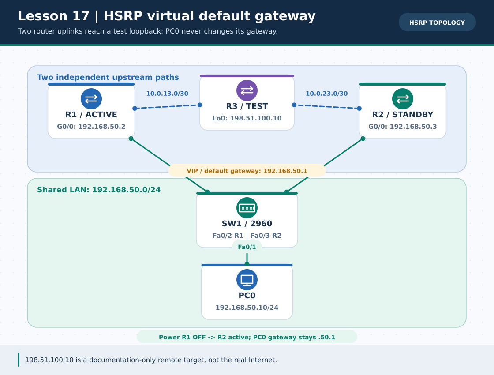
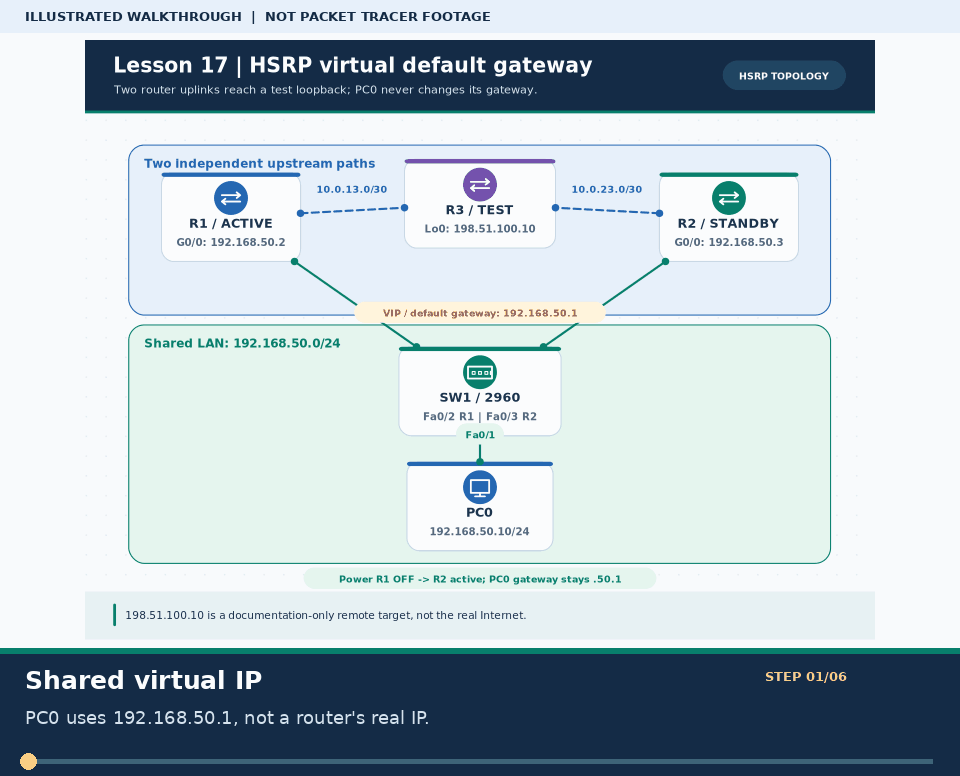
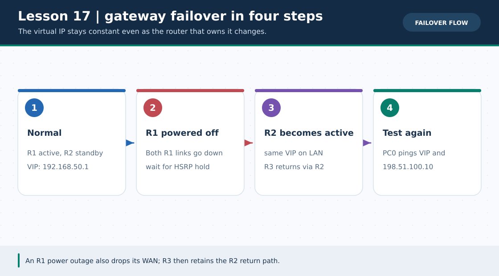

# লেসন ১৭ · HSRP: দুটি রাউটার, একটি Virtual Gateway

> 🌐 **English:** [Read this guide in English](../en/lessons/17-hsrp-gateway-redundancy.md) · [English track index](../en/README.md)

> **নেভিগেশন:** [⬅ লেসন ১৬](16-multilayer-switch-svi.md) · [➡ লেসন ১৮](18-ipv6-slaac-routing.md) · [📚 লেসন সূচি](README.md) · [🏠 হোম](../README.md) · [📖 CLI Cheat-Sheet](../reference/cli-command-cheatsheet.md)

| 🎯 লক্ষ্য | ⏱️ সময় | 📊 লেভেল | 🧰 প্রয়োজন |
| :--- | :--- | :--- | :--- |
| R1 বন্ধ হলে R2 একই virtual gateway নিয়ে remote test address-এ যোগাযোগ ফিরিয়ে আনা | ৫০–৬০ মিনিট | 🔴 Advanced | Packet Tracer-এ **নিজে বানাবে**; এই লেসনের `.pkt` এখনো নেই |

**Tags:** `#hsrp` `#gateway-redundancy` `#standby` `#virtual-ip` `#failover` `#ccna`

---

### 🖼️ ছবি ১: LAN-এর একই gateway, upstream-এর দুটি আলাদা পথ



> **ছবির সারকথা:** PC0 কখনো R1-এর `.50.2` বা R2-এর `.50.3` gateway হিসেবে লিখবে না—**VIP `192.168.50.1`** লিখবে। R1 এবং R2 উভয়েই একই SW1 LAN-এ আছে, এবং R3-তে যাওয়ার জন্য **আলাদা** WAN লিংক আছে। R3-এর `198.51.100.10` কেবল *ইন্টারনেট-সদৃশ পরীক্ষার ঠিকানা*; প্রকৃত ইন্টারনেট সংযোগ নয়। এটি আসল Packet Tracer screenshot নয়।



> 🎞️ **৩০ সেকেন্ডে মনে রাখো:** এটি উপরের ডায়াগ্রামের ওপর ভিত্তি করে বানানো ছয় ধাপের ভিজ্যুয়াল সারাংশ; বাস্তব Packet Tracer run, packet capture বা ফলের প্রমাণ নয়। [সব GIF-এর topic search name ও গুরুত্ব](../GIF-CATALOG.md) দেখো।


### 🖼️ ছবি ২: active router বন্ধ হলে কে দায়িত্ব নেয়



> **ছবির সারকথা:** Failover-এ PC-এর gateway IP বদলায় না; R2 **Active** হয়ে VIP-র উত্তর দেয়। কয়েকটি ping packet হারানো স্বাভাবিক। এটি gateway redundancy—একটি রাউটার বন্ধ হলেও পথ আছে; R3 বা LAN switch নষ্ট হলে এই নকশা নিজে থেকে বাঁচাবে না।

---

## 🏷️ শব্দকোষ

| শব্দ | অর্থ |
| :--- | :--- |
| **HSRP** | Hot Standby Router Protocol; একই LAN-এ একাধিক router একটি virtual default gateway দেয়। |
| **VIP** | Virtual IP; এই ল্যাবে `192.168.50.1`, PC0-এর একমাত্র default gateway। |
| **Active / Standby** | Active router VIP-র ট্রাফিক forward করে; standby তার ব্যর্থতার অপেক্ষায় থাকে। |
| **Priority / Preempt** | বেশি priority-র router Active হওয়ার যোগ্য; preempt থাকলে ভাল priority নিয়ে ফিরে এসে আবার Active হতে পারে। |
| **Interface tracking** | নিজের WAN link down হলে active router-এর priority কমানোর ঐচ্ছিক ব্যবস্থা; PT মডেলভেদে কমান্ড নাও থাকতে পারে। |

> **পূর্বশর্ত:** [লেসন ০২ · Static Routing](02-static-routing.md)। HSRP **gateway** বাঁচায়, upstream route নিজে তৈরি করে না। তাই এই উদাহরণে R3-তে দুইটি return route এবং R1/R2-তে default route রয়েছে।

## 🧩 তার, পোর্ট ও Addressing Table

**3 × Cisco 2911 routers** (`R1`, `R2`, `R3`), **1 × 2960** (`SW1`), **1 × PC** (`PC0`) নাও। PC0↔SW1 `Fa0/1`, SW1 `Fa0/2`↔R1 `G0/0`, SW1 `Fa0/3`↔R2 `G0/0` (একই VLAN 1); R1 `G0/1`↔R3 `G0/0`, R2 `G0/1`↔R3 `G0/1`। Packet Tracer-এর Automatic cable নির্বাচন করা যায়; প্রয়োজনমতো link light দেখে cable বদলাবে।

| ডিভাইস | ইন্টারফেস | IPv4/Mask | ভূমিকা |
| :--- | :--- | :--- | :--- |
| PC0 | `Fa0` | `192.168.50.10/24` | Default gateway **`192.168.50.1`** |
| R1 | `G0/0` | `192.168.50.2/24` | LAN · HSRP priority 120 |
| R2 | `G0/0` | `192.168.50.3/24` | LAN · HSRP priority 100 |
| R1 ↔ R3 | `G0/1` ↔ `G0/0` | `10.0.13.1/30` ↔ `10.0.13.2/30` | WAN path A |
| R2 ↔ R3 | `G0/1` ↔ `G0/1` | `10.0.23.1/30` ↔ `10.0.23.2/30` | WAN path B |
| R3 | `Loopback0` | `198.51.100.10/32` | দূরের *test target*, বাস্তব Internet নয় |

PC0-এর **Desktop → IP Configuration**-এ mask `255.255.255.0` ও gateway `192.168.50.1` বসাও। R3-এর `198.51.100.0/24` হলো documentation/test range; সত্যিকারের public Internet service ধরে নিও না।

## 🔧 Step 1 · R1: Active gateway ও default route

**শুধু R1-তে** পেস্ট করবে:

```cisco
enable
configure terminal
hostname R1
interface gigabitEthernet 0/0
 ip address 192.168.50.2 255.255.255.0
 standby 1 ip 192.168.50.1
 standby 1 priority 120
 standby 1 preempt
 no shutdown
exit
interface gigabitEthernet 0/1
 ip address 10.0.13.1 255.255.255.252
 no shutdown
exit
ip route 0.0.0.0 0.0.0.0 10.0.13.2
end
copy running-config startup-config
```

## 🔧 Step 2 · R2: Standby gateway ও বিকল্প default route

**শুধু R2-তে** পেস্ট করবে:

```cisco
enable
configure terminal
hostname R2
interface gigabitEthernet 0/0
 ip address 192.168.50.3 255.255.255.0
 standby 1 ip 192.168.50.1
 standby 1 priority 100
 standby 1 preempt
 no shutdown
exit
interface gigabitEthernet 0/1
 ip address 10.0.23.1 255.255.255.252
 no shutdown
exit
ip route 0.0.0.0 0.0.0.0 10.0.23.2
end
copy running-config startup-config
```

## 🔧 Step 3 · R3: test target ও দুইটি return path

**শুধু R3-তে** পেস্ট করবে:

```cisco
enable
configure terminal
hostname R3
interface gigabitEthernet 0/0
 ip address 10.0.13.2 255.255.255.252
 no shutdown
exit
interface gigabitEthernet 0/1
 ip address 10.0.23.2 255.255.255.252
 no shutdown
exit
interface loopback 0
 ip address 198.51.100.10 255.255.255.255
exit
ip route 192.168.50.0 255.255.255.0 10.0.13.1
ip route 192.168.50.0 255.255.255.0 10.0.23.1
end
copy running-config startup-config
```

> 🛠️ আলাদা ডিভাইসের CLI চাইলে `python3 scripts/ios_config_generator.py hsrp --role R1`, আবার `--role R2`, এবং `--role R3` চালাও। এক router-এর script অন্য router-এ পেস্ট করবে না।

## ✅ Step 4 · স্বাভাবিক অবস্থায় যাচাই

```cisco
R1# show standby brief
R2# show standby brief
R1# show ip route
R2# show ip route
R3# show ip route
```

R1-এ group 1 **Active**, R2-তে **Standby**, দুইটিতেই VIP `192.168.50.1` প্রত্যাশিত। R3-তে LAN `192.168.50.0/24`-এর দুইটি static next-hop দেখবে (platform output আলাদা হতে পারে)। PC0 Command Prompt-এ:

```text
ping 192.168.50.1
ping 198.51.100.10
```

প্রথম ping gateway, দ্বিতীয়টি **remote loopback**। প্রথম packet ARP/HSRP settle হওয়ার সময় হারাতে পারে; পুনরায় চালাও।

## 🔄 Step 5 · R1 সম্পূর্ণ বন্ধ করে failover পরীক্ষা

1. PC0-তে `ping 198.51.100.10` দিয়ে baseline সফল দেখো।
2. **Packet Tracer-এর R1 Physical tab-এ পাওয়ার OFF** করো (এটি R1-এর LAN *ও* WAN—দুই link-ই নামায়)। `G0/0`-ই শুধু `shutdown` করলে R3-এর R1-গামী return route তখনো সক্রিয় থেকে blackhole হতে পারে—এই ল্যাবের নির্ভরযোগ্য failover পরীক্ষা সেটি নয়।
3. HSRP hold timer ও link-state বদলানোর জন্য কয়েক সেকেন্ড অপেক্ষা করো; R2-তে `show standby brief` → **Active** হওয়ার কথা।
4. PC0-তে **গেটওয়ে না বদলে** আবার `ping 192.168.50.1` এবং `ping 198.51.100.10` দাও। R3-তে `show ip route 192.168.50.0` দেখো—R1-এর WAN link-down হলে তার next-hop route সরে যাওয়ার কথা; R2-পথ থাকবে।
5. R1 ON করো; `preempt` থাকলে R1 আবার Active হতে পারে। R1/R2 `show standby brief` মিলিয়ে দেখো।

> **দাবির সীমা:** আমরা এখানে **বাস্তব Internet**, NAT বা cloud simulate করছি না; R3 loopback-এর reachability দেখছি। R3, SW1 বা PC0-এর তার একক ব্যর্থতা হলে এই design যথেষ্ট নয়। Live Packet Tracer run এই রিপোতে সংরক্ষিত নেই—ফলগুলি নিজে মেপে দেখবে।

### ⭐ ঐচ্ছিক: শুধু R1-এর WAN `G0/1` নামিয়ে দেখবে?

যদি তোমার Packet Tracer/IOS model `standby 1 track` সমর্থন করে, **R1-এর LAN interface-এ** যোগ করো:

```cisco
R1# configure terminal
R1(config)# interface gigabitEthernet 0/0
R1(config-if)# standby 1 track gigabitEthernet 0/1 30
R1(config-if)# end
R1# show standby
```

R1-এর WAN link নেমে গেলে priority `120 - 30 = 90`, অর্থাৎ R2-এর `100`-এর নিচে; R2-তে `preempt` আছে বলে Active হতে পারে। WAN interface **up** থাকলেও R3-এর পরে outage ঘটলে এই *interface tracking* তা টের পায় না। `% Invalid input` দেখালে এই bonus বাদ দাও; main test-এ R1 সম্পূর্ণ OFF করো। WAN-only test শেষে `no shutdown` ও `show standby brief` দিয়ে ফিরিয়ে আনো।

## 🧯 ভুল হলে দ্রুত পরীক্ষা

| সমস্যা | কারণ / সমাধান |
| :--- | :--- |
| দুই router-এ `Active` | উভয়ের group `1`, VIP `.50.1`, LAN mask `/24`, SW1-এ একই VLAN, cable ও HSRP hello check। |
| VIP ping হয়, R3 loopback হয় না | R1/R2-তে default route ও R3-তে `192.168.50.0/24` return routes পরীক্ষা। |
| R1 OFF, R2-ও remote ping পায় না | R2 `G0/1 ↔ R3 G0/1` link, R3-এর R2-গামী route, `show ip route`, PC gateway দেখো। |
| R1 `G0/0`-ই বন্ধ, কিন্তু remote ping মাঝেমধ্যে ফেল | R3 এখনও R1-এর **সচল WAN**-এ return packet পাঠাতে পারে; R1 power OFF দিয়ে পরীক্ষা করো অথবা upstream routing redesign করো। |
| Failover অবিলম্বে হয় না | HSRP hello/hold timer অপেক্ষা করো; পিং সাময়িক হারানো মানেই ল্যাব ব্যর্থ নয়। |

## ☑️ নিজের চেকলিস্ট

- [ ] PC0-এর gateway VIP `.50.1` (কোনো physical router IP নয়)।
- [ ] R1 Active, R2 Standby; baseline remote ping সফল।
- [ ] R1 পুরোপুরি OFF → R2 Active → remote ping আবার সফল।
- [ ] R1 ON করার পর priority/preempt অনুযায়ী Active/Standby দেখা গেছে।

## ❓ অনুশীলন কুইজ

**প্রশ্ন ১.** PC0-এর default gateway কোনটি?

- **A.** `192.168.50.2`
- **B.** `192.168.50.3`
- **C.** `192.168.50.1`
- **D.** `10.0.13.2`

<details><summary>✅ উত্তর দেখো</summary>

**✅ উত্তর: C. `192.168.50.1`**
**🧠 কেন:** HSRP VIP একই থাকে; Active device পাল্টায় কিন্তু PC-তে নতুন gateway বসাতে হয় না।

</details>

**প্রশ্ন ২.** R1 power OFF করে R2 Active হলেও remote ping ফেল করছে। R3-তে কোন দিকটি বিশেষভাবে পরীক্ষা করবে?

- **A.** DNS A-record
- **B.** `192.168.50.0/24`-এর R2-গামী return route
- **C.** SW1-এর VLAN 20 trunk
- **D.** IPv6 OSPFv3 neighbor

<details><summary>✅ উত্তর দেখো</summary>

**✅ উত্তর: B. `192.168.50.0/24`-এর R2-গামী return route**
**🧠 কেন:** R3 থেকে PC0-এর reply R2 দিয়ে LAN-এ ফিরতে হবে; শুধু gateway failover যথেষ্ট নয়।

</details>

**প্রশ্ন ৩.** R1-এর শুধু WAN link down হলে `standby 1 track ... 30` কেন যোগ করা হয়?

- **A.** WAN-এর IP ৩০ বৃদ্ধি করতে
- **B.** R1 priority `120` থেকে `90` করে R2 (`100`) কে Active হতে দিতে
- **C.** PC0 gateway স্বয়ংক্রিয়ভাবে `.3` করতে
- **D.** R3-তে DHCP চালু করতে

<details><summary>✅ উত্তর দেখো</summary>

**✅ উত্তর: B. R1 priority `120` থেকে `90` করে R2 (`100`) কে Active হতে দিতে**
**🧠 কেন:** Interface tracking-এর ৩০ decrement R1-কে R2-এর নিচে নামায়; R2-তে preempt লাগবে। এটি ঐচ্ছিক, simulator-ভেদে অনুপস্থিত হতে পারে।

</details>

---

**এরপর:** [লেসন ১৮ · IPv6, SLAAC ও OSPFv3](18-ipv6-slaac-routing.md) · [Extra ০৮ · DHCP Snooping + DAI](../Extras/dhcp-snooping-dai-lab.md) · [Cisco · HSRP Priority/Preempt/Tracking](https://www.cisco.com/c/en/us/td/docs/switches/lan/catalyst9600/software/release/16-11/configuration_guide/ip/b_1611_ip_9600_cg/configuring___hsrp.html)
