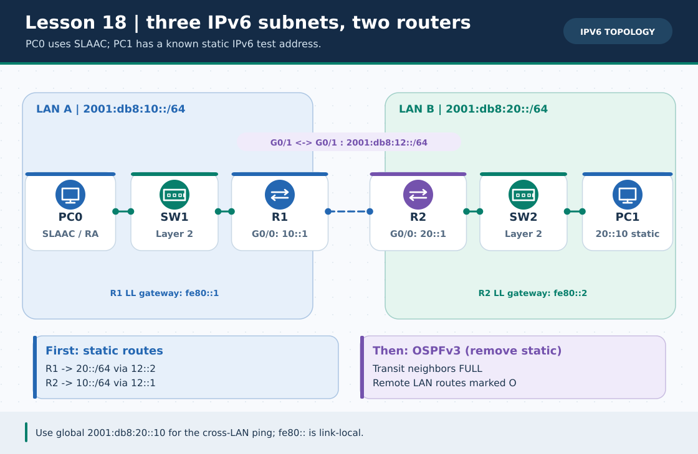
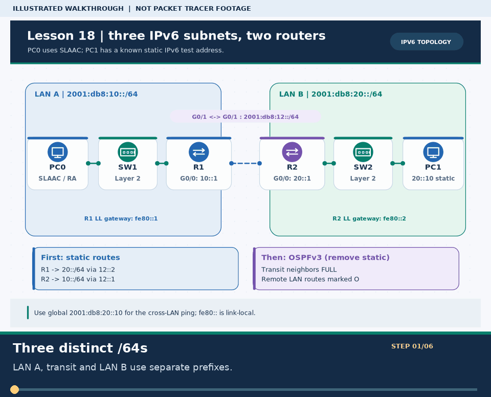
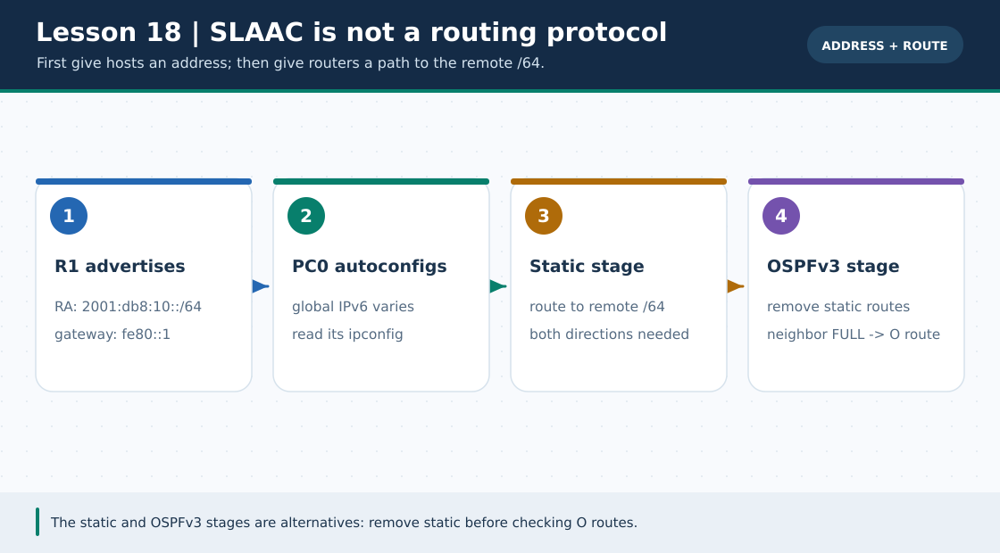

# লেসন ১৮ · IPv6, SLAAC, Static Routing ও OSPFv3

> 🌐 **English:** [Read this guide in English](../en/lessons/18-ipv6-slaac-routing.md) · [English track index](../en/README.md)

> **নেভিগেশন:** [⬅ লেসন ১৭](17-hsrp-gateway-redundancy.md) · [📚 লেসন সূচি](README.md) · [🏠 হোম](../README.md) · [📖 CLI Cheat-Sheet](../reference/cli-command-cheatsheet.md) · [🗺️ রোডম্যাপ](../ROADMAP.md)

| 🎯 লক্ষ্য | ⏱️ সময় | 📊 লেভেল | 🧰 প্রয়োজন |
| :--- | :--- | :--- | :--- |
| PC0 SLAAC-এ global IPv6 নিয়ে প্রথমে static, পরে **আলাদা ধাপে** OSPFv3 দিয়ে PC1-কে ping | ৫০–৬০ মিনিট | 🔴 Advanced | Packet Tracer-এ **নিজে বানাবে**; এই লেসনের `.pkt` এখনো নেই |

**Tags:** `#ipv6` `#slaac` `#router-advertisement` `#link-local` `#static-route` `#ospfv3` `#ccna`

---

### 🖼️ ছবি ১: তিনটি ভিন্ন /64; PC0 থেকে PC1-এর ঠিকানা জানা



> **ছবির সারকথা:** LAN A `2001:db8:10::/64`, WAN `2001:db8:12::/64`, LAN B `2001:db8:20::/64`—**একই /64 সব লিংকে বসাবে না**। PC0-এর SLAAC host অংশ রানভেদে আলাদা হবে; PC1-এর `2001:db8:20::10` স্থির, যাতে cross-LAN ping-এর গন্তব্য জানা থাকে। ছবিটি একটি শিক্ষামূলক ডায়াগ্রাম।



> 🎞️ **৩০ সেকেন্ডে মনে রাখো:** এটি উপরের ডায়াগ্রামের ওপর ভিত্তি করে বানানো ছয় ধাপের ভিজ্যুয়াল সারাংশ; বাস্তব Packet Tracer run, packet capture বা ফলের প্রমাণ নয়। [সব GIF-এর topic search name ও গুরুত্ব](../GIF-CATALOG.md) দেখো।


### 🖼️ ছবি ২: SLAAC এবং routing দুটি আলাদা কাজ



> **ছবির সারকথা:** RA পেয়ে host **নিজের ঠিকানা/gateway** শেখে; কিন্তু R1→R2 দূরের prefix কীভাবে পাবে তা রাউটারকে static route **অথবা** OSPFv3-এ আলাদাভাবে শিখতে হবে। `fe80::` gateway কেবল ঐ লিংকের জন্য; remote subnet-এ forward করা যায় না।

---

## 🏷️ ছোট শব্দকোষ

| শব্দ | সহজ অর্থ |
| :--- | :--- |
| **`2001:db8::/32`** | উদাহরণ/ডকুমেন্টেশনের জন্য নির্ধারিত IPv6 range; **বাস্তব Internet-এ route হবে না**। নিচে তিনটি আলাদা `/64` এই range থেকেই। |
| **Global unicast** | একাধিক network-এর মধ্যে route-যোগ্য IPv6 ঠিকানা; এখানে `2001:db8:...` কেবল ল্যাব-উদাহরণ। |
| **Link-local `fe80::/10`** | একই লিংকের প্রতিবেশীদের মধ্যে কাজ করে; router advertisement ও next-hop gateway-তে কাজে লাগে। |
| **SLAAC / RA** | Router Advertisement-এ prefix জানিয়ে host-কে নিজে IPv6 বানাতে সাহায্য করে; DNS সরবরাহের জন্য এখানে DHCPv6 নেই। |
| **OSPFv3** | IPv6 routes বিনিময়ের dynamic routing process; IPv4 OSPFv2-এর `network` syntax এখানে কপি করো না। |

## 🧩 ডিভাইস ও IP পরিকল্পনা

**2 × 2911 routers** (`R1`, `R2`), **2 × 2960 switches** (`SW1`, `SW2`), **2 × PC** (`PC0`, `PC1`)। তার বসাও: PC0 `Fa0` ↔ SW1 `Fa0/1`; SW1 `Fa0/2` ↔ R1 `G0/0`; R1 `G0/1` ↔ R2 `G0/1`; R2 `G0/0` ↔ SW2 `Fa0/2`; SW2 `Fa0/1` ↔ PC1 `Fa0`। Switch দুটিতে কোনো IPv6 CLI কনফিগ প্রয়োজন নেই। Router↔router-এ Packet Tracer Automatic cable ব্যবহার করতে পারো; link up কিনা নিশ্চিত হও।

| ডিভাইস | ইন্টারফেস | Global IPv6 | Link-local / Gateway |
| :--- | :--- | :--- | :--- |
| R1 | `G0/0` · LAN A | `2001:db8:10::1/64` | `fe80::1` (manual) |
| R1 | `G0/1` · transit | `2001:db8:12::1/64` | স্বয়ংক্রিয় link-local |
| R2 | `G0/1` · transit | `2001:db8:12::2/64` | স্বয়ংক্রিয় link-local |
| R2 | `G0/0` · LAN B | `2001:db8:20::1/64` | `fe80::2` (manual) |
| PC0 | LAN A | **Auto Config (SLAAC)**; `2001:db8:10::/64`-এর ভেতর | RA থেকে `fe80::1` |
| PC1 | LAN B | **Static** `2001:db8:20::10/64` | `fe80::2` |

PC0-তে **Desktop → IP Configuration → IPv6 Configuration → Auto Config** বেছে নাও। PC1-তে **Static**, `IPv6 Address 2001:db8:20::10`, `Prefix Length 64`, `Default Gateway fe80::2` বসাও। PC1-কে স্থির রেখেছি যাতে PC0 থেকে `ping 2001:db8:20::10` সব সময় একই test হয়।

## 🔧 ধাপ ১ · IPv6 forwarding ও interface ঠিকানা

**R1-এ:**

```cisco
enable
configure terminal
hostname R1
ipv6 unicast-routing
interface gigabitEthernet 0/0
 ipv6 address 2001:db8:10::1/64
 ipv6 address fe80::1 link-local
 no shutdown
exit
interface gigabitEthernet 0/1
 ipv6 address 2001:db8:12::1/64
 no shutdown
exit
end
copy running-config startup-config
```

**R2-এ:**

```cisco
enable
configure terminal
hostname R2
ipv6 unicast-routing
interface gigabitEthernet 0/0
 ipv6 address 2001:db8:20::1/64
 ipv6 address fe80::2 link-local
 no shutdown
exit
interface gigabitEthernet 0/1
 ipv6 address 2001:db8:12::2/64
 no shutdown
exit
end
copy running-config startup-config
```

**এখন পরীক্ষা:** R1-এ `show ipv6 interface brief`, R2-এ `ping 2001:db8:12::1`, PC0-তে `ipconfig` → global `2001:db8:10:...` এবং gateway `fe80::1` দেখো। PC0-তে `ping 2001:db8:10::1` সফল হওয়ার কথা। Router যদি RA না পাঠায়, `ipv6 unicast-routing`, interface `up/up` এবং PC0 **Auto Config** আছে কি না দেখো। *SLAAC নিজের LAN ঠিক করে, দূরের LAN-এ route দেয় না।*

## 🧭 ধাপ ২ · IPv6 Static Route (প্রথম round)

**R1-এ:**

```cisco
configure terminal
ipv6 route 2001:db8:20::/64 2001:db8:12::2
end
show ipv6 route
```

**R2-এ return path:**

```cisco
configure terminal
ipv6 route 2001:db8:10::/64 2001:db8:12::1
end
show ipv6 route
```

`S 2001:db8:20::/64` R1-এ ও `S 2001:db8:10::/64` R2-এ দেখো। PC0 থেকে `ping 2001:db8:20::10`; PC1 থেকে `ping <PC0-এর ipconfig-এ দেখা global IPv6>`। **PC0-এর SLAAC ঠিকানাটি মুখস্থ `.10` ধরে লিখবে না**—নিজে পড়ে নেবে। প্রথম কয়েকটি ping Neighbor Discovery শেখার সময় timeout হতে পারে; আবার দাও।

## 🔄 ধাপ ৩ · Static সরিয়ে OSPFv3 (দ্বিতীয় round)

> ⚠️ **একই lab-এর আলাদা পর্যায়:** OSPFv3 route পরীক্ষা করার আগে static routes **দুই router থেকেই সরাও**। না হলে static route-এর administrative distance কম হওয়ায় route table-এ `S`-ই দেখা যেতে পারে, OSPF কাজ করলেও বোঝা যাবে না। এই Packet Tracer অনুশীলনে classic `ipv6 router ospf` + interface-level `ipv6 ospf ... area 0` syntax ব্যবহার করা হচ্ছে; নতুন IOS-এর `router ospfv3` address-family syntax-এর সাথে একসাথে মেশাবে না।

**R1-এ:**

```cisco
configure terminal
no ipv6 route 2001:db8:20::/64 2001:db8:12::2
ipv6 router ospf 10
 router-id 1.1.1.1
exit
interface gigabitEthernet 0/0
 ipv6 ospf 10 area 0
exit
interface gigabitEthernet 0/1
 ipv6 ospf 10 area 0
exit
end
copy running-config startup-config
```

**R2-এ:**

```cisco
configure terminal
no ipv6 route 2001:db8:10::/64 2001:db8:12::1
ipv6 router ospf 10
 router-id 2.2.2.2
exit
interface gigabitEthernet 0/0
 ipv6 ospf 10 area 0
exit
interface gigabitEthernet 0/1
 ipv6 ospf 10 area 0
exit
end
copy running-config startup-config
```

Router-ID `1.1.1.1`/`2.2.2.2` দেখতে IPv4-এর মতো হলেও এটি **32-bit OSPF identifier**, এই ল্যাবে IPv4 transport address নয়। R1 ও R2-এর process ID `10` এখানে একই রাখা সহজ; neighbor হওয়ার জন্য area ও link-এর সেটিং বেশি গুরুত্বপূর্ণ।

```cisco
R1# show ipv6 ospf neighbor
R1# show ipv6 route
R2# show ipv6 ospf neighbor
R2# show ipv6 route
```

Transit `G0/1`-এ প্রতিবেশী `FULL` এবং R1-এ `O 2001:db8:20::/64`, R2-এ `O 2001:db8:10::/64` প্রত্যাশিত। `show ipv6 route ospf` মডেল সমর্থন করলে আরও সংক্ষিপ্ত দেখা যায়; না হলে পূর্ণ `show ipv6 route`-ই ব্যবহার করো। তারপর PC0→PC1 `ping 2001:db8:20::10` আবার চালাও।

> 🛠️ ডিভাইসভিত্তিক নমুনা: `python3 scripts/ios_config_generator.py ipv6-static --role R1` / `--role R2`; static stage শেষ হলে `python3 scripts/ios_config_generator.py ospfv3 --role R1` / `--role R2`। প্রতিটি output **নির্দিষ্ট router-এ** পেস্ট করবে।

## 🧯 সমস্যার সূত্র

| উপসর্গ | কী দেখবে / কী ঠিক করবে |
| :--- | :--- |
| PC0 `fe80::` পায় কিন্তু global পায় না | R1 `ipv6 unicast-routing`, G0/0 up/up, `2001:db8:10::1/64`, PC0 **Auto Config** এবং RA আসার সময় দেখো। |
| নিজের gateway ping চলে; remote fail | দুই দিকের static route বা OSPF-learned `O` route, PC1 `fe80::2` gateway ও transit interface পরীক্ষা। |
| OSPF neighbor নেই | R1/R2 G0/1 `2001:db8:12::/64`, একই area 0, OSPFv3 enable, router-id **ভিন্ন** এবং link `up/up`? |
| OSPF neighbor FULL, কিন্তু route `S` | ধাপ ২-এর static route এখনো আছে; দুই router থেকে `no ipv6 route ...` চালাও। |
| `ipv6 ospf` কমান্ড নেই | Packet Tracer-এর router model/IOS emulator version পরীক্ষা; অসমর্থিত হলে static-routing পর্যন্ত সম্পন্ন করো, OSPFv3-র ফল দাবি করো না। |
| Link-local দিয়ে দূরের PC ping ব্যর্থ | `fe80::/10` **লিংক-পার্শ্বে সীমিত**; দূরের PC-এর **global** `2001:db8:...` ঠিকানা ব্যবহার করো। |

## ☑️ নিজের চেকলিস্ট

- [ ] PC0 SLAAC-এ `2001:db8:10::/64`-এর global IPv6 এবং `fe80::1` gateway পেয়েছে।
- [ ] PC1 static `2001:db8:20::10/64` + gateway `fe80::2`।
- [ ] Static stage-এ দুদিকের `S` route ও PC0↔PC1 ping।
- [ ] Static সরিয়ে OSPFv3 `FULL` এবং দুদিকের `O` route; ping আবার সফল।

## ❓ অনুশীলন কুইজ

**প্রশ্ন ১.** PC0 SLAAC-এ LAN-এর IPv6 prefix কীভাবে জানে?

- **A.** IPv4 DHCP Offer থেকে
- **B.** R1-এর Router Advertisement (RA) থেকে
- **C.** OSPFv3 neighbor থেকে
- **D.** SW1-এর MAC table থেকে

<details><summary>✅ উত্তর দেখো</summary>

**✅ উত্তর: B. R1-এর Router Advertisement (RA) থেকে**
**🧠 কেন:** `ipv6 unicast-routing` চালু থাকলে router RA পাঠায়; host prefix নিয়ে নিজে global IPv6 তৈরি করে।

</details>

**প্রশ্ন ২.** `fe80::1`-কে দূরের LAN B-তে internet-routable ঠিকানা ধরা যাবে?

- **A.** হ্যাঁ, এটি global unicast
- **B.** হ্যাঁ, শুধু OSPFv3 চালু করলেই
- **C.** না, এটি link-local; LAN A-তেই সীমিত
- **D.** কেবল IPv4 NAT থাকলে

<details><summary>✅ উত্তর দেখো</summary>

**✅ উত্তর: C. না, এটি link-local; LAN A-তেই সীমিত**
**🧠 কেন:** Link-local address একই local link-এ neighbor/gateway যোগাযোগে ব্যবহৃত হয়; remote destination হিসেবে global IPv6 দরকার।

</details>

**প্রশ্ন ৩.** OSPFv3 neighbor FULL, তবু `show ipv6 route`-এ remote LAN-এ `S` দেখায় কেন?

- **A.** Static route এখনো আছে এবং administrative distance কম
- **B.** RA বন্ধ আছে
- **C.** `fe80::` সব জায়গায় এক
- **D.** 2960 switch-এ trunk নেই

<details><summary>✅ উত্তর দেখো</summary>

**✅ উত্তর: A. Static route এখনো আছে এবং administrative distance কম**
**🧠 কেন:** Static route সরিয়ে আবার `show ipv6 route`-এ OSPFv3 `O` দেখলেই dynamic-routing stage আলাদাভাবে প্রমাণিত হবে।

</details>

---

**আরও পড়ো:** [RFC 3849 · IPv6 Documentation Prefix](https://www.rfc-editor.org/rfc/rfc3849) · [Cisco · OSPFv3 কনফিগারেশন উদাহরণ](https://www.cisco.com/c/en/us/support/docs/ip/ip-version-6-ipv6/112100-ospfv3-config-guide.html) · [লেসন ১৩ · OSPFv2-এর তুলনা](13-dynamic-routing-ospf.md) · [Extra ০৭ · IP Telephony](../Extras/voip-ip-telephony-lab.md)
