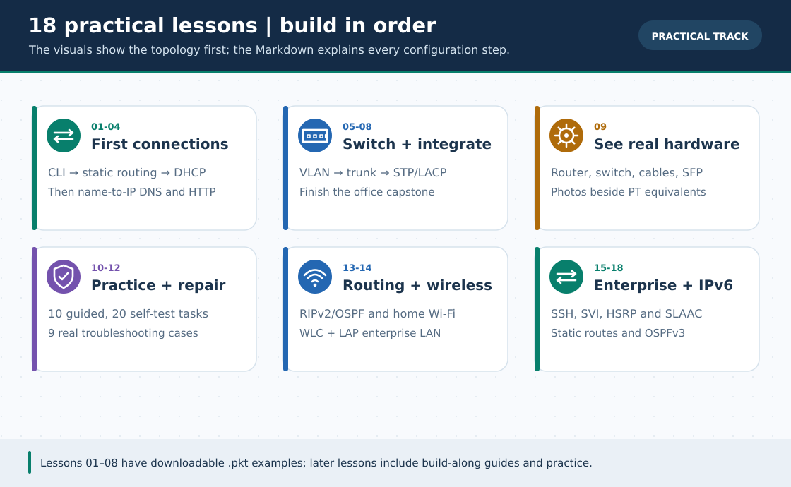

# 📚 হাতে-কলমে কোর্স — ১৮টি সিরিয়াল লেসন (Practical Track · v3.5)

> **নেভিগেশন:** [🏠 রেপো হোম](../README.md) · [🎓 CCNA Fundamentals](../ccna-fundamentals/README.md) · [📦 Extra Labs](../Extras/README.md) · [📖 CLI Cheat-Sheet](../reference/cli-command-cheatsheet.md) · [🗺️ রোডম্যাপ](../ROADMAP.md)

এই ফোল্ডারে রয়েছে **EBAUB — Computer Networking Lab** ও **CCNA Practical** প্রস্তুতির **১৮টি ধারাবাহিক লেসন**। প্রথম CLI থেকে অফিস নেটওয়ার্ক প্রজেক্ট, OSPF/WLC/SSH, তারপর **L3 SVI, HSRP ও IPv6/OSPFv3** পর্যন্ত হাতে-কলমে শেখো। প্রতিটি লেসনে **বাংলা ব্যাখ্যাসহ লোকাল SVG + নিজস্ব ৩০-সেকেন্ড GIF** আছে; [English practical track](../en/lessons/README.md)-এ ১৮টি বিষয়ের English adaptation। [GIF topic search names/গুরুত্ব](../GIF-CATALOG.md)-ও দেওয়া আছে। GIF বাস্তব PT recording নয়। লেসন ১৬–১৮-এর `.pkt` এখনো নেই: ছবির পোর্ট/IP দেখে Packet Tracer-এ নিজে build করবে।

---

### 🖼️ চিত্রে বোঝো: ১৮টি প্র্যাকটিক্যাল লেসনের ভিজ্যুয়াল ম্যাপ

> **ছবির সারকথা:** CLI দিয়ে শুরু করে OSPF/WLC/SSH-এর পরে L3 switch SVI, HSRP failover ও IPv6 routing-এ যাও।

---

## 🗺️ প্রতিটি লেসনের গঠন

> 🧠 **ধারণা + শব্দকোষ** → 🧩 **ধাপে-ধাপে ল্যাব** → 🔍 **ভেরিফিকেশন (`show`/`ping`)** → 🔁 **প্যাকেট ফ্লো লজিক** → ❌ **ট্রাবলশুটিং** → ✅ **চেকলিস্ট**

---

## 📋 লেসন সূচি ও প্রোগ্রেস ট্র্যাকার

| # | লেসন | সময় | লেভেল | সংযুক্ত `.pkt` ফাইল |
| :---: | :--- | :---: | :---: | :--- |
| **০১** | [🖥️ Router CLI Basics ও প্রথম ল্যাব](01-router-cli-basics.md) | ~৪৫ মি. | 🟢 Beginner | [`lesson-01-router-cli-basics.pkt`](../pkt-files/labs/lesson-01-router-cli-basics.pkt) |
| **০২** | [🛣️ Two Routers + Static Routing](02-static-routing.md) | ~৫০ মি. | 🟢 Beginner | [`lesson-02-static-routing.pkt`](../pkt-files/labs/lesson-02-static-routing.pkt) |
| **০৩** | [🎫 Router DHCP Configuration](03-dhcp.md) | ~৪০ মি. | 🟢 Beginner | [`lesson-03-dhcp.pkt`](../pkt-files/labs/lesson-03-dhcp.pkt) |
| **০৪** | [🌍 DNS Server ও HTTP Web Server](04-dns-http-server.md) | ~৫০ মি. | 🟡 Beg–Int | [`lesson-04-dns-http-server.pkt`](../pkt-files/labs/lesson-04-dns-http-server.pkt) |
| **০৫** | [🔀 VLAN Configuration ও Isolation](05-vlan.md) | ~৪৫ মি. | 🟡 Intermediate | [`lesson-05-vlan.pkt`](../pkt-files/labs/lesson-05-vlan.pkt) |
| **০৬** | [🔗 Trunk Link ও Inter-VLAN Routing](06-trunk-inter-vlan.md) | ~৬০ মি. | 🟡 Intermediate | [`lesson-06-trunk-inter-vlan.pkt`](../pkt-files/labs/lesson-06-trunk-inter-vlan.pkt) |
| **০৭** | [⚡ Switching: STP · Port Security · EtherChannel](07-switching.md) | ~৬০ মি. | 🟠 Int–Adv | [`lesson-07-switching.pkt`](../pkt-files/labs/lesson-07-switching.pkt) |
| **০৮** | [🎓 Final Project — সম্পূর্ণ অফিস নেটওয়ার্ক](08-final-project.md) | ~৯০ মি. | 🔴 Advanced | [`lesson-08-final-project.pkt`](../pkt-files/labs/lesson-08-final-project.pkt) |
| **০৯** | [📷 Real Network Hardware Guide](09-real-hardware.md) | ~২৫ মি. | 🟢 সবার জন্য | *ছবিসহ গাইড (প্রয়োজন নেই)* |
| **১০** | [🧪 Practice Lab (১০টি টাস্ক — সমাধানসহ)](10-practice-lab.md) | ~২–৩ ঘণ্টা | 🟢→🟠 | *নিজে তৈরি করবে* |
| **১১** | [📝 Practice List (২০টি টাস্ক — সমাধান ছাড়া)](11-practice-list.md) | নিজের গতিতে | 🟢→🔴 | *নিজে তৈরি করবে* |
| **১২** | [🛠️ Problem Solve — ৯টি বাস্তব ট্রাবলশুটিং ব্যাংক](12-problem-solve.md) | ~১৫ মি./সমস্যা | 🟢→🔴 | [🕵️ Broken Labs](../Extras/broken-labs-challenge.md) |
| **১৩** | [🧭 Dynamic Routing — RIPv2 ও Single-Area OSPF](13-dynamic-routing-ospf.md) | ~৬৫ মি. | 🟠 Intermediate | *ত্রিভুজ Failover ল্যাব* |
| **১৪** | [📡 Wireless LAN — Home Wi-Fi ও Enterprise WLC](14-wireless-lan.md) | ~৫৫ মি. | 🟡→🟠 | *WRT300N + WLC-2504* |
| **১৫** | [🔐 SSH Remote Access, Hardening, NTP ও Syslog](15-ssh-syslog-ntp.md) | ~৫০ মি. | 🟠 Intermediate | *RSA + NTP + Syslog; নিজে বানাবে* |
| **১৬** | [🔀 Multilayer Switch · VLAN 10/20 SVI Routing](16-multilayer-switch-svi.md) `🆕 v3.0` | ~৪০ মি. | 🟠 Intermediate | *দুটি SVG + CLI; `.pkt` নেই* |
| **১৭** | [🔄 HSRP Virtual Gateway ও Router Failover](17-hsrp-gateway-redundancy.md) `🆕 v3.0` | ~৬০ মি. | 🔴 Advanced | *দুটি SVG + CLI; `.pkt` নেই* |
| **১৮** | [🌐 IPv6, SLAAC, Static Routing ও OSPFv3](18-ipv6-slaac-routing.md) `🆕 v3.0` | ~৬০ মি. | 🔴 Advanced | *দুটি SVG + CLI; `.pkt` নেই* |

---

## ✅ নিজের অগ্রগতি টিক দাও

- [ ] লেসন ০১ — Router CLI Basics ও প্রথম Ping Lab
- [ ] লেসন ০২ — Two Routers + Static Routing
- [ ] লেসন ০৩ — Router DHCP Configuration
- [ ] লেসন ০৪ — DNS Server ও HTTP Web Server
- [ ] লেসন ০৫ — VLAN Configuration ও Isolation
- [ ] লেসন ০৬ — Trunk Link ও Inter-VLAN Routing
- [ ] লেসন ০৭ — STP, Port Security ও EtherChannel
- [ ] লেসন ০৮ — Final Project (সম্পূর্ণ অফিস নেটওয়ার্ক)
- [ ] লেসন ০৯ — Real Network Hardware ও Datacenter Rack পরিচিতি
- [ ] লেসন ১০ — Practice Lab (১০/১০ টাস্ক সম্পন্ন)
- [ ] লেসন ১১ — Practice List (২০/২০ টাস্ক সম্পন্ন)
- [ ] লেসন ১২ — Problem Solve Bank (সব ৯টি ট্রাবলশুটিং কেস সমাধান)
- [ ] লেসন ১৩ — Dynamic Routing: RIPv2 ও Single-Area OSPF (কেবল কেটে Failover সহ)
- [ ] লেসন ১৪ — Wireless LAN: WRT300N ও Cisco WLC-2504 + Lightweight AP
- [ ] লেসন ১৫ — SSHv2 রিমোট অ্যাক্সেস, Device Hardening, NTP ও Syslog সার্ভার
- [ ] লেসন ১৬ — 3560-এ SVI10/20 `up/up` ও PC0→PC2 inter-VLAN ping
- [ ] লেসন ১৭ — HSRP R1 Active→R2 Active এবং একই VIP রেখে remote target ping
- [ ] লেসন ১৮ — PC0 SLAAC, IPv6 static stage ও আলাদা OSPFv3 stage-এর `O` route

---

> **নেভিগেশন:** [🏠 রেপো হোম](../README.md) · [🎓 CCNA Fundamentals](../ccna-fundamentals/README.md) · [📦 Extra Labs](../Extras/README.md) · [📖 CLI Cheat-Sheet](../reference/cli-command-cheatsheet.md)
