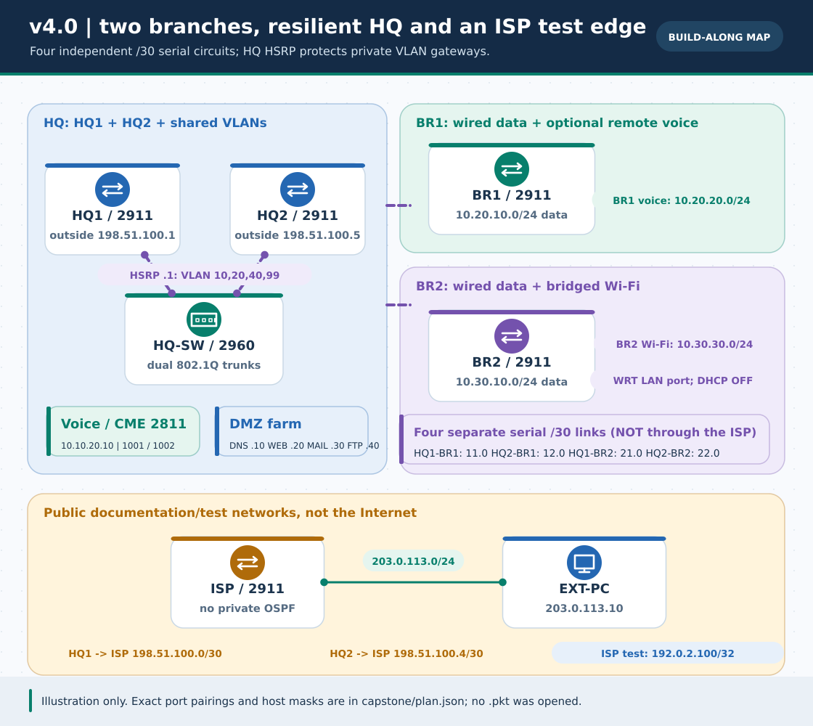

# 📦 Phase 5 v4.0 — নিজের Packet Tracer প্রকল্প রাখার জায়গা

> **নেভিগেশন:** [🏆 বাংলা build-along](../../capstone/README.md) · [🌐 English guide](../../en/capstone/README.md) · [🧪 Test worksheet](../../capstone/VERIFICATION.md) · [সব `.pkt` ফাইল](../README.md) · [হোম](../../README.md)

**এখানে এখন নতুন `.pkt` নেই।** পুরনো ১৮টি native `.pkt` অপরিবর্তিত; এই ফেজে [`capstone/plan.json`](../../capstone/plan.json), [৯টি পৃথক IOS text snippet](../../capstone/README.md), topology SVG ও **খালি** test worksheet দিয়েছি। Cisco Packet Tracer এখানে চালানো যায়নি; কেবল `.txt`-কে `.pkt` নামে বদলে দিলে চলার মতো ল্যাব হয় না।

## আপনি চেষ্টা করলে কীভাবে বানাবেন

1. নিজের Packet Tracer-এ [বাংলা](../../capstone/README.md) বা [English](../../en/capstone/README.md) build order মেনে HQ, দুই branch, ISP, চার DMZ server ও CME/phone/AP যোগ করুন। HWIC-2T port label, DCE side ও VLAN switchport-গুলি **নিজের PT সংস্করণে** মিলিয়ে নিন।
2. এক role-এ এক config: [`HQ1`](../../capstone/configs/HQ1.txt), [`HQ2`](../../capstone/configs/HQ2.txt), [`BR1`](../../capstone/configs/BR1.txt), [`BR2`](../../capstone/configs/BR2.txt), [`ISP`](../../capstone/configs/ISP.txt), [`HQ-SW`](../../capstone/configs/HQ-SW.txt), [`BR1-SW`](../../capstone/configs/BR1-SW.txt), [`BR2-SW`](../../capstone/configs/BR2-SW.txt), [`CME`](../../capstone/configs/CME.txt)। Server-PT/WRT/PC GUI values গাইড ও [`plan.json`](../../capstone/plan.json)-এ।
3. প্রথমে Packet Tracer-এ **File → Save As** করে নিজের working file রাখুন, যেমন `enterprise-hq-two-branches-v4.pkt`। নাম উল্লেখ করলেই এই রেপোতে ফাইল তৈরি হয় না। Configuration বদলালে আবার Save করুন।
4. [Verification worksheet](../../capstone/VERIFICATION.md)-এর N01–N20 এবং F01–F08-এ actual command/UI result, PT version ও fail/unsupported অবস্থা লিখুন। HQ1 **সম্পূর্ণ power OFF** করে তারপর failover পরীক্ষা করুন। সব ফল সফল না হলে সফল বলে টিক দেবেন না।
5. চাইলে আসল `.pkt` এই ফোল্ডারে কপি/আপলোড করুন এবং এই README-তে প্রকৃত file link, PT সংস্করণ, কিসে সাফল্য/ব্যর্থতা হয়েছে, আর worksheet-এর evidence যোগ করুন। আপনার অনুমতি ছাড়া অন্যের `.pkt` বা গোপন credential প্রকাশ করবেন না।

**Known limitations:** নতুন build-along-এর Cisco IOS/GUI কনফিগ এখানে execution-verified নয়। ব্রাঞ্চ ফোনের remote CME registration ও public TCP/80 mapping বিশেষ করে আপনার simulator-এ মেপে দেখতে হবে। `.pkt` তৈরি করতে না পারলেও গাইড/CLI/খালি worksheet দিয়ে অধ্যায়গুলো আলাদা করে অনুশীলন করা যায়। পুরনো ল্যাব দেখতে [existing Packet Tracer files](../README.md)।
