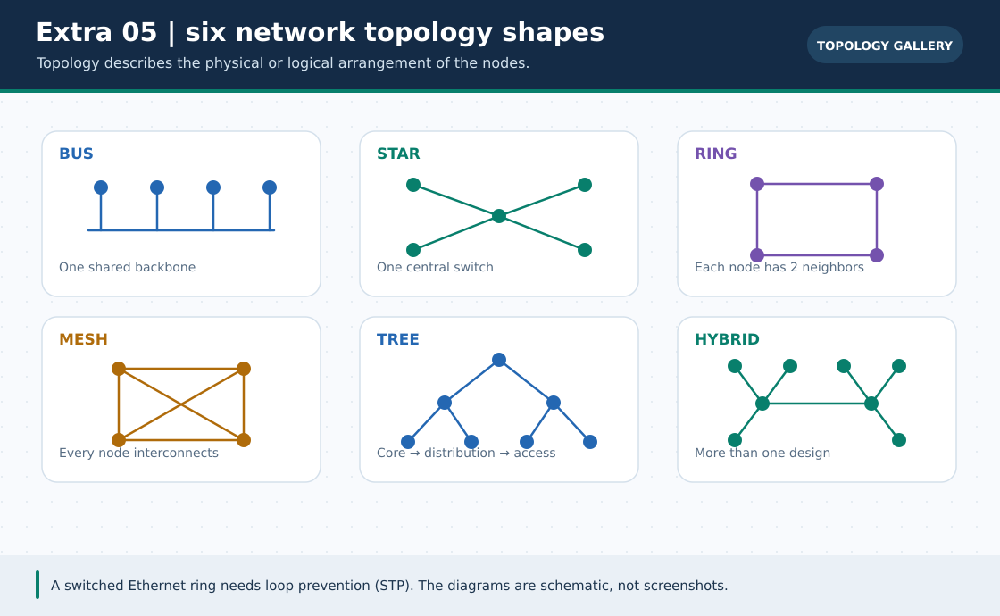

# 🕸️ 6 Existing Packet Tracer Topology Projects

> **নেভিগেশন:** [🏠 হোম](../../README.md) · [📦 .pkt ইনডেক্স](../README.md) · [বাংলা গাইড](../../Extras/network-topologies-lab.md) · [English guide](../../en/Extras/network-topologies-lab.md)

এগুলো **পূর্ব থেকেই থাকা ৬টি native `.pkt` উদাহরণ**। একটি ছবিতে তারের বিন্যাস বোঝা যায়, কিন্তু প্যাকেটের আচরণ বুঝতে প্রতিটি ফাইল Packet Tracer-এ নিজে খুলে **Simulation Mode** চালাতে হবে। ছবি/GIF-কে verified simulator recording মনে কোরো না।

| প্যাটার্ন | ফাইল | কী যাচাই করবে |
| :--- | :--- | :--- |
| Bus | [`bus-topology.pkt`](bus-topology.pkt) | আধুনিক Ethernet simulation-এর সীমা ও shared-path ধারণা। |
| Star | [`star-topology.pkt`](star-topology.pkt) | কেন্দ্রীয় ডিভাইস বা লিংক বন্ধ হলে প্রভাব। |
| Ring | [`ring-topology.pkt`](ring-topology.pkt) | রিং-এর পথ, failure ও বাস্তব protocol behavior। |
| Mesh | [`mesh-topology.pkt`](mesh-topology.pkt) | `N(N−1)/2` কেবল এবং বিকল্প পথ। |
| Tree | [`tree-topology.pkt`](tree-topology.pkt) | স্তরভিত্তিক hierarchy ও uplink। |
| Hybrid | [`hybrid-topology.pkt`](hybrid-topology.pkt) | একাধিক pattern মেশালে কোন অংশের আচরণ কী। |

**৩০ সেকেন্ডের conceptual GIF:** [Topologies walkthrough](../../assets/gifs/extra-05-network-topologies-lab.gif) · [সব GIF-এর topic search name ও গুরুত্ব](../../GIF-CATALOG.md)।

> [মূল গাইডে ফিরে যান](../../Extras/network-topologies-lab.md) · [English companion](../../en/Extras/network-topologies-lab.md)
