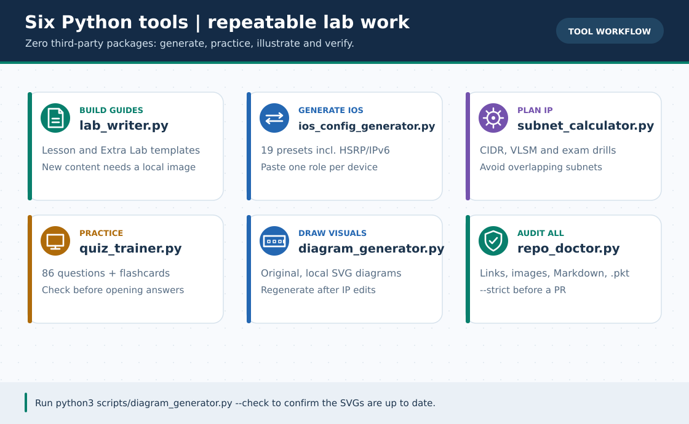

# 🛠️ Automation & Helper Scripts (`scripts/`)

> **নেভিগেশন:** [🏠 রেপো হোম](../README.md) · [📚 মূল লেসন](../lessons/README.md) · [🎓 CCNA Fundamentals](../ccna-fundamentals/README.md) · [📖 CLI Cheat-Sheet](../reference/cli-command-cheatsheet.md) · [🗺️ রোডম্যাপ](../ROADMAP.md)

এই ফোল্ডারে **১০টি Python script**: আগের ছয়টি CLI/SVG/audit টুল, v3.5-এর English/GIF/portal-সংক্রান্ত তিনটি এবং v4.0-এর **[capstone config/SVG generator](capstone_config_generator.py)**। v4 tool [`plan.json`](../capstone/plan.json) যাচাই করে নয়টি আলাদা device snippet ও দুটি চিত্র বানায়; **Cisco IOS/PT চালায় না, `.pkt` তৈরি করে না।**

> 💡 **প্রয়োজনীয়তা:** আগের ৬টি এবং v4 capstone script `Python 3.10+` standard library-তে চলে। English/GIF/portal tooling ও MkDocs build-এর জন্য **Python 3.11+** এবং [ঐচ্ছিক `requirements-docs.txt`](../requirements-docs.txt) ইন্সটল করো।

---

### 🖼️ চিত্রে বোঝো: ছয়টি Python টুল কখন ব্যবহার করবে



> **ছবির সারকথা:** নতুন লেসন লেখা, IOS কনফিগ, Subnet হিসাব, Quiz, ডায়াগ্রাম তৈরি ও অডিট।

---

## 📋 স্ক্রিপ্ট তালিকা (এক নজরে)

| স্ক্রিপ্ট ফাইল | কার জন্য | মূল কাজ |
| :--- | :---: | :--- |
| [`lab_writer.py`](lab_writer.py) | ✍️ লেখক / কন্ট্রিবিউটর | রেপোর হুবহু স্টাইলে নতুন **Lesson**, **Extra Lab**, বা **Problem Solve** মার্কডাউন তৈরি করে |
| [`ios_config_generator.py`](ios_config_generator.py) | 👨‍🎓 শিক্ষার্থী / ল্যাব | রাউটার/সুইচের রেডিমেড **Cisco IOS CLI কমান্ড** (বাংলা কমেন্টসহ) জেনারেট করে |
| [`subnet_calculator.py`](subnet_calculator.py) | 🧮 শিক্ষার্থী / পরীক্ষা | **IPv4 Subnetting**, **VLSM Address Plan** টেবিল এবং **Exam Drill** প্রশ্ন তৈরি করে |
| [`quiz_trainer.py`](quiz_trainer.py) | 🎯 শিক্ষার্থী | CCNA + Practical মিলে **৮৬টি প্রশ্ন** (৭৯টি MCQ + ৭টি উন্মুক্ত) এবং **২২টি Cisco CLI ফ্ল্যাশকার্ড** অনুশীলন করায় |
| [`diagram_generator.py`](diagram_generator.py) | 🖼️ শিক্ষার্থী / লেখক | আগের **৫৬টি** আসল SVG টপোলজি ও কনসেপ্ট ডায়াগ্রাম তৈরি/পরীক্ষা করে |
| [`repo_doctor.py`](repo_doctor.py) | 🩺 মেইনটেইনার / CI | ব্রোকেন লিংক, ছবির ফরম্যাট, সব `.md`-তে ছবি আছে কি না, `.pkt` নামকরণ ও মার্কডাউন স্বাস্থ্য পরীক্ষা করে |
| [`english_track_generator.py`](english_track_generator.py) | 🌐 লেখক / CI | [`en/*.yml`](../en/README.md)-এর হাতে-লেখা English prose থেকে ৩৫টি গাইড তৈরি ও `--check` করে |
| [`gif_walkthrough_generator.py`](gif_walkthrough_generator.py) | 🎞️ ভিজ্যুয়াল / CI | মূল SVG থেকে ২৬টি **৩০-সেকেন্ড conceptual GIF** তৈরি; `--check`-এ hash, source, frame, duration দেখে |
| [`portal_docs.py`](portal_docs.py) | 🖥️ ওয়েব / CI | রিপোর public content `build/docs/`-এ stage করে; [MkDocs](../mkdocs.yml) static site `build/site/`-এ বানায় |
| [`capstone_config_generator.py`](capstone_config_generator.py) | 🏆 v4 build / CI | [`plan.json`](../capstone/plan.json)-এর চার WAN/দুই ISP link validate করে ৯টি role config text + ২টি conceptual SVG generate/check; **PT run নয়** |

---

## 🚀 কীভাবে চালাবে (কপি-পেস্ট উদাহরণ)

### ১. 🧮 `subnet_calculator.py` — Subnetting, VLSM ও প্র্যাকটিস ড্রিল

```bash
# যেকোনো IP/CIDR-এর পূর্ণ বিশ্লেষণ (Network, Broadcast, Usable Range, Wildcard, Binary)
python3 scripts/subnet_calculator.py 192.168.1.65/26

# একটি /24 নেটওয়ার্ককে সমান /26 সাবনেটে ভাগ করা
python3 scripts/subnet_calculator.py --split 192.168.1.0/24 --new-prefix 26

# VLSM অটো-প্ল্যানার (বড় বিভাগ থেকে ছোট ক্রমে সাজিয়ে Markdown Table বানিয়ে দেবে!)
python3 scripts/subnet_calculator.py --vlsm 192.168.10.0/24 --departments "CSE:55,EEE:25,Admin:10,WAN:2"

# পরীক্ষার প্রস্তুতির জন্য ৫টি র‍্যান্ডম Subnetting প্রশ্ন ও উত্তর তৈরি
python3 scripts/subnet_calculator.py --drill 5
```

---

### ২. ⚡ `ios_config_generator.py` — Cisco IOS CLI কমান্ড রাইটার

```bash
# কী কী টেমপ্লেট আছে তা দেখা
python3 scripts/ios_config_generator.py --list

# Router-on-a-Stick + প্রতি VLAN-এ DHCP সহ পূর্ণ Switch ও Router কনফিগ তৈরি!
python3 scripts/ios_config_generator.py roas --vlans "10:CSE:192.168.10.0/24,20:EEE:192.168.20.0/24" --with-dhcp

# [v2.5] স্বয়ংক্রিয় Wildcard Mask হিসাবসহ Single-Area OSPFv2 কনফিগ তৈরি!
python3 scripts/ios_config_generator.py ospf --router-id 1.1.1.1 --networks "192.168.1.0/24,10.0.12.0/30"

# [v2.5] সম্পূর্ণ SSHv2 + RSA 2048 + Hardening + NTP + Syslog স্ক্রিপ্ট তৈরি!
python3 scripts/ios_config_generator.py ssh-hardening --hostname R1 --domain office.local

# [v2.5] ট্রাবলশুটিং চর্চার জন্য রহস্যময় ভাঙা কনফিগ জেনারেট (Case 1 থেকে 6)
python3 scripts/ios_config_generator.py broken-lab --case 5

# [v3.0] মোট ১৯টি preset: Phase 3-তে এক command = এক ডিভাইসের output
python3 scripts/ios_config_generator.py svi-switch                  # Lesson 16, SW1
python3 scripts/ios_config_generator.py hsrp --role R1              # Lesson 17
python3 scripts/ios_config_generator.py hsrp --role R2
python3 scripts/ios_config_generator.py hsrp --role R3              # return routes
python3 scripts/ios_config_generator.py ipv6-static --role R1       # Lesson 18 first
python3 scripts/ios_config_generator.py ipv6-static --role R2
python3 scripts/ios_config_generator.py ospfv3 --role R1            # AFTER static stage
python3 scripts/ios_config_generator.py ospfv3 --role R2
python3 scripts/ios_config_generator.py voip-cme --role R1          # Extra 07
python3 scripts/ios_config_generator.py voip-cme --role SW1
python3 scripts/ios_config_generator.py dhcp-snooping --role SW1     # Extra 08
python3 scripts/ios_config_generator.py dhcp-snooping --role R1
python3 scripts/ios_config_generator.py dai --role SW1              # AFTER DHCP bindings

# দুটি রাউটারের দ্বিমুখী Static Routing স্ক্রিপ্ট (পুরনো multi-device preset; ডিভাইসভাগে পেস্ট করবে)
python3 scripts/ios_config_generator.py static-routing --lan1 192.168.1.0/24 --lan2 192.168.2.0/24 --wan 10.0.0.0/30

# কমেন্ট ছাড়া ফাইল হিসেবে সেভ করতে চাইলে
python3 scripts/ios_config_generator.py dhcp --pool LAB --network 192.168.5.0/24 --no-comments --save-to my-dhcp.txt
```

> **ব্যবহারবিধি:** `--role`-ভিত্তিক v3.0 স্ক্রিপ্ট **একবারে এক ডিভাইসে** পেস্ট করবে; পুরনো `roas`/`static-routing` output একাধিক device-এর অংশে ভাগ করা। Script `.pkt` বানায় না, বাস্তব PT output-ও নিশ্চিত করে না। বিশেষত **DAI-তে** প্রথমে DHCP Snooping binding দেখবে; Packet Tracer-এ ARP drop অনিশ্চিত। সতর্কতা পড়তে DAI-তে `--no-comments` বাদ দাও।

---

### ৩. ✍️ `lab_writer.py` — নতুন লেসন, ল্যাব ও প্রবলেম রাইটার

```bash
# ভবিষ্যৎ সিরিয়াল লেসনের (যেমন লেসন ১৯) বাংলা খসড়া তৈরি
python3 scripts/lab_writer.py lesson --num 19 --slug campus-backup \
    --title "Campus Backup Routing" --level "🔴 Advanced"

# Extras/ ফোল্ডারে খসড়া; .pkt না-বানালে --pkt যুক্ত করবে না
python3 scripts/lab_writer.py extra --slug campus-routing-lab \
    --title "Campus Routing Configuration"

# লেসন ১২ (Problem Solve Bank)-এ সরাসরি নতুন সমস্যা যোগ করা (--append)
python3 scripts/lab_writer.py problem --num 7 \
    --title "OSPF Neighbor তৈরি হচ্ছে না (Area Mismatch)" --append
```

---

### ৪. 🎯 `quiz_trainer.py` — ইন্টারেক্টিভ CCNA কুইজ ও CLI ফ্ল্যাশকার্ড

```bash
# কোন লেসনে কয়টি কুইজ আছে দেখা
python3 scripts/quiz_trainer.py --list

# ইন্টারেক্টিভ ৫টি র‍্যান্ডম প্রশ্ন (মোট ৮৬টি: ৭৯ MCQ + ৭ উন্মুক্ত; ৬৮ CCNA + ১৮ Practical)!
python3 scripts/quiz_trainer.py --count 5

# শুধু লেসন ১৬, ১৭ বা ১৮-এর নতুন MCQ (যেকোনো একটি নম্বর)
python3 scripts/quiz_trainer.py --track practical --lesson 18 --count 3
python3 scripts/quiz_trainer.py --track practical --count 5

# শুধু Subnetting (লেসন ০৫)-এর কুইজ অনুশীলন করো
python3 scripts/quiz_trainer.py --lesson 5 --count 7

# Cisco IOS কমান্ড শর্টকাট ফ্ল্যাশকার্ড মোড
python3 scripts/quiz_trainer.py --mode cli --count 5
```

---

### ৫. 🖼️ `diagram_generator.py` — আসল SVG টপোলজি ও কনসেপ্ট ডায়াগ্রাম

মূল v3.0-এর ৪৯টি Markdown-এর জন্য [`diagram_generator.py`](diagram_generator.py)-তে ৫৬টি নিজস্ব [স্থানীয় SVG (`assets/diagrams/`)](../assets/diagrams/README.md) আছে; Phase 3-এর পাঁচটি গাইডে ২টি করে SVG। v3.5-এর GIF ও English pages-সহ তখন ৯২/৯২ Markdown-এ ছবি ছিল। v4-এর capstone generator **আরও ২টি SVG** বানায়—মোট **৫৮টি SVG, ৯৬/৯৬ Markdown-এ ছবি**। বাংলা পাতায় বাংলা ব্যাখ্যা/alt text, English-এ English ব্যাখ্যা/alt text। এগুলো *লজিক্যাল শিক্ষামূলক চিত্র*, Packet Tracer screenshot/`.pkt` নয়।

```bash
# রিপোজিটরির সব ডায়াগ্রাম নতুন করে তৈরি (Python 3.10+, pip লাগবে না)
python3 scripts/diagram_generator.py

# ডায়াগ্রামের source বদলেছে কিন্তু SVG rebuild করা হয়নি কি না, CI-তে পরীক্ষা
python3 scripts/diagram_generator.py --check
```

**রঙের সূত্র:** সবুজ সলিড = তারের Ethernet · বেগুনি ড্যাশ = 802.1Q/CAPWAP · নীল ডট = Wi-Fi · লাল ড্যাশ = লিংক ফেল · কমলা = STP-তে ব্লক। রঙের পাশাপাশি **লাইন স্টাইল ও লেখা** দিয়েও বোঝানো হয়েছে। নতুন IP/পোর্ট চিত্রে বদলালে সংশ্লিষ্ট Markdown-এর IP টেবিলের সাথেও মিলিয়ে দেবে।

---

### ৬. 🩺 `repo_doctor.py` — রিপোজিটরি হেলথ ও লিংক চেকার

নতুন লেসন বা ছবি যোগ করার পর `git push` দেওয়ার আগে চালাও। প্রতিটি `.md`-তে **অন্তত একটি কাজের লোকাল ছবি** লাগবে; রিমোট Badge একা গণনা হবে না:

```bash
python3 scripts/repo_doctor.py --strict

# Phase 3/4/5-এর কনফিগ, media, portal ও পরিকল্পনার offline regression tests
python3 -m unittest discover -s tests -p 'test_*.py' -v
```

> **পরীক্ষার সীমা:** [`tests/test_phase3.py`](../tests/test_phase3.py) ও [`tests/test_phase5.py`](../tests/test_phase5.py) CLI text, IP/port plan, Markdown/SVG asset ও expected evidence যাচাই করে; **কোনোটি Cisco IOS বা Packet Tracer চালায় না**। বাস্তব failover/CME/PAT/ACL ফল বা DAI enforcement প্রমাণ নয়।

---

### ৭–৯. 🌐 English, 🎞️ GIF ও 🖥️ MkDocs Material portal (v3.5)

**৩৫টি English adaptation** হাতে-লেখা [`en/*.yml`](../en/README.md) থেকে generate হয়; বাংলা source-এর প্রতিটি বাক্য বা ৮৬টি quiz আক্ষরিক অনুবাদ করা হয়েছে—এমন দাবি নয়। **২৬টি GIF** original SVG-এর উপর ছয়-ধাপের টাইমলাইন; আসল PT screen recording নয়। [GIF search names ও গুরুত্ব](../GIF-CATALOG.md) থেকে নিজের GIF পরে upload/replacement করতে পারো।

```bash
python3 -m pip install -r requirements-docs.txt
python3 scripts/english_track_generator.py --check
python3 scripts/gif_walkthrough_generator.py --check
python3 scripts/portal_docs.py
python3 -m mkdocs build --strict -f mkdocs.yml
python3 -m mkdocs serve -f mkdocs.yml -a 0.0.0.0:8000
```

Markdown/SVG/GIF/source validation ও bilingual navigation-র offline regression: [`tests/test_phase4.py`](../tests/test_phase4.py)। Pages build/deployment নির্দেশিকা: [PORTAL.md](../PORTAL.md)। GitHub-এ push এবং Settings → Pages-এ GitHub Actions source চালু না করা পর্যন্ত সাইট live হবে না।

---

### ১০. 🏆 `capstone_config_generator.py` — Phase 5 v4.0 (শুধু text/diagram)

একটি authoritative [`plan.json`](../capstone/plan.json)-এ subnets, VLAN/HSRP VIP, চারটি private serial /30, দুই ISP /30, প্রতি switch-এ port map, CME/Wi-Fi ও DMZ host সাজানো আছে। তার থেকে [নয়টি device-wise `.txt`](../capstone/README.md) ও [দুটি conceptual SVG](../assets/diagrams/README.md) তৈরি হয়। নিজের Packet Tracer version-এ serial/card interface ও GUI service **আলাদাভাবে পরীক্ষা** করতে হবে:

```bash
python3 scripts/capstone_config_generator.py --list
python3 scripts/capstone_config_generator.py --role BR2   # একটি role-এর snippet দেখাও
python3 scripts/capstone_config_generator.py --write      # plan বদলালে configs + SVG regenerate
python3 scripts/capstone_config_generator.py --check      # উৎস/আউটপুট consistency, PT test নয়
python3 -m unittest discover -s tests -p 'test_phase5.py' -v  # ৯টি offline regressions
```

**কখনো নয়টি snippet একই device-এ paste করবেন না।** চার WAN/DCE, HSRP, ACL, NAT, CME, Wi-Fi, server GUI ও HQ1 power-off-এর পূর্ণ পদক্ষেপ [বাংলা গাইডে](../capstone/README.md), [English guide-এ](../en/capstone/README.md) এবং [খালি actual worksheet-এ](../capstone/VERIFICATION.md) আছে। এই script `.pkt` বানায় না, IOS parser/traffic পরীক্ষা করে না।

---

> **নেভিগেশন:** [🏠 রেপো হোম](../README.md) · [🗺️ রোডম্যাপ](../ROADMAP.md) · [🤝 কীভাবে কন্ট্রিবিউট করবে](../CONTRIBUTING.md)
